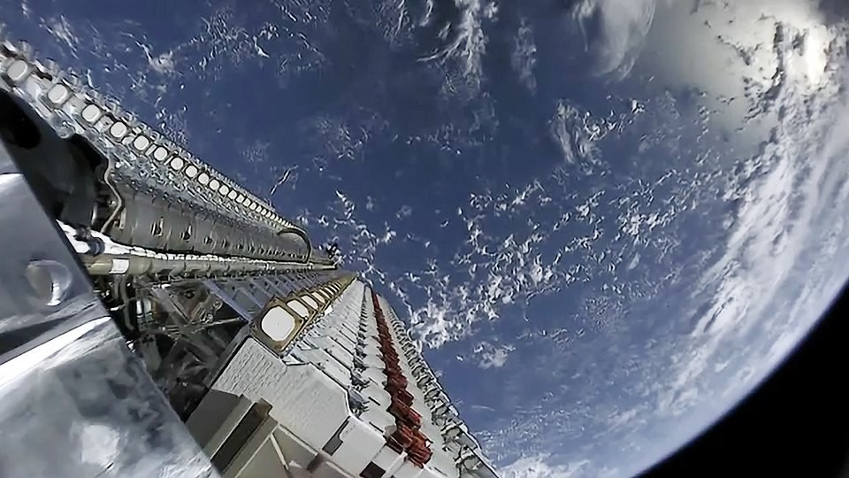
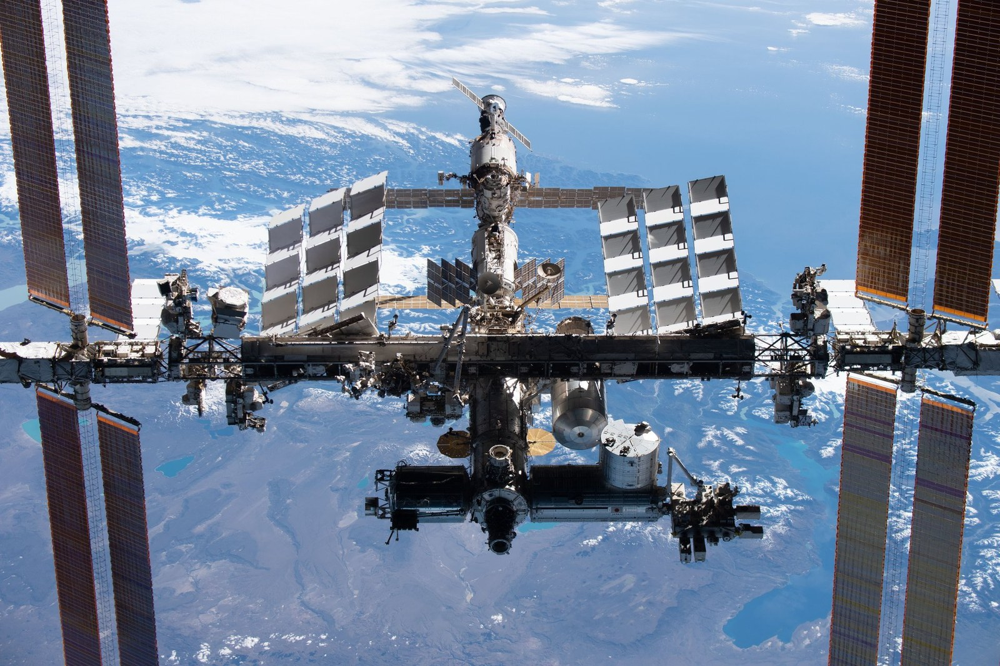
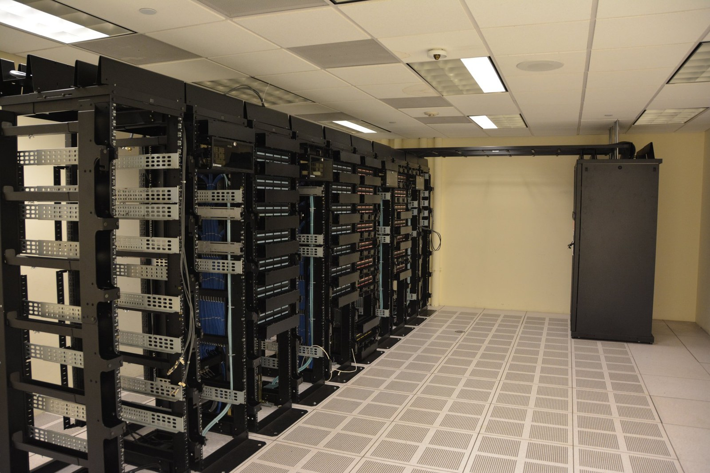
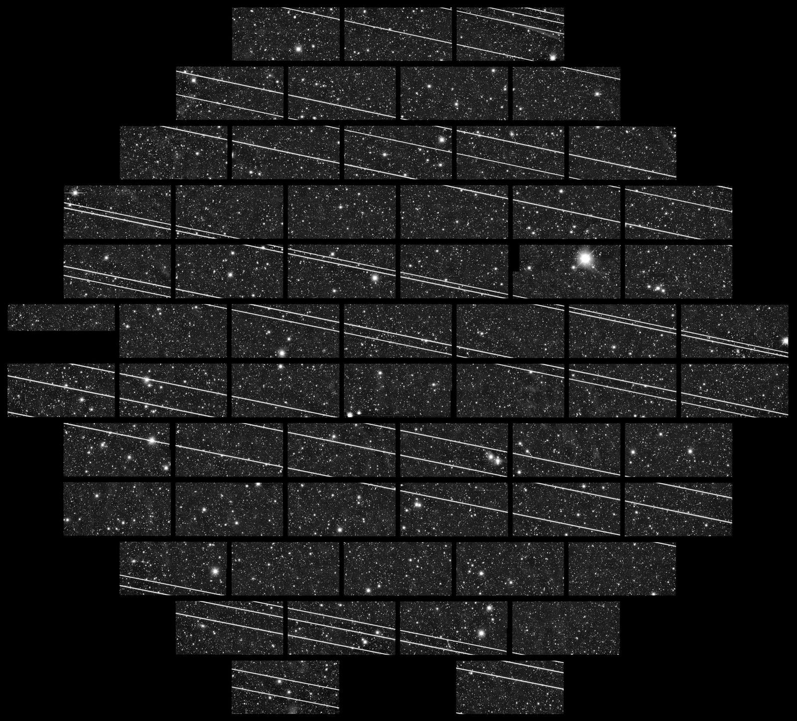
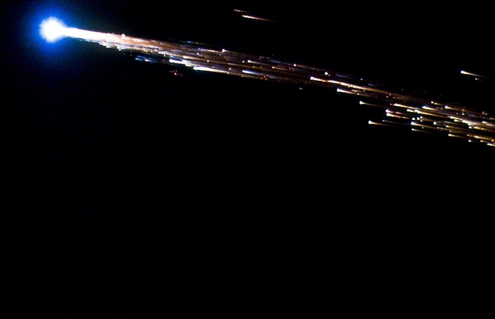

Putting data centers into orbit sounded like science fiction a few years ago. In 2026 it has become one of the most talked-about ideas in technology. SpaceX has asked the US Federal Communications Commission (FCC) for permission to launch **up to one million** satellites that would work as data centers ([FCC public notice](https://docs.fcc.gov/public/attachments/DA-26-113A1.txt)). Blue Origin, Starcloud, Google and Chinese research groups have plans of their own. Supporters see it as the way out of the AI power crunch on Earth. Critics call it premature, expensive and potentially harmful to the upper atmosphere, to orbital safety and to the night sky.

This article is a status check as of **17 November 2026**. It explains what is already flying, what is only planned, why cheaper rockets matter, and what physics, economics and environmental science say about the idea. Throughout, we separate **facts** (documented events, filings and measurements), **company claims** (what firms say about their own plans), **analyst and expert opinions**, and **predictions**.

## The short version

- **What exists (fact):** a handful of small test satellites with powerful chips are in orbit. Starcloud flew an Nvidia H100 graphics processor in November 2025 and trained a small language model in space ([CNBC](https://www.cnbc.com/2025/12/10/nvidia-backed-starcloud-trains-first-ai-model-in-space-orbital-data-centers.html)). China launched the first 12 satellites of its Three-Body Computing Constellation in May 2025. Google launched a first Project Suncatcher test satellite with its own chips on 1 October 2026 ([TechCrunch](https://techcrunch.com/2026/10/01/google-thinks-spacexs-starship-has-to-launch-1600-times-before-space-data-centers-get-off-the-ground/)).
- **What is planned (company claims):** SpaceX (which merged with xAI in February 2026) wants up to one million data center satellites and says in its IPO prospectus that it expects to start deploying them "as early as 2028". Blue Origin has filed for up to 51,600 satellites and Starcloud for up to 88,000.
- **Why now:** reusable rockets have cut launch prices, and Starship could cut them much further. On 13–14 November 2026 a Starship upper stage returned from orbit and was caught by its launch tower for the first time ([Spaceflight Now](https://spaceflightnow.com/2026/11/13/live-coverage-starship-flight-15-attempts-to-recover-full-vehicle-in-double-launch-pad-catch/)).
- **The physics:** sunlight in a suitable orbit is strong and almost constant, but waste heat can only leave by **radiation**. That requires large radiators, and cooling is the hardest engineering problem.
- **The economics:** most independent models still find orbital computing more expensive than computing on the ground. Google's own analysis says launch prices would need to fall to **about $200 per kilogram** by the mid-2030s before the costs become roughly comparable.
- **The environment:** no water use and no land for the computers themselves, but thousands of extra launches, tonnes of metal burning up in the upper atmosphere, more collision risk and brighter skies. A November 2026 report led by David Sandalow of Columbia University urges "great caution".
- **Our verdict:** small-scale computing in orbit, for example processing satellite images, makes sense now. Gigawatt-scale AI data centers in orbit are **technically possible but economically unproven and environmentally under-studied**. Today they are premature rather than necessary.

### Key terms in plain English

- **Data center:** a building full of servers, storage and network equipment. AI data centers use thousands of specialised chips (GPUs from Nvidia, TPUs from Google) and need huge amounts of electricity and cooling.
- **Orbital data center (ODC):** a satellite, or a group of satellites, carrying servers instead of, or in addition to, cameras or radios. It gets power from solar panels and sends results back to Earth by radio or laser.
- **Low Earth orbit (LEO):** orbits from about 160 to 2,000 kilometres above the ground. Most proposals use 500 to 2,000 km.
- **Sun-synchronous and dawn-dusk orbit:** a near-polar orbit that keeps the same angle to the Sun. A "dawn-dusk" version follows the line between day and night, so the satellite stays in sunlight almost all the time.
- **Radiative cooling:** getting rid of heat by emitting infrared light. In a vacuum there is no air or water to carry heat away, so this is the only way out.
- **Radiation hardening:** designing or shielding electronics so that energetic particles in space do not damage them or flip stored bits (a "bit flip" is a 0 turning into a 1 or the reverse).
- **Inference and training:** *training* builds an AI model and needs many chips talking to each other very fast for weeks; *inference* means running a finished model to answer questions and needs fewer chips per task.
- **Cost per kilogram to orbit:** the launch price divided by the payload mass. It is the key number in every orbital data center business case.
- **Kessler syndrome:** a feared chain reaction in which collisions create debris that causes more collisions, until some orbits become unusable.

## Why now: cheaper rockets and Starship

Launching mass into orbit has historically been brutally expensive. According to Ars Technica, the Space Shuttle cost more than **$60,000 per kilogram**, expendable rockets such as Atlas and Delta brought that into the low $10,000s, and the partly reusable Falcon 9 is below **$5,000 per kilogram** ([Ars Technica](https://arstechnica.com/space/2026/03/orbital-data-centers-part-1-theres-no-way-this-is-economically-viable-right/)). TechCrunch puts the current cost to orbit on a reusable Falcon 9 at roughly **$3,600 per kilogram** ([TechCrunch](https://techcrunch.com/2026/02/11/why-the-economics-of-orbital-ai-are-so-brutal/)). In its own IPO prospectus, SpaceX cites NASA figures saying the first Falcon 9 reduced launch cost to about **$2,700 per kilogram**, compared with a historical average of **$18,500 per kilogram**, and says Starship aims to cut the cost to orbit "by 99% or more" relative to that historical average ([SpaceX prospectus, SEC](https://www.sec.gov/Archives/edgar/data/1181412/000162828026042639/spaceexplorationtechnologi.htm)). That last point is a **company goal**, not an achieved price.

The hope rests on **Starship**, SpaceX's fully reusable super-heavy rocket. Its progress is real but incomplete:

- **Fact:** on Flight 15, launched from Starbase in Texas on 13 November 2026, the Ship upper stage reached orbit, deployed 26 Starlink V3 satellites, circled Earth 14 times and was then caught by the launch tower arms on 14 November. It was the first time the upper stage of an orbital rocket had been recovered this way. The Super Heavy booster aborted its catch attempt and was destroyed in an offshore splashdown ([Spaceflight Now](https://spaceflightnow.com/2026/11/13/live-coverage-starship-flight-15-attempts-to-recover-full-vehicle-in-double-launch-pad-catch/)).
- **Fact (as reported by TechCrunch in October 2026):** Starship had never flown more than five times in a single year.
- **Company claim / prediction:** Elon Musk has suggested Starship could reach an hourly flight rate in 2029. Starcloud's chief executive, Philip Johnston, expects commercial access to Starship to open up in 2028 and 2029 ([TechCrunch](https://techcrunch.com/2026/03/30/starcloud-raises-170-million-series-ato-build-data-centers-in-space/)).

The second driver is the electricity squeeze on the ground. The International Energy Agency (IEA) estimates that data centers used about **415 terawatt-hours (TWh)** of electricity in 2024, roughly 1.5% of global electricity, and projects about **945 TWh** by 2030 in its base case ([IEA](https://www.iea.org/reports/energy-and-ai/energy-demand-from-ai)). In the United States, a Department of Energy report found data centers used about 4.4% of electricity in 2023 and could use 6.7 to 12% by 2028 (cited by Ars Technica). Local resistance to new data centers, over water, noise and power prices, is growing. Space, the argument goes, offers unlimited sunlight and no neighbours.

Money has followed the idea. According to the market research firm Quilty Space, cited by Axios, about **$197 million** of investment went into orbital data center ventures in 2025 and **$1.11 billion** so far in 2026 ([Axios](https://www.axios.com/2026/11/15/space-data-centers-risks-stargazing-report)).

*A stack of 60 Starlink satellites before their first launch in May 2019. Mass-produced satellite platforms like these are the starting point for most orbital data center designs. Photo: Official SpaceX Photos, “Starlink Mission” (24 May 2019), [CC0 1.0](https://creativecommons.org/publicdomain/zero/1.0/), via [Wikimedia Commons](https://commons.wikimedia.org/wiki/File:Starlink_Mission_(47926144123).jpg).*

## Who is building what in 2026

Here is what we could confirm in published sources. Numbers of satellites in FCC filings are **upper limits requested by companies**, not deployment schedules.

### Starcloud (United States)

- **Fact:** Starcloud (formerly Lumen Orbit) launched **Starcloud-1**, a roughly 60-kilogram satellite, in November 2025. It carried an Nvidia H100, the first data-center-class GPU in orbit. The company trained Andrej Karpathy's small NanoGPT model on the complete works of Shakespeare and ran Google's open Gemma model in orbit ([CNBC](https://www.cnbc.com/2025/12/10/nvidia-backed-starcloud-trains-first-ai-model-in-space-orbital-data-centers.html); [Observer](https://observer.com/2026/03/starcloud-ceo-philip-johnston-nvidia-space-data-center/)). Another GPU on board, an Nvidia A6000, failed during launch, according to TechCrunch.
- **Fact:** Starcloud raised $250 million at a $2.3 billion valuation in August 2026, with Nvidia among the new investors, bringing its total to $450 million ([Business Wire](https://www.businesswire.com/news/home/20260821884035/en/Starcloud-Raises-%24250-Million-at-%242.3-Billion-Valuation-to-Scale-AI-with-Orbital-Data-Centers)).
- **Company claims:** Starcloud-2 with several GPUs, including an Nvidia Blackwell chip, and a deployable radiator; **Starcloud-3**, a 200-kilowatt, roughly 3-tonne spacecraft designed to be launched about 50 at a time on Starship; and eventually a 5-gigawatt orbital cluster with solar and cooling panels about 4 kilometres wide and 4 kilometres high. Starcloud has filed with the FCC for up to **88,000 satellites** and speaks of 20 gigawatts of orbital compute. Johnston told the Observer he expects orbital data centers to become cost-competitive with terrestrial ones around mid-2028; that is a **prediction**.

### Google: Project Suncatcher

- **Fact:** Google published a research paper in November 2025 describing fleets of solar-powered satellites with its Trillium TPU chips, linked by laser, flying in tight formation. An illustrative cluster has **81 satellites within a 1-kilometre radius**, at about 650 km altitude, with neighbouring satellites only 100 to 200 metres apart ([Google Research](https://research.google/blog/exploring-a-space-based-scalable-ai-infrastructure-system-design/); [arXiv paper](https://arxiv.org/html/2511.19468v1)). A peer-reviewed version was announced for the journal *Joule* in October 2026.
- **Fact:** on 1 October 2026 Google's first prototype satellite, built with Planet Labs, launched on a SpaceX rideshare. It carries four TPUs but runs only one at a time, in 15-minute bursts, to protect its power and thermal systems ([TechCrunch](https://techcrunch.com/2026/10/01/google-thinks-spacexs-starship-has-to-launch-1600-times-before-space-data-centers-get-off-the-ground/)).
- **Company framing:** Google calls Suncatcher a long-term "moonshot". Its paper stresses that it is not a full economic feasibility study.

### SpaceX and xAI

- **Fact:** on 30 January 2026 SpaceX applied to the FCC for a "SpaceX Orbital Data Center system" of **up to one million satellites** at 500 to 2,000 km altitude, linked by lasers to each other and to Starlink. The FCC accepted the filing for public comment ([FCC](https://docs.fcc.gov/public/attachments/DA-26-113A1.txt)). SpaceX then confirmed it had acquired xAI ([Via Satellite](https://www.satellitetoday.com/connectivity/2026/02/02/spacex-acquires-xai-to-pursue-orbital-data-center-constellation/)).
- **Company claims:** in its filing SpaceX calls the system a "first step towards becoming a Kardashev II-level civilization", a hypothetical civilisation that uses all of its star's energy. It projects about **100 kilowatts of compute per tonne** of satellite and, if it launched a million tonnes a year, about 100 gigawatts of new AI capacity per year. Its June 2026 prospectus says it expects to start deploying "orbital AI compute satellites as early as 2028" and that it is "the only company with a commercially viable path" to doing so at scale.
- **Company risk disclosure (fact):** the same prospectus warns that orbital AI compute involves "unproven technologies or technologies that do not exist" and "may not achieve commercial viability".
- **Prediction:** at the World Economic Forum in Davos in January 2026, Musk said the lowest-cost place for AI "will be in space, and that will be true within two years, maybe three at the latest" ([Fortune](https://fortune.com/2026/02/19/ai-data-centers-in-space-elon-musk-power-problems/)).

### Blue Origin: Project Sunrise

- **Fact:** Blue Origin has filed with the FCC for **up to 51,600 satellites** in sun-synchronous orbits between 500 and 1,800 km, routing data through its planned TeraWave network ([SpaceNews](https://spacenews.com/blue-origin-joins-the-orbital-data-center-race/); [FCC filing via fcc.report](https://fcc.report/IBFS/SAT-AMD-20260917-00370/0e1de88bcfd70b10c070f3542f851c26.pdf?raw=1)).
- **Company claim:** the filing says orbital data centers will be "a complement to terrestrial infrastructure" and will "fundamentally lower the marginal cost of compute capacity".

### Axiom Space and Kepler

- **Fact:** Kepler Communications launched the first 10 satellites of its optical relay network on 11 January 2026. They carry multi-GPU compute modules, and Axiom Space uses the network for its first **orbital data center nodes** ([Kepler](https://kepler.space/kepler-successfully-launches-first-tranche-of-optical-relay-satellites/)). Axiom markets them mainly for processing data from other satellites, and for defence and government customers ([Axiom Space](https://www.axiomspace.com/orbital-data-center)).

### China: Three-Body Computing Constellation

- **Fact:** on 14 May 2025 a Long March 2D rocket launched **12 satellites** for the Three-Body Computing Constellation, led by the company ADA Space and Zhejiang Lab. According to ADA Space, as reported by Live Science, each satellite can perform 744 trillion operations per second and the batch about 5 peta-operations per second combined. The long-term plan is about 2,800 satellites ([Live Science](https://www.livescience.com/technology/computing/china-is-building-a-constellation-of-ai-supercomputers-in-space-and-just-launched-the-first-pieces); [SpaceNews](https://spacenews.com/china-launches-first-of-2800-satellites-for-ai-space-computing-constellation/)).

### Europe: ASCEND

- **Fact:** ASCEND, an EU-funded Horizon Europe feasibility study led by Thales Alenia Space with partners including Airbus, ArianeGroup, DLR and Orange, reported in June 2024. It concluded that space data centers could be feasible, but that meaningful CO₂ savings would require **a launcher ten times less emissive over its entire lifecycle** than today's. It aims for 1 gigawatt before 2050 ([Thales Alenia Space](https://www.thalesaleniaspace.com/en/press-releases/thales-alenia-space-reveals-results-ascend-feasibility-study-space-data-centers-0)).

### Lonestar: data storage on the Moon

- **Fact:** Lonestar Data Holdings flew a small storage and processing payload, "Freedom", to the Moon on Intuitive Machines' Athena lander in February and March 2025. It completed tests in transit and briefly on the surface before the lander tipped over and lost power ([DCD](https://www.datacenterdynamics.com/en/news/intuitive-machines-lunar-lander-falls-on-its-side-lonestar-moon-data-center-manages-final-task/)). It is a data-backup concept, not an AI computing project.

*The International Space Station photographed from a departing Crew Dragon on 8 November 2021. The orange wings are solar arrays; the white panels near the centre are radiators that dump waste heat into space. Photo: NASA/Crew-2, public domain (NASA), via [Wikimedia Commons](https://commons.wikimedia.org/wiki/File:View_of_the_ISS_taken_during_Crew-2_flyaround_(ISS066-E-081311).jpg).*

## The physics: power and cooling in a vacuum

### Power: the strongest argument

Above the atmosphere, sunlight delivers about **1,361 watts per square metre**. On the ground, clouds, night, seasons and the atmosphere cut the yearly yield sharply. Ars Technica and TechCrunch cite estimates that a solar panel in a good orbit collects **about five to eight times** more energy than the same panel on Earth. In a dawn-dusk orbit a satellite can be in sunlight more than 90% of the time, which reduces the need for heavy batteries. This advantage is a **physical fact**; how much of it survives in a real design is a matter of engineering.

The scale is enormous, though. A rough calculation (ours): with solar cells converting about 22% of sunlight into electricity, each square metre gives about 300 watts. **One gigawatt** of electrical power would therefore need roughly **3 to 4 square kilometres** of panels. Starcloud's concept of 4 km by 4 km (16 km²) for 5 gigawatts fits that order of magnitude. Boon Ooi, a professor at Rensselaer Polytechnic Institute, told Fortune that a gigawatt in space would need roughly a square kilometre of panels and called that "extremely heavy and very expensive to launch". Whichever estimate is used, nothing remotely this large has ever been built in orbit. The US Government Accountability Office (GAO) notes that large orbital data centers would need solar arrays "larger than any launched and assembled in space as of April 2026" ([GAO](https://www.gao.gov/assets/gao-26-109012.pdf)).

### Cooling: the hardest problem

A common misconception is that space is cold, so cooling is "free". The vacuum is an excellent insulator, like the inside of a thermos flask. Every watt of electricity a chip uses becomes heat, and that heat can leave only as infrared radiation from a radiator surface.

How much a radiator can shed is set by the **Stefan–Boltzmann law**: emitted power per square metre = emissivity × σ × T⁴, where σ is about 5.67 × 10⁻⁸ W/(m²·K⁴) and T is the temperature in kelvin. Some illustrative numbers (our calculation, assuming an emissivity of 0.9 and a radiator that sees only deep space):

| Radiator temperature | Heat shed per square metre, one side |
|---|---|
| 300 K (about 27 °C) | about 410 W |
| 330 K (about 57 °C) | about 600 W |
| 350 K (about 77 °C) | about 770 W |

A two-sided panel at 300 K would need about **1,200 m²** to reject **one megawatt**, and roughly **1.2 km²** per gigawatt. In reality the job is harder: radiators also absorb sunlight and infrared from the warm Earth, and the engineer Andrew McCalip points out that a panel facing the Sun must re-radiate almost all the sunlight it absorbs, not only the electricity it converts ([McCalip model](https://andrewmccalip.com/space-datacenters)). Because output rises with the fourth power of temperature, designers want hot radiators. Alexis Abramson, dean of the Columbia Climate School, writes in the new Innovation for Cool Earth Forum (ICEF) report that the best design is to run AI chips "as hot as they can safely tolerate". She warns that ageing radiator coatings and debris-avoidance manoeuvres could erode cooling performance over a satellite's life ([Columbia Climate School](https://news.climate.columbia.edu/2026/11/12/new-report-urges-caution-in-the-race-for-space-based-data-centers/)).

For scale: the ISS's main external cooling system, two ammonia loops with large rotating radiators, is designed to reject **70 kilowatts** ([NASA](https://www.nasa.gov/wp-content/uploads/2021/02/473486main_iss_atcs_overview.pdf)). A single planned Starcloud-3 satellite is meant to handle 200 kilowatts. A one-gigawatt orbital data center would need cooling equal to more than 14,000 ISS systems. Johnston said on a podcast that cooling takes about 70% of his engineering team's attention (reported by the Observer). The GAO concludes that cooling solutions at this scale "are also unproven".

## Radiation, latency, repairs and debris

### Radiation

Outside the protection of the atmosphere, energetic particles slowly degrade chips (the "total ionizing dose") and occasionally flip bits. Google tested its Trillium TPUs in a particle beam. The most sensitive part, the high-bandwidth memory, began showing irregularities only after a dose about three times the expected dose of a shielded five-year mission, and there were no hard failures up to the maximum tested dose ([Google Research](https://research.google/blog/exploring-a-space-based-scalable-ai-infrastructure-system-design/)). After a corrected re-test, Travis Beals, who leads Suncatcher, told TechCrunch the error rate was "very low" for inference, "like one in a million", but "problematic" for a months-long training run on thousands of chips. Starcloud's Johnston said even a 10% higher chip failure rate in space than on Earth "would basically wipe out all of the savings from the energy" (Observer).

### Latency and bandwidth

- **Latency** (delay) is not the main problem. Light needs only about 2 to 7 milliseconds to travel 500 to 2,000 km straight up or down (our calculation). Real routes through laser links and ground stations add more, but chatbot answers would not be noticeably slower.
- **Bandwidth** between chips is the real limit. According to the ITU, links between satellites may carry about **100 gigabits per second**, compared with about **7 terabits per second** between chips on Earth ([ITU](https://www.itu.int/hub/2026/11/space-and-ai-could-data-centres-move-into-orbit/)). Google's answer is close formation flying; its bench test achieved 800 Gbps in each direction with one pair of transceivers. A July 2026 preprint on arXiv concludes that inference in orbit "may be feasible", but that training frontier-scale language models in orbit "is unlikely to be competitive" ([arXiv](https://arxiv.org/abs/2607.14172)).

### Repairs and lifetime

On the ground, technicians swap failed GPUs every day. In orbit nobody can. Starcloud and Google plan for about **five-year** satellite lives, which also matches how fast AI chips become outdated. That means continuous replacement launches. The ICEF report's reference scenario for one gigawatt uses 10,000 units of 100 kilowatts and 2.5 tonnes each, 25,000 tonnes in total. At 100 tonnes per launch that is 250 launches to build it and about 50 launches a year to replace the hardware ([JetsonsAge summary of the ICEF roadmap](https://www.jetsonsage.com/briefs/orbital-data-center-replacement-launches)).

### Debris and crowded orbits

According to ESA's 2025 Space Environment Report, about **40,000 objects** are tracked in orbit, of which about 11,000 are active payloads. More than **1.2 million** debris objects larger than 1 cm, each capable of catastrophic damage, are estimated to exist. At around 550 km, the density of dangerous debris is now of the same order as that of active satellites ([ESA](https://www.esa.int/Space_Safety/Space_Debris/ESA_Space_Environment_Report_2025)). Large satellites with square-kilometre arrays are bigger targets, and each failure or collision adds debris. Kathleen Curlee of Georgetown University's Center for Security and Emerging Technology (CSET) told Fortune that managing such fleets would need autonomous collision avoidance. The ICEF report also warns that military use could make the satellites potential targets in a conflict (Axios).

*Server racks in a terrestrial data center. On the ground, power, cooling and repairs are routine; in orbit, each of them becomes a launch-mass problem. Photo: Carl Lender, “Datacenter Server Racks” (4 November 2015), [CC BY 2.0](https://creativecommons.org/licenses/by/2.0/), via [Wikimedia Commons](https://commons.wikimedia.org/wiki/File:Datacenter_Server_Racks_(22370909788).jpg) / Flickr (resized).*

## The economics: launch prices, capex and what analysts say

### The $200 per kilogram threshold

The most cited benchmark comes from Google's Suncatcher paper. On the ground, data centers spend about **$570 to $3,000 per kilowatt per year** on power, depending on local prices and efficiency. Google estimates that if launch to low Earth orbit falls to about **$200 per kilogram**, launching and running a Starlink-like satellite could cost about **$810 per kilowatt per year**, "roughly comparable" ([arXiv paper](https://arxiv.org/html/2511.19468v1)). At today's prices TechCrunch, citing the same paper, puts that figure at about **$14,700 per kilowatt per year**.

Google bases its forecast on a "learning rate": SpaceX's prices have fallen by roughly 20% each time cumulative launched mass doubled. Keeping that up would take about **180 Starship launches a year**, about 1,800 over ten years at about 200 tonnes each, to reach below $200/kg by around 2035. Even at 70% fewer launches, Google estimates prices of about $300/kg. This is a **projection**, and the paper itself calls the needed launch rate "a substantial achievement".

### Capex: what it costs to build

Capital expenditure (capex) means the upfront cost of building something. Most independent models say orbital capex is still much higher:

- **Andrew McCalip**, an engineer working in space and manufacturing, built a widely shared public calculator. In February 2026, TechCrunch reported that his baseline put a 1-gigawatt orbital data center at about **$42.4 billion**, almost three times its ground-based equivalent. His calculator page, which lets users change every assumption, showed default totals of about $31.2 billion for orbit versus $14.8 billion on the ground when we checked it in November 2026. His conclusion: "the economics are not close". He also warns that the satellites themselves cost "almost $1,000 a kilo right now", a cost people forget when they focus on launch prices ([TechCrunch](https://techcrunch.com/2026/02/11/why-the-economics-of-orbital-ai-are-so-brutal/)). Yet he told Ars Technica that "it's really close" if a company owns both the rockets and the AI business, and "I wouldn't bet against Elon."
- **Economists at the consultancy Rational Futures**, cited by TechCrunch, argue that SpaceX has little reason to sell Starship launches far below the price of its best competitor. External customers may therefore pay much more than the hundreds of dollars per kilogram that business plans assume.
- **Ars Technica** estimates the "bare-bones" cost of deploying one million satellites at more than **a trillion dollars**, about two orders of magnitude more than Starlink or Starship each needed upfront.
- **Morgan Stanley analysts**, cited by CNBC, have flagged harsh radiation, difficult in-orbit maintenance, debris and regulatory questions about data governance and space traffic.
- **Sam Altman**, chief executive of OpenAI (a direct competitor of xAI), said in February 2026: "I honestly think the idea with the current landscape of putting data centers in space is ridiculous." He added that it could "make sense someday" but "is not something that's going to matter at scale this decade" ([Business Insider](https://www.businessinsider.com/sam-altman-elon-musk-data-centers-space-timeline-2026-2)).

### The case for: speed, permits and owning the whole chain

Supporters argue that the comparison should not be just dollars per watt. On the ground, AI builders wait years for grid connections and permits, and face growing local opposition. McCalip summarised the strategic logic to Ars Technica: "A FLOP is a FLOP, it doesn't matter where it lives." In other words, a company can expand on Earth until it hits permitting or capital limits and then move further growth to orbit. Jeff Thornburg, chief executive of Portal Space Systems and a former SpaceX engineer, told Fortune that moving data centers off the ground to use solar energy in orbit is "a no-brainer" in principle. He also predicted "you're beyond 2030 for mass production" and doubted it would be on schedule or on budget.

There is also an edge-computing case that already works: processing images from Earth-observation satellites in orbit and sending down only the results. Johnston told the Observer this can shorten "the time to actionable insight from a few days to potentially a few seconds". GAO also judges smaller data centers that process space-generated data to be "closer to maturity" than large AI-training facilities.

*A 333-second exposure from the Blanco 4-metre telescope at the Cerro Tololo Inter-American Observatory in Chile, crossed by at least 19 streaks from Starlink satellites, November 2019. Astronomers fear far larger data center constellations would make this much worse. Image: NSF's National Optical-Infrared Astronomy Research Laboratory/CTIO/AURA/DELVE (astronomers Clara Martínez-Vázquez and Cliff Johnson), [CC BY 4.0](https://creativecommons.org/licenses/by/4.0/), via [Wikimedia Commons](https://commons.wikimedia.org/wiki/File:Starlink_Satellites_Imaged_from_CTIO.jpg) (resized).*

## The environmental balance sheet

### What orbit saves

- **Water:** orbital data centers need no cooling water. Ars Technica cites estimates of about 560 billion litres a year for terrestrial data centers, with other estimates much higher. The ASCEND study lists this as a key advantage "in times of increasing drought".
- **Land and grid:** the computers and their power plant would not occupy land, would not need new power lines and would not compete with households for electricity. The GAO lists reduced demand for "electricity, water, and physical infrastructure on Earth" as the main opportunity.
- **Clean power:** the electricity comes from sunlight. On the ground, much new data center demand is still met by fossil fuel plants.

### What orbit costs

- **Launch emissions.** Kerosene-fuelled rockets inject black carbon (soot) directly into the stratosphere, where it can stay for years. A 2022 NOAA-led study found that a tenfold increase in such launches, plausible within two decades at the time, would cut ozone north of 30° N, with a maximum reduction of 4% at the North Pole in June ([NOAA](https://research.noaa.gov/2022/06/21/projected-increase-in-space-travel-may-damage-ozone-layer/)). Starship burns cleaner methane, but Eloise Marais, professor of atmospheric chemistry at University College London, told Space.com: "Starship is a bigger rocket burning more propellant… It has potential per launch to produce quite similar amounts of black carbon." Andrew Wilson, a space sustainability researcher at Glasgow Caledonian University, told Space.com that each Starship launch produces about **76,000 tonnes of CO₂ equivalent**; we could not check how this figure was calculated ([Space.com](https://www.space.com/space-exploration/launches-spacecraft/spacex-wants-to-put-1-million-ai-satellites-in-orbit-what-would-that-do-to-earths-climate)).
- **Scale of launches.** The ICEF report says putting even **10% of the AI data centers expected by 2030** into orbit would need more than **700 large-rocket launches every year**, about two a day, "in perpetuity" (Columbia Climate School). Space.com notes there were 324 orbital launches worldwide in 2025.
- **Re-entry pollution (alumina).** Satellites at the end of their life are usually steered into the atmosphere to burn up. Their aluminium turns into aluminium oxide (alumina) particles, which can catalyse ozone-destroying reactions. A 2024 study by José Ferreira, Ziyu Huang and Joseph Wang of the University of Southern California estimated that re-entering satellites released about **17 tonnes** of alumina in 2022, and that the constellations planned *before* the data center wave would release about **360 tonnes a year**, 646% above natural levels. The particles may take up to 30 years to sink to the ozone layer ([AGU](https://news.agu.org/press-release/satellite-megaconstellations-burn-deplete-ozone/); [GRL paper](https://agupubs.onlinelibrary.wiley.com/doi/10.1029/2024GL109280)). Atmospheric scientist Laura Revell and astronomers Michele Bannister and Samantha Lawler estimate that a million satellites could mean **about a teragram (one billion kilograms)** of alumina accumulating in the upper atmosphere ([The Conversation](https://theconversation.com/a-new-space-race-could-turn-our-atmosphere-into-a-crematorium-for-satellites-276366)). The authors stress that satellite makers rarely disclose their materials, so these figures are uncertain.
- **Debris and falling fragments.** Revell, Bannister and Lawler also cite an estimated **40% chance of a casualty** on the ground per five-year cycle of megaconstellation re-entries, and the Outer Space Institute's "CRASH Clock" estimate that a collision would occur within **3.8 days** if satellites stopped manoeuvring to avoid each other.
- **Night sky and astronomy.** The American Astronomical Society has asked the FCC to deny SpaceX's application and filed critical comments on Starcloud's and Blue Origin's, warning of large, sunlit satellites visible to the naked eye and more radio noise ([AAS petition](https://aas.org/sites/default/files/2026-03/American%20Astronomical%20Society%20-%20SpaceX%20Orbital%20Data%20Centers%20Petition%20to%20Deny.pdf); [AAS on Starcloud](https://compasse.aas.org/aas-starcloud-data-centers-comment/)). The ICEF report warns that "the most visible points of light in the sky during much of the night in much of the world could be satellites, not stars" (Axios).

### Net effect: unclear, and possibly negative

Europe's own ASCEND study, which was broadly positive about the concept, concluded that real CO₂ savings need a launcher ten times cleaner over its lifecycle than today's. That is the core issue: an orbital data center trades emissions from power plants on the ground for emissions and pollution high in the atmosphere, where they persist longer and are much less understood. Marais told Space.com: "We need way more observations and way more time to be able to look into that." Aaron Boley of the University of British Columbia added that "we have to understand that before we actually launch a million satellites".

*ESA's Jules Verne Automated Transfer Vehicle breaking up during its planned re-entry over the uninhabited South Pacific on 29 September 2008, photographed from a NASA research aircraft. Every orbital data center satellite would eventually end this way, releasing metal particles high in the atmosphere. Photo: NASA/ESA/Bill Moede and Jesse Carpenter, public domain (NASA), via [Wikimedia Commons](https://commons.wikimedia.org/wiki/File:Jules_Verne_Automated_Transfer_Vehicle_re-enters_Earth%27s_atmosphere.jpg) (resized).*

## Verdict: sensible, premature or unnecessary?

### What people are saying on X and Reddit (opinions)

The online debate is sharply divided, and it often follows views of Elon Musk more than engineering detail.

- **Supporters on X.** The investor Gavin Baker, a prominent backer of the idea, mocked critics on 31 August 2026: talking to "brilliant physicists who have thought about orbital compute for 3 hours and are convinced it will never work" reminded him of a Keanu Reeves quote about staying out of arguments ([X post](https://x.com/GavinSBaker/status/2094439466802835942)). Musk replied that people who say "orbital AI is impossible due to cooling" do not "even know things as basic as heat rejection of the radiator per m^2, coolant temp or max operating temp of the GPU" ([X post](https://x.com/elonmusk/status/2094570156995256542)). (We read both posts through a public archive mirror.)
- **Sceptics on Reddit.** In a post on r/MechanicalEngineering, one engineer vented that people claim space "solves the cooling problem" and asked: "What about maintenance are we just going to burn up billions in servers whenever better tech is available???" ([Reddit](https://www.reddit.com/r/MechanicalEngineering/comments/1qwouom/rant_data_centers_in_space/)). On r/space and r/SpaceXLounge, the Ars Technica series and Scott Manley's video "Is It Really Impossible To Cool A Datacenter In Space?" sparked long threads. Many commenters agree the physics works but doubt the economics ([r/space](https://www.reddit.com/r/space/comments/1s2ktff/orbital_data_centers_part_1_theres_no_way_this_is/); [r/SpaceXLounge](https://www.reddit.com/r/SpaceXLounge/comments/1rxec49/is_it_really_impossible_to_cool_a_datacenter_in/)).
- **Academics in the press.** In an article by Times Radio business editor Dominic O'Connell, shared on [r/space](https://www.reddit.com/r/space/comments/1u6g4m8/can_we_really_put_data_centres_in_space/), Mark Boggett of the venture investor Seraphim Space asked: "For data centres, all the technology works on earth, so why not in space?" Matthew Santer, professor of aerospace structures at Imperial College London, was more cautious in the same piece: "To be honest, I am still doubtful." Josep Miquel Jornet of Northeastern University told Fortune: "Two to three years is not realistic at the scale being promised."

These are **opinions**. Social media posts show the range of views, not evidence for either side.

### Facts, claims and predictions at a glance

| Statement | Status |
|---|---|
| Starcloud ran an H100 GPU and trained a small model in orbit (2025) | Fact, confirmed by several outlets |
| China launched 12 computing satellites (May 2025); Google's first TPU test satellite launched (Oct 2026) | Fact |
| Starship upper stage caught by tower after an orbital flight (14 Nov 2026) | Fact |
| SpaceX filed for up to one million data center satellites | Fact (filing); deployment is a company plan |
| Deployment "as early as 2028" | Company claim in the SpaceX prospectus |
| Space is the cheapest place for AI "within two years, maybe three" | Prediction by Elon Musk (January 2026) |
| Launch below $200/kg by about 2035 | Projection in Google's paper |
| 1 GW in orbit costs about two to three times as much as on the ground | Analyst model (McCalip), depends on assumptions |
| More than 700 launches a year for 10% of 2030 AI capacity | Estimate in the ICEF report |
| Upper-atmosphere effects of alumina and soot | Scientific estimates with large uncertainty |

### Our assessment

1. **Small orbital computing makes sense now.** Processing satellite data where it is collected saves bandwidth and time, and the first commercial nodes (Starcloud, Axiom/Kepler, China's constellation) are doing exactly that. This is a useful niche, not a revolution.
2. **Gigawatt-scale AI data centers in orbit are physically possible but not yet justified.** No law of physics rules them out, but every step is unproven at scale: square-kilometre solar arrays and radiators, years of reliable operation without repairs, laser networks fast enough for big clusters, and launch prices far below anything achieved so far. Most independent analyses, and even SpaceX's own risk disclosures, describe the economics as unproven.
3. **The environmental case is not settled, and may run the wrong way.** Orbit saves water, land and grid capacity. But it moves the burden into the upper atmosphere and orbital space, which are shared by everyone, are poorly monitored and recover slowly. Even the pro-space ASCEND study says the climate benefit depends on launchers that do not yet exist.
4. **It is not the only answer to the AI power problem.** The terrestrial options, including faster grid connections, solar and storage, nuclear, more efficient chips and models, and heat reuse, are cheaper and much better understood today.

**Bottom line:** data centers in space are **premature rather than pointless**. They are worth researching and testing in small steps, as Google, Starcloud and others are doing. Scaling them to hundreds of thousands of satellites before independent studies of the atmosphere, debris and night-sky impacts are done would be a gamble with shared resources. The ICEF report's advice, to gain operational experience first and let independent science catch up, looks like the sensible middle path.

## FAQ

**Is space cold enough to cool computers for free?**
No. Space has no air or water to carry heat away, so it acts like an insulator. Heat must be radiated from large panels, which adds mass, cost and complexity. Cooling is widely considered the hardest engineering problem.

**Are there already data centers in space?**
Only small ones. Several satellites carry powerful chips and run AI models, including Starcloud-1, China's Three-Body Computing Constellation satellites, Axiom Space's nodes on Kepler satellites and Google's first test satellite. None comes anywhere near the size of a terrestrial AI data center.

**How cheap do launches have to get?**
Google's analysis suggests about $200 per kilogram to low Earth orbit, compared with roughly $3,000 to $5,000 per kilogram on today's Falcon 9. The satellites themselves also need to become much cheaper.

**Would a chatbot answer from orbit be slower?**
Hardly. Light needs only a few milliseconds to reach low Earth orbit and back. The bigger limit is the bandwidth between chips, which matters most for training large models.

**Are orbital data centers greener?**
They need no water and no land for the computers, and they run on solar power. But launches and burning-up satellites add soot and metal particles high in the atmosphere, with possible effects on the ozone layer and climate. The overall balance is still unknown.

**When could large orbital data centers exist?**
SpaceX says it may start deploying in 2028, and Starcloud expects cost parity around 2028. Many independent experts quoted by Fortune and others expect small pilots this decade and large-scale production, if it happens at all, in the 2030s.

**What would they mean for stargazing?**
Astronomers warn that hundreds of thousands of large, sunlit satellites could outnumber the visible stars in many places and harm both optical and radio astronomy.

**Who regulates them?**
In the US, the FCC licenses radio spectrum and satellite systems, and the ITU coordinates frequencies internationally. A partner at the law firm DLA Piper told the ITU: "No jurisdiction on Earth has adopted a dedicated regulatory framework for orbital data centres."

## What we could not verify, and sources

### What we could not verify

- **Starcloud-2's status.** Starcloud had said it would launch in October 2026. We found no confirmation that it has launched; some unofficial trackers list early 2027.
- **The methodology behind the 76,000-tonne CO₂-equivalent figure** per Starship launch, quoted by Space.com. It probably covers more than the fuel burned, but we could not confirm this.
- **The full text of the ICEF roadmap and of the October 2026 preprint by Eloise Marais and Connor Barker (UCL)** on pollution from a million data center satellites. We rely on summaries by Columbia University, Axios, JetsonsAge and Space.com.
- **Reddit comment threads.** We could read the opening posts but not reliably load the comment sections, so we describe the debate only in general terms.
- **Real power and mass figures for SpaceX's data center satellites.** The FCC filing gives only about 100 kW per tonne; press estimates of satellite mass and size are not confirmed by SpaceX.
- **Whether Starship prices will fall as hoped.** No public price list for Starship launches exists.

### Sources

- FCC: [Space Bureau accepts SpaceX's application for orbital data centers](https://docs.fcc.gov/public/attachments/DA-26-113A1.txt) (public notice, 2026)
- SpaceX: [Prospectus (Form 424B4), filed 12 June 2026](https://www.sec.gov/Archives/edgar/data/1181412/000162828026042639/spaceexplorationtechnologi.htm) (US SEC)
- Via Satellite: [SpaceX acquires xAI to pursue orbital data center constellation](https://www.satellitetoday.com/connectivity/2026/02/02/spacex-acquires-xai-to-pursue-orbital-data-center-constellation/) (2 February 2026)
- Spaceflight Now: [Starship returns to Starbase and a successful tower catch](https://spaceflightnow.com/2026/11/13/live-coverage-starship-flight-15-attempts-to-recover-full-vehicle-in-double-launch-pad-catch/) (13–14 November 2026)
- Google Research: [Exploring a space-based, scalable AI infrastructure system design](https://research.google/blog/exploring-a-space-based-scalable-ai-infrastructure-system-design/) (November 2025) and [preprint on arXiv](https://arxiv.org/html/2511.19468v1)
- TechCrunch: [Google thinks SpaceX's Starship has to launch 1,800 times before space data centers get off the ground](https://techcrunch.com/2026/10/01/google-thinks-spacexs-starship-has-to-launch-1600-times-before-space-data-centers-get-off-the-ground/) (1 October 2026)
- TechCrunch: [Why the economics of orbital AI are so brutal](https://techcrunch.com/2026/02/11/why-the-economics-of-orbital-ai-are-so-brutal/) (11 February 2026)
- TechCrunch: [Starcloud raises $170 million Series A](https://techcrunch.com/2026/03/30/starcloud-raises-170-million-series-ato-build-data-centers-in-space/) (30 March 2026)
- CNBC: [Nvidia-backed Starcloud trains first AI model in space](https://www.cnbc.com/2025/12/10/nvidia-backed-starcloud-trains-first-ai-model-in-space-orbital-data-centers.html) (10 December 2025)
- Observer: [Starcloud CEO Philip Johnston on putting the first data center in space](https://observer.com/2026/03/starcloud-ceo-philip-johnston-nvidia-space-data-center/) (March 2026)
- Business Wire: [Starcloud raises $250 million at $2.3 billion valuation](https://www.businesswire.com/news/home/20260821884035/en/Starcloud-Raises-%24250-Million-at-%242.3-Billion-Valuation-to-Scale-AI-with-Orbital-Data-Centers) (company press release, August 2026)
- SpaceNews: [Blue Origin joins the orbital data center race](https://spacenews.com/blue-origin-joins-the-orbital-data-center-race/) (19 March 2026); [Blue Origin FCC application (via fcc.report)](https://fcc.report/IBFS/SAT-AMD-20260917-00370/0e1de88bcfd70b10c070f3542f851c26.pdf?raw=1)
- Kepler Communications: [Kepler successfully launches first tranche of optical relay satellites](https://kepler.space/kepler-successfully-launches-first-tranche-of-optical-relay-satellites/) (11 January 2026); Axiom Space: [Orbital data centers](https://www.axiomspace.com/orbital-data-center)
- Live Science: [China is building a constellation of AI supercomputers in space](https://www.livescience.com/technology/computing/china-is-building-a-constellation-of-ai-supercomputers-in-space-and-just-launched-the-first-pieces) (May 2025); SpaceNews: [China launches first of 2,800 satellites for AI space computing constellation](https://spacenews.com/china-launches-first-of-2800-satellites-for-ai-space-computing-constellation/)
- Thales Alenia Space: [Results of the ASCEND feasibility study](https://www.thalesaleniaspace.com/en/press-releases/thales-alenia-space-reveals-results-ascend-feasibility-study-space-data-centers-0) (27 June 2024)
- DCD: [Lonestar Moon data center manages final task](https://www.datacenterdynamics.com/en/news/intuitive-machines-lunar-lander-falls-on-its-side-lonestar-moon-data-center-manages-final-task/) (March 2025)
- US GAO: [Science & Tech Spotlight: Data centers in space (GAO-26-109012)](https://www.gao.gov/assets/gao-26-109012.pdf) (2026)
- ITU: [Space and AI: Could data centres move into orbit?](https://www.itu.int/hub/2026/11/space-and-ai-could-data-centres-move-into-orbit/) (5 November 2026)
- arXiv: [The cost and network limits of space-based AI compute](https://arxiv.org/abs/2607.14172) (July 2026, preprint)
- NASA: [ISS Active Thermal Control System overview](https://www.nasa.gov/wp-content/uploads/2021/02/473486main_iss_atcs_overview.pdf)
- Andrew McCalip: [Economics of orbital vs terrestrial data centers](https://andrewmccalip.com/space-datacenters) (interactive model)
- Ars Technica: [Orbital data centers, part 1: There's no way this is economically viable, right?](https://arstechnica.com/space/2026/03/orbital-data-centers-part-1-theres-no-way-this-is-economically-viable-right/) (March 2026)
- Fortune: [Can AI data centers really move to space? Experts say not for decades](https://fortune.com/2026/02/19/ai-data-centers-in-space-elon-musk-power-problems/) (19 February 2026)
- Business Insider: [Altman says Musk's idea to put data centers in space is "ridiculous"](https://www.businessinsider.com/sam-altman-elon-musk-data-centers-space-timeline-2026-2) (February 2026)
- IEA: [Energy and AI: Energy demand from AI](https://www.iea.org/reports/energy-and-ai/energy-demand-from-ai)
- Columbia Climate School: [New report urges caution in the race for space-based data centers](https://news.climate.columbia.edu/2026/11/12/new-report-urges-caution-in-the-race-for-space-based-data-centers/) (12 November 2026)
- Axios: [Space data centers could end stargazing as we know it](https://www.axios.com/2026/11/15/space-data-centers-risks-stargazing-report) (15 November 2026)
- JetsonsAge: [Orbital data centers would need a continuing supply of launches](https://www.jetsonsage.com/briefs/orbital-data-center-replacement-launches) (16 November 2026)
- Space.com: [SpaceX wants to put 1 million AI satellites in orbit. What would that do to Earth's climate?](https://www.space.com/space-exploration/launches-spacecraft/spacex-wants-to-put-1-million-ai-satellites-in-orbit-what-would-that-do-to-earths-climate) (2026)
- NOAA Research: [Projected increase in space travel may damage ozone layer](https://research.noaa.gov/2022/06/21/projected-increase-in-space-travel-may-damage-ozone-layer/) (21 June 2022)
- Ferreira, Huang and Wang: [Potential ozone depletion from satellite demise during atmospheric reentry](https://agupubs.onlinelibrary.wiley.com/doi/10.1029/2024GL109280) (*Geophysical Research Letters*, 2024); [AGU press release](https://news.agu.org/press-release/satellite-megaconstellations-burn-deplete-ozone/)
- The Conversation (Revell, Bannister, Lawler): [A new space race could turn our atmosphere into a "crematorium for satellites"](https://theconversation.com/a-new-space-race-could-turn-our-atmosphere-into-a-crematorium-for-satellites-276366) (2026)
- Marais and Barker: [A million data centre satellites will usher in a new era of space pollution](https://doi.org/10.22541/essoar.15011354/v1) (ESS Open Archive preprint, October 2026)
- ESA: [ESA Space Environment Report 2025](https://www.esa.int/Space_Safety/Space_Debris/ESA_Space_Environment_Report_2025)
- American Astronomical Society: [Petition to deny SpaceX's orbital data center application](https://aas.org/sites/default/files/2026-03/American%20Astronomical%20Society%20-%20SpaceX%20Orbital%20Data%20Centers%20Petition%20to%20Deny.pdf) (March 2026); [Comments on Starcloud's application](https://compasse.aas.org/aas-starcloud-data-centers-comment/) (13 April 2026)
- X posts: [Gavin Baker, 31 August 2026](https://x.com/GavinSBaker/status/2094439466802835942); [Elon Musk, 31 August 2026](https://x.com/elonmusk/status/2094570156995256542) (opinion)
- Reddit: [r/MechanicalEngineering](https://www.reddit.com/r/MechanicalEngineering/comments/1qwouom/rant_data_centers_in_space/), [r/space](https://www.reddit.com/r/space/comments/1s2ktff/orbital_data_centers_part_1_theres_no_way_this_is/), [r/space (Times Radio excerpt)](https://www.reddit.com/r/space/comments/1u6g4m8/can_we_really_put_data_centres_in_space/), [r/SpaceXLounge](https://www.reddit.com/r/SpaceXLounge/comments/1rxec49/is_it_really_impossible_to_cool_a_datacenter_in/) (opinion)

### Image credits

- Header: Steve Jurvetson, “Liftoff of SpaceX IFT-5” (13 October 2024), [CC BY 2.0](https://creativecommons.org/licenses/by/2.0/), via [Wikimedia Commons](https://commons.wikimedia.org/wiki/File:Liftoff_of_SpaceX_IFT-5_(54064037095).jpg) (cropped and resized).
- Starlink stack: Official SpaceX Photos, “Starlink Mission” (24 May 2019), [CC0 1.0](https://creativecommons.org/publicdomain/zero/1.0/), via [Wikimedia Commons](https://commons.wikimedia.org/wiki/File:Starlink_Mission_(47926144123).jpg).
- ISS: NASA/Crew-2 (8 November 2021), public domain, via [Wikimedia Commons](https://commons.wikimedia.org/wiki/File:View_of_the_ISS_taken_during_Crew-2_flyaround_(ISS066-E-081311).jpg) (resized).
- Server racks: Carl Lender (4 November 2015), [CC BY 2.0](https://creativecommons.org/licenses/by/2.0/), via [Wikimedia Commons](https://commons.wikimedia.org/wiki/File:Datacenter_Server_Racks_(22370909788).jpg) (resized).
- Satellite streaks: NSF's NOIRLab/CTIO/AURA/DELVE (20 November 2019), [CC BY 4.0](https://creativecommons.org/licenses/by/4.0/), via [Wikimedia Commons](https://commons.wikimedia.org/wiki/File:Starlink_Satellites_Imaged_from_CTIO.jpg) (resized).
- ATV re-entry: NASA/ESA/Bill Moede and Jesse Carpenter (29 September 2008), public domain, via [Wikimedia Commons](https://commons.wikimedia.org/wiki/File:Jules_Verne_Automated_Transfer_Vehicle_re-enters_Earth%27s_atmosphere.jpg) (resized).

*This article is for information only. Company plans and forecasts can change; figures from filings and press releases are the companies' own.*
