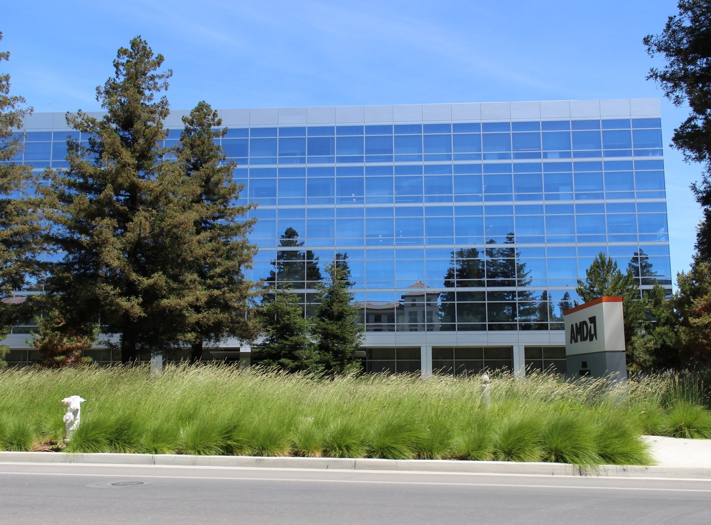
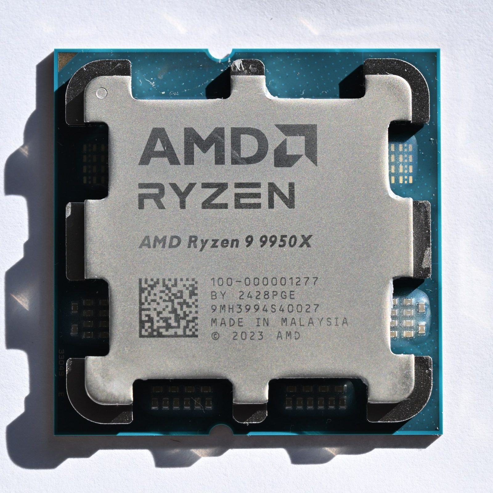
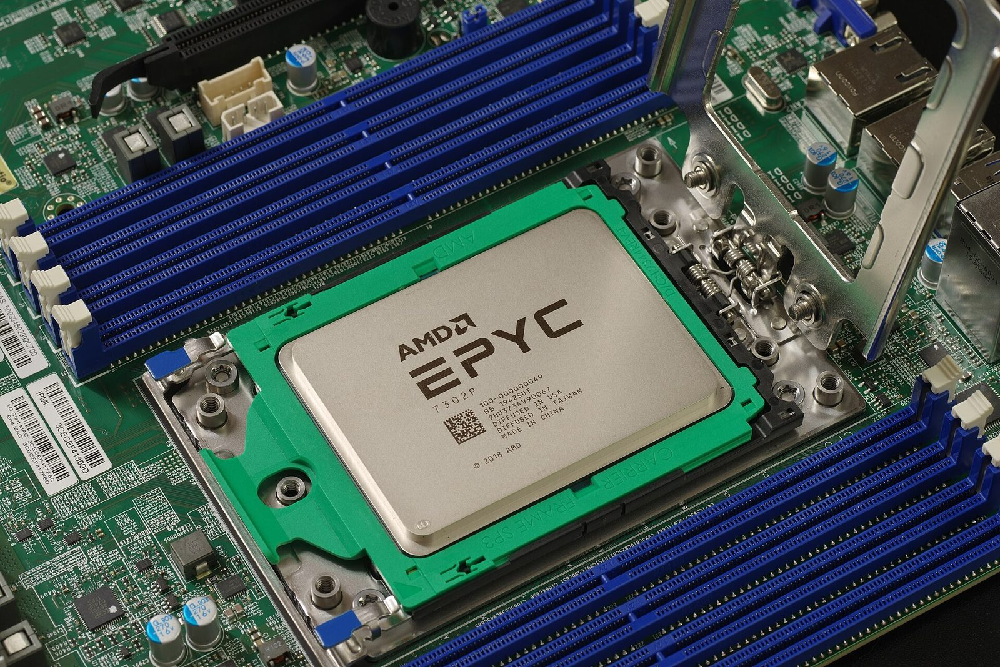

Lisa Su is the chair and chief executive of Advanced Micro Devices, the US semiconductor company known as AMD. She was born in Tainan, Taiwan, moved to the United States as a young child, trained as an electrical engineer at MIT, and became CEO on 8 October 2014. AMD was then still a listed company with billions of dollars in sales, but it was losing money, carrying more debt than cash, and was often described in later profiles as close to collapse. A decade later it was one of the most valuable US chip firms, and a challenger — still clearly number two — to Nvidia in AI accelerators.

This portrait has two parts: her biography, including what reputable sources actually say about her family relationship to Jensen Huang, Nvidia's long-time chief executive; and the remaking of AMD itself. AMD is not a Taiwanese company. It is a US firm, headquartered in Santa Clara, California. Taiwan matters because Su was born there, and because Taiwan Semiconductor Manufacturing Company (TSMC) fabricates AMD's leading-edge chips.

Figures from company filings and earnings releases are **company-reported facts**. Comments from Su or other executives are **their statements**. Assessments from analysts and journalists are **opinions**. Anything about deployments or revenue that has not yet happened is a **plan or forecast**. The picture below is current as of **16 November 2026**.

## The short version

- **Who she is.** Born in Tainan in 1969, raised in New York, three MIT electrical-engineering degrees. Texas Instruments, 13 years at IBM, then Freescale. Joined AMD in January 2012; CEO on 8 October 2014; board chair on 14 February 2022.
- **The family link.** Su has called Jensen Huang a "distant relative" and said they did not grow up together. Genealogist Jean Wu told CNN they are **first cousins once removed** (Huang's mother and Su's grandfather were siblings). Nvidia confirmed to CNN only a distant cousin on Huang's mother's side, not Wu's exact label.
- **AMD in 2014.** Revenue **$5.51 billion**, net loss **$403 million**, cash **$1.04 billion**, debt **$2.21 billion**. Later accounts put the share price a little above **$3** on her first day as CEO, and the market value at roughly **$2 billion to $3 billion**.
- **The turnaround.** Zen arrived in 2017 as Ryzen and EPYC. Leading-edge production moved to TSMC; chiplet packaging followed. Console chips helped; the Xilinx deal closed in February 2022. Instinct GPUs and multi-year deals with OpenAI, Meta and Anthropic are the latest chapter.
- **Where things stand.** 2025 revenue was a record **$34.6 billion**. Third-quarter 2026 revenue was a record **$13.4 billion**, with data center at **$8.5 billion**, up 97%. On 21 September 2026 the shares briefly valued AMD at more than **$1 trillion**, still well short of Nvidia. Analysts in 2026 have argued that AMD's AI software still trails. Huang resigned as Nvidia's CEO on 12 November 2026; some reports have floated Su's name. Nvidia's board has said it has not formally engaged any candidates and that such speculation is premature.

## From Tainan to MIT, then Texas Instruments, IBM and Freescale

Su was born in Tainan, in southern Taiwan, in 1969. CNN, in a 2023 profile of Su and Huang, reports that she immigrated to the United States at the age of three and grew up in New York. In an interview with *IEEE Spectrum*, she said she chose electrical engineering because "I felt like I was actually building and making things."

She earned three MIT degrees in electrical engineering: a bachelor's in 1990, a master's in 1991 and a Ph.D. in 1994, according to *IEEE Spectrum*. Her doctoral work was on silicon-on-insulator transistors, a way of building a transistor on an insulating layer so that less current leaks away. MIT Technology Review, which later named her one of its innovators under 35, has described her as an early researcher in a technique that was then unproven.

Her first job, from 1994 to 1995, was as a member of the technical staff at Texas Instruments. She then spent 13 years at IBM. AMD's official biography says her roles there included vice president of the Semiconductor Research and Development Center, with responsibility for IBM's silicon technologies, joint development alliances and semiconductor research operations. *IEEE Spectrum* notes that she also served as a technical assistant to IBM's chief executive and later led emerging-products work before that vice-president role in 2006.

In 2007 she joined Freescale Semiconductor as chief technology officer, and later became senior vice president and general manager of the networking and multimedia business. She left Freescale to join AMD in January 2012 as senior vice president and general manager of global business units, was later chief operating officer, and was named CEO in October 2014.

She was named an IEEE Fellow in 2009 and has published more than 40 technical articles, according to AMD. She was elected to the National Academy of Engineering in 2018 and to the American Academy of Arts and Sciences in 2020. In 2021 she received the IEEE Robert N. Noyce Medal, which IEEE describes as its highest semiconductor honour; coverage at the time noted that she was the first woman to receive it. TIME named her CEO of the Year for 2024 and included her in the TIME100 list in 2025. She was appointed to the President's Council of Advisors on Science and Technology and, according to AMD, chairs the board of the Semiconductor Industry Association. On 8 October 2026 — twelve years to the day after she became CEO — she received the National Medal of Science, which the US government describes as its highest honour for scientists and engineers. AMD's newsroom and a White House release both record the award.

## How she is related to Jensen Huang

The two executives have a family connection that is real, and that is also easy to overstate.

Su first acknowledged the link in 2020, at a Consumer Technology Association event. "We are distant relatives," she said, according to CNN. Business Insider, reporting the same appearance, quoted her as calling it "some complex second cousin type of thing." That is her own wording, and it is looser than a formal kinship term.

In November 2023, CNN published a more detailed account based on the work of Jean Wu, a Taiwanese genealogist and former financial journalist. Wu told CNN that, in Mandarin, Huang is Su's *biao jiu*, and that in Western terms they are **first cousins once removed** — cousins separated by a generation. "To be exact," CNN wrote, summarizing Wu, "Su is Huang's uncle's granddaughter." In the family tree Wu described, Huang's mother and Su's grandfather were siblings. Wu said she had worked from public records, newspaper clippings and yearbooks, and had interviewed a close relative of Huang's.

An Nvidia spokesperson confirmed to CNN that Su is a distant cousin of Huang through his mother's side of the family. Huang declined to comment for that story; Su did not respond to CNN's request. Neither company has, in the reporting we reviewed, endorsed Wu's specific "first cousins once removed" label. The confirmation is the broader one: a distant cousin on the mother's side.

They did not grow up as close family. Huang was born in Taipei in 1963, about six years before Su. Su grew up in New York. In a 2024 interview with Bloomberg's Emily Chang, quoted by Business Insider, Su said: "We were really distant, so we didn't grow up together. We actually met at an industry event. So it wasn't until we were well into our careers." Asked about family gatherings, she said: "No family dinners."

The coincidence is not a management alliance. The two companies compete in PC processors, graphics, server CPUs and AI accelerators. Huang worked at AMD as a microprocessor designer in the 1980s, long before he co-founded Nvidia in 1993 and long before Su arrived. Su, speaking in 2020, called Nvidia "a great company" and added that "it is a competitive world, so there's no question that we compete hard." Christopher Miller, author of *Chip War*, told CNN that it was "not surprising to find two people of Taiwanese descent at the absolute center of the chip industry," given the ties between Taiwan and Silicon Valley.

A brief note on November 2026. Huang resigned as Nvidia's president, chief executive and a director on 12 November. The board named Colette Kress, already the chief financial officer, as interim CEO. On 16 November, CNBC reported, citing a person familiar with the matter, that the board was not considering bringing Huang back. Some news reports have mentioned Su among names the industry is watching. Those reports are unconfirmed. On 13 November, Nvidia's board told CNBC that it had "not formally engaged any potential candidates" and that "any speculation regarding individual candidates, whether internal or external, is premature." This article does not treat Su as a candidate for that job. For more on the interim CEO and the push to bring Huang back, read our profile of [Colette Kress, Nvidia’s interim CEO](https://thearchitecthighlevel.com/2026/11/17/colette-kress-nvidia-interim-ceo-bring-back-jensen/).

## AMD in 2014: a US company in deep trouble

*Photo: Coolcaesar, “2485 Augustine Drive headquarters in Santa Clara, California” (21 June 2020), [CC BY-SA 4.0](https://creativecommons.org/licenses/by-sa/4.0/), via [Wikimedia Commons](https://commons.wikimedia.org/wiki/File:2485_Augustine_Drive_headquarters_in_Santa_Clara,_California.jpg). Scaled down to 1,920 px width, otherwise unchanged. The photograph shows AMD's headquarters building as it looked in 2020; the campus may look different today.*

AMD was founded in California in 1969. It is a US public company, listed on the Nasdaq under the ticker AMD. When Su became CEO the press release was still dated from Sunnyvale; the headquarters later moved to Santa Clara, at 2485 Augustine Drive. Calling AMD a "Taiwanese chipmaker" is a common slip, perhaps because Su was born in Taiwan, or because its most important manufacturing partner is TSMC. The company itself is American. It designs chips; it does not own the leading-edge factories that make them.

The business she inherited was under severe strain. For 2014, AMD reported revenue of **$5.51 billion** and a GAAP net loss of **$403 million**. Gross margin was 33%. At year-end it held **$1.04 billion** in cash, cash equivalents and marketable securities, against **$2.21 billion** of total debt. Fourth-quarter revenue had fallen 22% from a year earlier, to $1.24 billion. In her first earnings comments as CEO, Su pointed to growth in the enterprise, embedded and semi-custom businesses and to "channel headwinds" in computing and graphics — the PC lines that had lost a great deal of ground to Intel.

Later profiles in Fortune, IEEE publications and elsewhere have described the company at that moment as nearly bankrupt. AMD did not file for bankruptcy. It was still a going concern with more than $5 billion in annual sales and a console-chip business that continued to bring in cash. But the official figures show a strained balance sheet and a loss-making year. CNBC, in a 2025 retrospective, put the market value at the start of her tenure at about $2 billion; a later Wall Street Journal account said it was just under $3 billion.

The console work needs a careful sentence. Sony's PlayStation 4 and Microsoft's Xbox One, both launched in 2013, used AMD semi-custom chips. Those contracts were in place before Su became CEO, though she was already a senior executive at the company. Later coverage has repeatedly described that revenue as a lifeline in the mid-2010s, when the PC side of the business was weak. The PlayStation 5 and Xbox Series consoles, launched in 2020, were designed during her time as CEO.

## Zen, Ryzen, EPYC, chiplets — and TSMC

The technical bet that changed AMD's reputation was a new CPU architecture, internally called Zen. CNBC, in a 2025 profile, reported that Su approved a "blank sheet" approach: rather than keep improving the existing cores, the company would spend its limited money on a redesigned compute core. The first products, sold as **Ryzen** for desktop PCs, reached the market in early 2017. **EPYC** server processors followed the same year. For the first time in a long stretch, AMD was again competing with Intel at the high end of the PC and server markets, not only at the low end.

*Photo: 4300streetcar, “An AMD Ryzen 9 9950X CPU” (27 November 2024), [CC BY 4.0](https://creativecommons.org/licenses/by/4.0/), via [Wikimedia Commons](https://commons.wikimedia.org/wiki/File:AMD_Ryzen_9_9950X.jpg). Scaled down to 1,920 px width, otherwise unchanged. This is a later Ryzen chip, photographed in 2024, not the original 2017 model.*

A second decision was about manufacturing. AMD had already become a "fabless" designer, relying on foundries rather than its own leading-edge plants. For years many of its chips were made by GlobalFoundries. In August 2018, GlobalFoundries said it would stop developing a 7-nanometre process. AMD moved its next generation of CPUs and GPUs to **TSMC**. That is the main way Taiwan enters the corporate story: not as the home of AMD, but as the place where its most advanced silicon is manufactured.

At around the same time, AMD changed how the chips were put together. Starting with the Zen 2 generation in 2019, it used a **chiplet** design: several smaller compute dies, built on TSMC's advanced process, placed in one package with a separate input/output die. The approach made it easier to scale from a desktop chip to a 64-core server part without building one enormous, expensive piece of silicon. It later became a template for the company's larger AI accelerators as well.

The results took a few years to show up in the accounts, and they were not a straight line. AMD's market value rose after the first Zen products, fell again in 2022 as the PC market cooled, and then rose again as data-center and AI demand grew. By 2024, company-reported revenue had reached **$25.8 billion**, nearly five times the 2014 figure. In 2025 it was a record **$34.6 billion**, up 34% from the year before, with GAAP net income of **$4.3 billion**.

Credit for Zen does not belong to one person. The architecture was the work of AMD's design teams over several years, and it was already under way when Su became CEO. Her role, as described in later reporting, was to back a costly redesign when the company had little room for error, and then to keep it pointed at high-performance PCs and, increasingly, servers.

## Consoles, Xilinx and the leap into AI

The second half of the transformation is about widening the company, then trying to catch a market that Nvidia had already defined.

On 27 October 2020, AMD agreed to buy Xilinx, the specialist in field-programmable gate arrays (FPGAs) and adaptive chips, in an all-stock deal. The purchase closed on **14 February 2022**. AMD's 2022 annual report recorded **$48.8 billion** in purchase consideration. Contemporary coverage often rounded the close to about $49 billion or $50 billion; the value had risen with AMD's share price since the deal was announced, when it was widely reported at about $35 billion. It was, at the time, the largest acquisition in the chip industry. The same day, AMD's board elected Su chair. The deal left AMD with an embedded franchise that, in the third quarter of 2026, still contributed $1.1 billion of revenue, up 29% from a year earlier.

The AI chapter is more recent and, in some respects, still unfinished. AMD already sold graphics processors and had a line of data-center accelerators under the **Instinct** brand. The MI300X, aimed at generative AI, was introduced in December 2023. CNBC later reported AMD's chief technology officer, Mark Papermaster, as saying that AI-chip sales rose from about $100 million in 2023 to $5 billion in 2024. That is a company figure relayed in the press; we flag it below as not independently re-checked against a segment table.

The more formal turning point was a set of multi-year customer agreements. On **6 October 2025**, AMD and OpenAI announced a partnership for OpenAI to deploy **6 gigawatts** of AMD GPUs over several years, starting with **1 gigawatt** of Instinct MI450-series GPUs in the second half of 2026. AMD issued OpenAI a warrant for up to **160 million** AMD shares, vesting as deployment and share-price milestones are met. Jean Hu, AMD's chief financial officer, said the partnership was "expected to deliver tens of billions of dollars in revenue for AMD." That is a company forecast, not a booked result. On **24 February 2026**, AMD and Meta announced an agreement to deploy **up to 6 gigawatts** of Instinct GPUs, with shipments for the first gigawatt expected in the second half of 2026, using a custom MI450-based GPU and AMD's Helios rack-scale design. AMD also issued Meta a performance-based warrant for up to **160 million** shares. On **22 July 2026**, AMD and Anthropic announced a partnership to deploy **up to 2 gigawatts** of MI450-series GPUs in Helios racks, with the first gigawatt beginning in the first half of 2027, and AMD committed to a strategic equity investment of **up to $5 billion** in Anthropic.

These are large headline figures, and they are also conditional. "Up to" 6 gigawatts, and warrants that vest only if shipments and other targets are achieved, are not the same thing as sales already delivered. The first OpenAI and Meta deployments were scheduled to begin in the second half of 2026 — that is, in the period around this article. AMD's third-quarter results, released on 3 November 2026, said data-center revenue had nearly doubled, driven by EPYC processors and the launch of the MI450 series, and that the company expected growth to accelerate in the fourth quarter as it scaled Helios and the "Venice" generation of EPYC chips. That is the company's own outlook.

*Photo: Rainer Knäpper, “CPU AMD Epyc 7302P with carrier mounted in open socket SP3 on a Supermicro motherboard” (16 March 2020), [Free Art License](https://artlibre.org/licence/lal/en/), via [Wikimedia Commons](https://commons.wikimedia.org/wiki/File:Amd_epyc_7302_socket_sp3_IMGP3493_smial_wp.jpg). Scaled down to 1,920 px width, otherwise unchanged. The chip shown is an EPYC 7302P, a 2020-era server processor, not a current-generation part.*

## What the numbers show now, and what is still open

On the evidence of AMD's own accounts, the company Su runs in late 2026 is not the company she took over. Third-quarter 2026 revenue was **$13.38 billion**, up 45% from a year earlier. The data-center segment alone, at **$8.5 billion**, was already larger than the entire company in 2014. Client PC processors still grew, to $2.9 billion, up 7%. Gaming revenue, which includes semi-custom console chips and graphics cards, fell 40% to $773 million. GAAP diluted earnings were $1.46 a share; the non-GAAP figure that AMD emphasises was $2.09.

The stock-market story is more dramatic, and more fragile. On **21 September 2026**, according to CNBC, AMD's shares hit an intraday high of $615.52 and the company's market value briefly exceeded **$1 trillion** for the first time. CNBC noted that this still left AMD "well behind" Nvidia, then valued at about $5.4 trillion and holding a majority of the market for AI data-center chips. Market values move every day; we are not repeating a live quote for mid-November here. The arc is from a few billion dollars in 2014, through a climb, a 2022 retreat, and a later surge driven largely by hopes around AI, to a peak in the trillion-dollar class.

The sceptical view is mostly about software and about Nvidia's lead, not about Su's earlier CPU work. In February 2026 the research firm SemiAnalysis, in a benchmark report covered by SDxCentral, argued that AMD's individual inference optimisations could look competitive, but that when three widely used techniques were combined — disaggregated prefill, wide expert parallelism, and four-bit floating-point arithmetic — "AMD's performance is currently not competitive with Nvidia's." Brad Shimmin of the research firm Futurum said the problem "speaks to a lack of optimization between the selected model, model architecture, inference libraries, and the underlying chip rather than any shortcoming in the chip itself." Brendan Burke, also of Futurum, was more constructive: AMD's GPUs "may not excel on all inference workloads yet remain useful to eight of the top 10 AI labs who know when to use them as part of a portfolio approach to AI compute."

Those are analyst judgements, not measurements we repeated ourselves. A fair summary of the public debate in 2026 is that AMD has become a credible second source for some of the largest AI customers, and that it has not displaced Nvidia. The OpenAI, Meta and Anthropic agreements are evidence of that "portfolio" demand. They are not evidence that the software gap has closed, or that every announced gigawatt will be shipped on the timetable in the press releases.

The record that can be checked is specific: a loss-making company with a weak balance sheet in 2014; a successful CPU redesign; a foundry shift to TSMC; a large acquisition; a late, large bet on AI accelerators; and a set of still-unfinished customer deployments. That is a remarkable corporate recovery. It is also a story that now depends, more than the Zen years did, on execution that has not yet fully shown up in the accounts.

## FAQ

**Is AMD a Taiwanese company?**

No. AMD is a US company, founded in California in 1969 and headquartered in Santa Clara. Lisa Su was born in Tainan, Taiwan, and moved to the United States as a child. Taiwan is central to AMD's manufacturing, because TSMC fabricates the company's leading-edge chips. Those facts are easy to blur; they are not the same thing.

**How are Lisa Su and Jensen Huang related?**

Su has described them as "distant relatives" and, in 2020, as "some complex second cousin type of thing." They have said they did not grow up together and met as adults at an industry event. Genealogist Jean Wu told CNN they are first cousins once removed, with Huang's mother and Su's grandfather as siblings. Nvidia confirmed a distant cousin relationship on Huang's mother's side, but not Wu's exact term.

**Did Lisa Su found AMD, or design Zen by herself?**

Neither. She joined AMD in 2012 and became CEO in 2014. Zen was designed by AMD's engineering teams over several years, including before she became CEO. Later reporting says she approved a clean-sheet redesign and then ran the company through the years when those products were sold.

**Was AMD bankrupt in 2014?**

No bankruptcy filing is part of this record. The company did report a $403 million net loss on $5.51 billion of sales, with $2.21 billion of debt and $1.04 billion of cash at year-end, and later profiles have often said it was close to collapse. Semi-custom console chips were an important source of revenue at the time.

**Has AMD caught up with Nvidia in AI chips?**

Not on the public evidence. AMD has won large, multi-year agreements and has grown data-center sales very quickly, but Nvidia remained, as of September 2026, far larger by market value and was still described as holding a majority of the AI data-center chip market. Independent analysts in 2026 have also argued that AMD's software stack still trails when several modern inference techniques are used together.

**What should readers make of the 6-gigawatt deals?**

They are formal agreements, announced by the companies, with deliveries staged over years and, in the OpenAI and Meta cases, with share warrants that vest only if milestones are met. "Up to" 6 gigawatts is a ceiling, not a shipment already made. AMD has said it expects tens of billions of dollars of revenue from the OpenAI partnership; that remains a forecast.

## What we could not verify

- **The exact kinship label.** We could not independently reconstruct Wu's family tree from primary records. We report her conclusion as CNN reported it, alongside Su's own looser wording and Nvidia's more general confirmation.
- **Su's exact date of birth.** Reliable secondary accounts agree on Tainan and 1969, and on her age of 44 when she became CEO in October 2014. We did not find a primary document for the calendar day and so we do not state one.
- **A live market value for 17 November 2026.** The $1 trillion crossing on 21 September 2026 is documented by CNBC. Prices have moved since, and we are not offering a fresh quotation.
- **Whether Lisa Su has been approached about the Nvidia job.** Some reports have named her. Nvidia's board has said it has not formally engaged candidates and that speculation is premature. We treat that as unsettled.
- **How much of the announced AI capacity will actually be installed, and when.** The OpenAI, Meta and Anthropic figures come from company press releases. They include conditions, future dates and, in two cases, warrants. Third-quarter 2026 results show strong data-center growth, not a completed 6-gigawatt build.
- **The $5 billion 2024 AI-chip sales figure** attributed to Mark Papermaster in CNBC's 2025 article. We did not re-find that number in an AMD segment table of our own and so we flag it as reported, not re-audited.
- **A single "times the stock has multiplied" figure.** The share price has risen from a little more than $3 in 2014 to a peak above $600 in 2026, but the number of shares also grew, especially with the all-stock Xilinx deal and with later warrants. Market value and revenue are the cleaner comparisons.
- **Personal details of Su's childhood** that appear in some secondary profiles. We did not independently confirm them and have left them out.

## Sources

- [AMD: Dr. Lisa Su, chair and chief executive officer (company biography)](https://www.amd.com/en/corporate/leadership/lisa-su.html)
- [AMD: Appoints Dr. Lisa Su as president and chief executive officer (8 October 2014)](https://ir.amd.com/news-events/press-releases/detail/568/amd-appoints-dr-lisa-su-as-president-and-chief-executive-officer)
- [AMD: Reports 2014 fourth quarter and annual results (20 January 2015)](https://ir.amd.com/news-events/press-releases/detail/589/amd-reports-2014-fourth-quarter-and-annual-results)
- [AMD: Completes acquisition of Xilinx (14 February 2022)](https://ir.amd.com/news-events/press-releases/detail/1047/amd-completes-acquisition-of-xilinx)
- [AMD: Board of directors announces new appointments; Su named chair (14 February 2022)](https://www.amd.com/en/newsroom/press-releases/2022-2-14-amd-board-of-directors-announces-new-appointments.html)
- [SEC / AMD 2022 Form 10-K exhibit: Xilinx purchase consideration of $48.8 billion](https://www.sec.gov/Archives/edgar/data/2488/000000248822000078/R20.htm)
- [AMD: Reports fourth quarter and full year 2025 financial results (3 February 2026)](https://ir.amd.com/news-events/press-releases/detail/1276/amd-reports-fourth-quarter-and-full-year-2025-financial-results)
- [AMD: Reports third quarter 2026 financial results (3 November 2026)](https://ir.amd.com/news-events/press-releases/detail/1303/amd-reports-third-quarter-2026-financial-results)
- [AMD and OpenAI: Strategic partnership to deploy 6 gigawatts of AMD GPUs (6 October 2025)](https://ir.amd.com/news-events/press-releases/detail/1260/amd-and-openai-announce-strategic-partnership-to-deploy-6-gigawatts-of-amd-gpus)
- [AMD and Meta: Expanded partnership to deploy 6 gigawatts of AMD GPUs (24 February 2026)](https://ir.amd.com/news-events/press-releases/detail/1279/amd-and-meta-announce-expanded-strategic-partnership-to-deploy-6-gigawatts-of-amd-gpus)
- [AMD and Anthropic: Partnership to deploy up to 2 gigawatts of Instinct MI450 GPUs (22 July 2026)](https://ir.amd.com/news-events/press-releases/detail/1292/amd-and-anthropic-announce-strategic-partnership-to-deploy-up-to-2-gigawatts-of-amd-instinct-mi450-series-gpus)
- [AMD newsroom: Lisa Su receives the National Medal of Science (8 October 2026)](https://newsroom.amd.com/news/lisa-su-national-medal-science/)
- [White House: President presents National Medals of Science and of Technology and Innovation (October 2026)](https://www.whitehouse.gov/releases/2026/10/president-trump-presents-national-medals-of-science-and-national-medals-of-technology-and-innovation/)
- [Fortune: Lisa Su, Most Powerful Women (2024 profile, describes AMD as nearly bankrupt in 2014)](https://fortune.com/ranking/most-powerful-women/2024/lisa-su/)
- [Wall Street Journal: How AMD came from behind in the AI chip wars (market value in 2014)](https://www.wsj.com/tech/ai/amd-openai-chip-deal-nvidia-competitor-37692514)
- [IEEE Spectrum: AMD's Lisa Su breaks through the silicon ceiling](https://spectrum.ieee.org/amds-lisa-su-breaks-through-the-silicon-ceiling)
- [IEEE: Member highlight on Lisa Su and the Robert N. Noyce Medal](https://life.ieee.org/2023/03/ieee-member-highlight-lisa-su/)
- [American Academy of Arts and Sciences: Lisa T. Su](https://www.amacad.org/person/lisa-t-su)
- [TIME: Lisa Su, TIME100 (2025)](https://time.com/collections/100-most-influential-people-2025/7273802/lisa-su/)
- [CNN Business: Nvidia and AMD CEOs, the Taiwanese American cousins (4 November 2023)](https://www.cnn.com/2023/11/05/tech/nvidia-amd-ceos-taiwan-intl-hnk)
- [Business Insider: Su says she met Huang later in life (December 2024)](https://www.businessinsider.com/amd-ceo-lisa-su-nvidia-ceo-jensen-huang-distant-cousins-2024-12)
- [CNBC: AMD's Lisa Su has already beaten Intel. Now comes Nvidia (20 March 2025)](https://www.cnbc.com/2025/03/20/amds-lisa-su-has-already-beaten-intel-now-comes-nvidia.html)
- [CNBC: AMD hits $1 trillion market cap for the first time (21 September 2026)](https://www.cnbc.com/2026/09/21/amd-stock-1-trillion-value.html)
- [NVIDIA: Announces CEO transition (12 November 2026)](https://investor.nvidia.com/news/press-release-details/2026/NVIDIA-Announces-CEO-Transition/)
- [CNBC: Nvidia has not yet selected a search firm; board says it has not formally engaged candidates (13 November 2026)](https://www.cnbc.com/2026/11/13/nvidia-huang-ceo-replacement-search.html)
- [CNBC: Nvidia board is not considering bringing Huang back as CEO, a source says (16 November 2026)](https://www.cnbc.com/2026/11/16/nvidia-ceo-jensen-huang.html)
- [Ars Technica: AMD to use TSMC for 7 nm CPUs and GPUs as GlobalFoundries abandons 7 nm (2018)](https://arstechnica.com/gadgets/2018/08/amd-to-use-tsmc-to-make-its-7nm-cpus-gpus-as-glofo-abandons-7nm-development/)
- [SDxCentral, reporting SemiAnalysis and Futurum comments on AMD's software stack (19 February 2026)](https://www.sdxcentral.com/news/nvidia-pulls-ahead-as-amds-software-stack-falls-short-report/)
