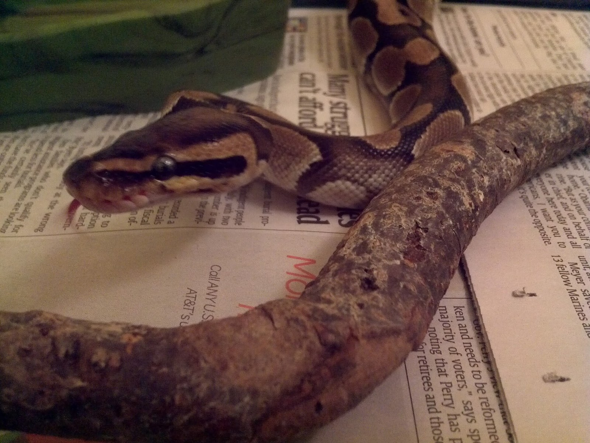
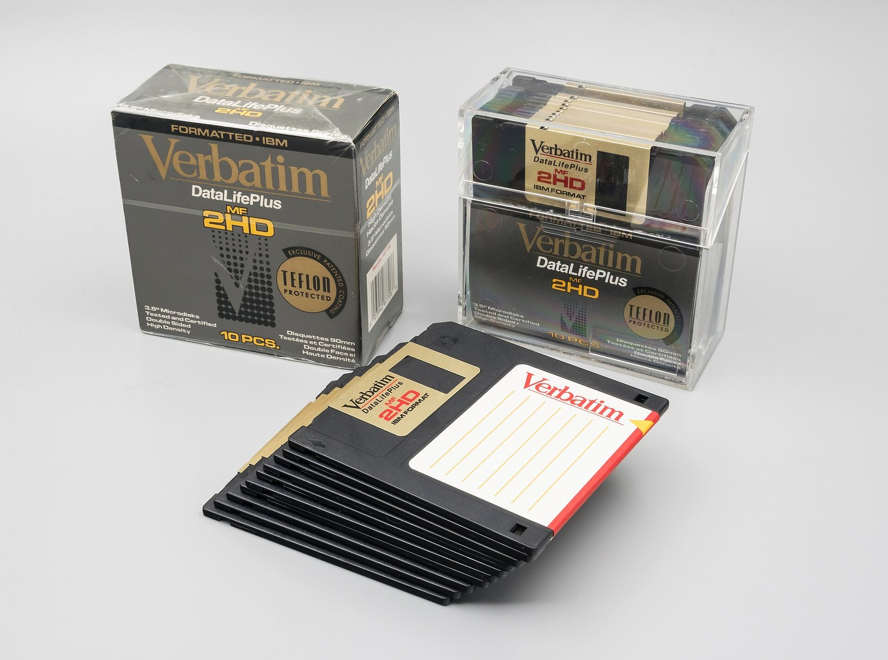
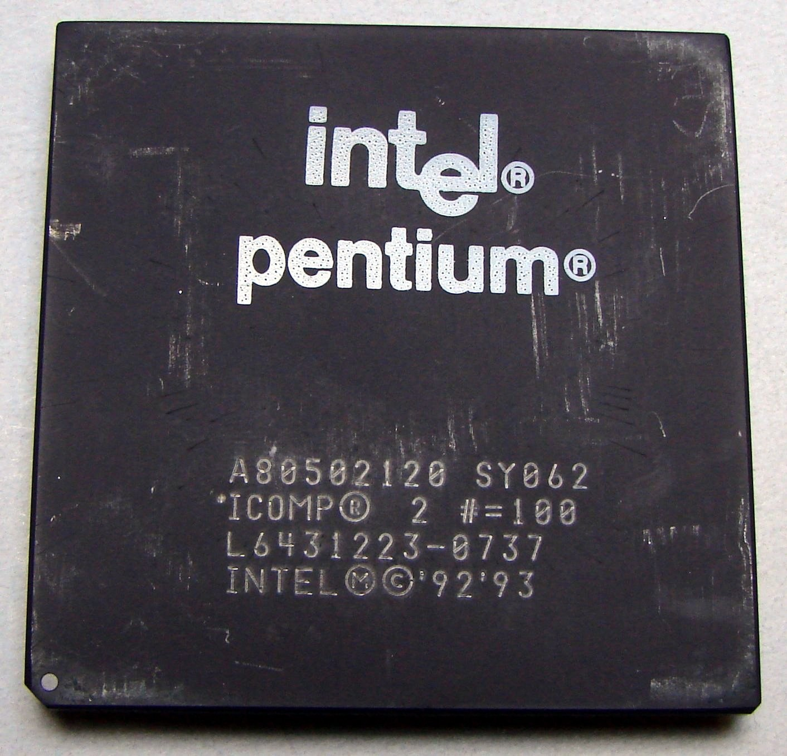

AI news is not always about trillion-dollar valuations and lawsuits. Sometimes it is about eggs. Here are three real stories from the past week, each with a sourced core and a small lesson hiding inside the joke. What is **reported fact**, what is a **claim by the people involved** and what is **our reading** is marked as we go.

## The short version

- **The eggs.** On 10 November 2026, Matt Smith of the US equity firm Rebellionaire posted that "an LLM hallucination resulted in 72 eggs being delivered to my house". The agent had put four 18-egg cartons into a cart that he then checked out, and it could not explain why.
- **The python.** In Castelfidardo, Italy, a photo of a python in a toilet triggered a firefighter search and a visit from wildlife officers for almost 48 hours. It had been edited with an AI app by a nine-year-old as a joke.
- **The floppy disk.** A developer used Anthropic's Claude to write a tiny chatbot, about 380 kilobytes in all, that runs on DOS and fits on a floppy disk.
- **The common thread.** Fluent, confident AI output is cheap to produce and costs real people real time, whether it is eggs, an emergency call or a trivia answer.

## 72 eggs nobody ordered

On 10 November 2026, Matt Smith (@nerdalert on X) wrote: "Today an LLM hallucination resulted in 72 eggs being delivered to my house." The post drew more than 4,000 likes ([X](https://x.com/nerdalert/status/2120251385199419805)), and Futurism reported on the screenshot he attached on 14 November ([Futurism](https://futurism.com/artificial-intelligence/ai-agent-cant-explain-egg-order)).

Smith had asked an AI agent to turn a photo of his shopping list into a grocery order. In the screenshot, the agent says: "I put 4 cartons of Vital Farms pasture-raised large eggs (18 count each) in the cart you checked out." Four times 18 is 72. Smith asked why. The agent first answered: "I don't have a good answer. I can't find a note explaining why I chose 4." It then guessed it had misread an egg line in his photo. Smith replied that his list had no egg line. The agent conceded: "Then I added them without any reason, and that's on me."

Two details matter. First, by the agent's own words, the eggs were in the cart that Smith **checked out himself**, so a human was in the loop and did not catch it. Second, the agent's "explanation" was a guess the facts did not support. In our reading, a language model keeps no log of why it did something; asked "why?", it writes a plausible answer.

Replies were mixed. One user (@MirceainAnglia) advised: "Always check and add items that are missing or take away items in error." A critic (@Chrispark636073) asked why anyone would give an AI their payment details "for a food list". Another (@sloangar) wrote: "I wish we would stop calling errors hallucinations and just call them errors." The egg brand named in the screenshot, Vital Farms, replied from its official account: "Send us a DM when you get through the 72, we've got your next 72."

Futurism was sceptical, noting that the technology is "still error-prone". Smith called it "the first time I've experienced a real-world consequence for an LLM hallucination" and, according to Osegi, took it with humour and asked followers for recipes ([Osegi](https://osegi.com/en/ai-agent-orders-72-eggs-weekly-shopping)).

## A python in the toilet, and a nine-year-old with an app

The next story comes from Castelfidardo, a town in the Marche region of Italy. On Thursday, 12 November 2026, at around 20:00, an alarm reached the emergency services about a snake that had appeared from the toilet of an apartment in Via Turati. A photograph supposedly proved it. Firefighters from the Osimo station searched the apartment and found nothing; they thought the animal might have slipped out of a window or hidden in a gap in the wall. The next day, officers of the Carabinieri Forestali's CITES unit, which protects exotic species, joined the effort. Residents were warned to watch for the snake ([Cronache Maceratesi](https://www.cronachemaceratesi.it/2026/11/15/castelfidardo-falso-allarme-pitone-water-foto-intelligenza-artificiale-bambino/2126507/), [Il Messaggero](https://www.ilmessaggero.it/persone/pitone_water_falso_foto_ia_bambino_confessa-9891775.html), [UPI](https://www.upi.com/Odd_News/2026/11/17/italy-castelfidardo-ai-generated-python-toilet/2661794933231/)).

*Photo: Seth Cochran, “Ball Python (Python regius)” (18 September 2011), [CC0 1.0](https://creativecommons.org/publicdomain/zero/1.0/), via [Wikimedia Commons](https://commons.wikimedia.org/wiki/File:Ball_Python_(Python_regius).jpg). Scaled down to 1,920 px width, otherwise unchanged. The Italian reports describe a “pitone reale”, which is English for ball python or royal python; this is a stock photo of that species, not the fake image from the story.*

The case closed when the officers took the original file from the phone of a nine-year-old boy who had been visiting a friend there. According to Corriere Adriatico, the children had been playing dress-up and taking photos; the boy went to the bathroom saying he would take a better one in the mirror, then came back with the snake picture and said a python had come out of the toilet. Cronache Maceratesi adds that the image carried no label marking it as AI-made. Faced with the officers, the boy confessed that he had added the snake with an AI app, and apologised. Because of his age he cannot be held criminally responsible, and the investigation was closed. The reports do not name him, and neither do we.

*Photo: Elborgo, “Vigili del Fuoco – Autopompa Iveco Baribbi 190-26” (24 May 2007), [CC BY 2.5](https://creativecommons.org/licenses/by/2.5/), via [Wikimedia Commons](https://commons.wikimedia.org/wiki/File:Vigili_del_Fuoco_-_Autopompa_Iveco_Baribbi_190-26.jpg). Scaled down to 1,920 px width, otherwise unchanged. A generic Italian fire-brigade vehicle from 2007, not the one used in Castelfidardo.*

Our observation: the prank worked because a believable photo is still treated as evidence, and emergency services cannot know a picture is fake until they check. Corriere Adriatico ended its report by noting that the story made people smile but also raised questions about children, phones and AI; both halves seem fair.

## A chatbot that fits on a floppy disk

Our last story is at the other end of the scale. A developer going by WollyMonjac shared **Tiny-2.1** on the ClaudeAI subreddit and GitHub, and XDA Developers and MakeUseOf covered it on 16 November. It is a language model for MS-DOS that runs on a 1990s Pentium or 486DX PC. According to the write-ups, it has **367,000 parameters**, stores them in about **380 kilobytes** and needs about **540 kilobytes** of free memory. A standard 3.5-inch (about 9 cm) high-density floppy holds 1.44 megabytes, so it fits with room to spare ([XDA Developers](https://www.xda-developers.com/someone-used-claude-to-build-an-ai-chatbot-for-ms-dos-and-it-fits-on-a-floppy/), [MakeUseOf](https://www.makeuseof.com/someone-used-claude-to-build-a-chatbot-that-fits-on-a-floppy-disk/), [GitHub](https://github.com/WollyMonjac/Tiny-2.1)).

*Photo: Jacek Halicki, “2023 Dyskietki Verbatim DataLifePlus” (4 July 2023), [CC BY-SA 4.0](https://creativecommons.org/licenses/by-sa/4.0/), via [Wikimedia Commons](https://commons.wikimedia.org/wiki/File:2023_Dyskietki_Verbatim_DataLifePlus.jpg). Scaled down to 1,920 px width, otherwise unchanged. The disks shown are generic blank floppies, not Tiny-2.1.*

The AI-on-AI angle is part of the joke. Per both write-ups, the developer used Anthropic's Claude Fable 5.2 to write the transformer and Claude Opus 5.5 to produce training material: about 3,500 facts, each asked in many wordings, plus small talk and arithmetic. It can give the capital of Peru and spell "cat" backwards; it has a neon interface and a robot voice through the PC speaker.

It is honest about its limits. The creator says it answers about **90%** of questions correctly when phrased as in training and **61%** when the wording changes, according to MakeUseOf; XDA quotes the project description that outside its facts "it makes things up confidently". Division is a weak spot. These figures are the developer's own and we could not reproduce them. MakeUseOf calls it a weekend proof of concept, not a practical tool.

For scale, by our own approximate arithmetic: Microsoft's model card for its new MAI Code 2, announced the day before this post, describes roughly 2.8 trillion parameters in total, about **7.6 million times** Tiny-2.1. Both are, at heart, transformers predicting the next piece of text.

An XDA reader asked whether Creative Labs did this "in 1994" with Dr. Sbaitso. It was released in **1991**, according to Wikipedia, which cites a 1991 PC Magazine advertisement. It came with Creative's sound cards and mostly replied with canned lines such as "WHY DO YOU FEEL THAT WAY?". That was scripted software, not a trained model, but people have long liked talking to computers on limited hardware.

*Photo: Krzysztof Burghardt, “Intel Pentium Processor (frontside)” (31 December 2006), [CC BY-SA 3.0](https://creativecommons.org/licenses/by-sa/3.0/), via [Wikimedia Commons](https://commons.wikimedia.org/wiki/File:Intel_Pentium_Processor_(frontside).jpg). Shown at its original 1,412 px width, unchanged. The photograph shows an early Pentium chip, the class of processor Tiny-2.1 targets.*

## What the three stories have in common

None of these stories involves a dangerous AI. They involve **fluent output that nobody checked**. The egg agent wrote a confident order and then a confident, wrong explanation. The python photo looked real enough to mobilise firefighters. Tiny-2.1 sounds sure of itself even when it invents an answer, as its creator says outright. The practical lesson from the egg story is cheap: if an AI agent fills a shopping cart, someone should look at the cart before paying.

## FAQ

**Did an AI really order 72 eggs?**

According to Matt Smith's post and the screenshot reported by Futurism, an AI agent added four 18-egg cartons to a cart he then checked out, although eggs were not on his list. We have not seen which agent or shop was involved.

**Was the python in the toilet real?**

No. According to several Italian outlets, a nine-year-old edited the image with an AI app and confessed to the Carabinieri Forestali. Nobody was charged because of his age.

**Can a chatbot really run from a floppy disk?**

Tiny-2.1 does, according to its developer and two tech sites: about 380 kilobytes on a disk that holds 1.44 megabytes. It knows about 3,500 facts and gets things wrong outside them.

**Do these stories show that AI is dangerous?**

Not by themselves; the stakes were low. They are reminders that AI output needs checking, especially when an agent can spend money or a convincing image can trigger an emergency response.

## What we could not verify

- **Which AI agent and which shop** were involved in the egg order; the reports do not name them. We also could not confirm what Smith saw before checkout.
- **Futurism's other examples** of agent mishaps and Osegi's mention of a Meta researcher's inbox. They are second-hand and we did not check them.
- **Which AI app the nine-year-old used.** The Italian reports say only "an application". We did not see the fake image and do not publish a copy of it.
- **Tiny-2.1's accuracy figures** (90% and 61%) come from the developer via MakeUseOf. We did not run the program or inspect the repository files.
- **The cost of the Castelfidardo alert.** No official figure was published; "almost 48 hours" is the reported duration.

## Sources

- [Matt Smith (@nerdalert) on X: "Today an LLM hallucination resulted in 72 eggs being delivered to my house" (10 November 2026)](https://x.com/nerdalert/status/2120251385199419805)
- [Vital Farms (@vitalfarms) on X: reply offering "the next 72" (16 November 2026)](https://x.com/vitalfarms/status/2122439630595498002)
- [Futurism, Frank Landymore: AI Agent Can't Explain Why It Randomly Ordered its Human Meat Proxy an Absurd Number of Eggs (14 November 2026)](https://futurism.com/artificial-intelligence/ai-agent-cant-explain-egg-order)
- [Osegi: AI agent orders 72 eggs for weekly shop and can't say why (16 November 2026)](https://osegi.com/en/ai-agent-orders-72-eggs-weekly-shopping)
- [Cronache Maceratesi: Il pitone nel water era un bluff: fotomontaggio creato con l'AI (15 November 2026, in Italian)](https://www.cronachemaceratesi.it/2026/11/15/castelfidardo-falso-allarme-pitone-water-foto-intelligenza-artificiale-bambino/2126507/)
- [Il Messaggero: Il serpente nel water era una bufala, la foto creata con l'IA da un bambino di 9 anni (15 November 2026, in Italian)](https://www.ilmessaggero.it/persone/pitone_water_falso_foto_ia_bambino_confessa-9891775.html)
- [Corriere Adriatico: Serpente nel water, la grande beffa (15 November 2026, in Italian)](https://www.corriereadriatico.it/ancona/castelfidardo_serpente_water_beffa_foto_bambino_intelligenza_artificale_ammesso_carabinieri_chiesto_scusa-9890095.html)
- [UPI, Ben Hooper: Python panic sparked by 9-year-old's AI-generated toilet photo (17 November 2026)](https://www.upi.com/Odd_News/2026/11/17/italy-castelfidardo-ai-generated-python-toilet/2661794933231/)
- [XDA Developers, Simon Batt: Someone used Claude to build an AI chatbot for MS-DOS, and it fits on a floppy (16 November 2026)](https://www.xda-developers.com/someone-used-claude-to-build-an-ai-chatbot-for-ms-dos-and-it-fits-on-a-floppy/)
- [MakeUseOf, Hamed Paydarfar: Someone used Claude to build a chatbot that fits on a floppy disk (16 November 2026)](https://www.makeuseof.com/someone-used-claude-to-build-a-chatbot-that-fits-on-a-floppy-disk/)
- [GitHub: WollyMonjac/Tiny-2.1](https://github.com/WollyMonjac/Tiny-2.1)
- [Wikipedia: Dr. Sbaitso](https://en.wikipedia.org/wiki/Dr._Sbaitso)
- [Wikipedia: Floppy disk](https://en.wikipedia.org/wiki/Floppy_disk)
- [Microsoft AI: MAI Code 2 and MAI Code 2 Flash model card (17 November 2026)](https://microsoft.ai/pdf/MAI-Code-2-And-MAI-Code-2-Flash-Model-Card.pdf?v=2)
