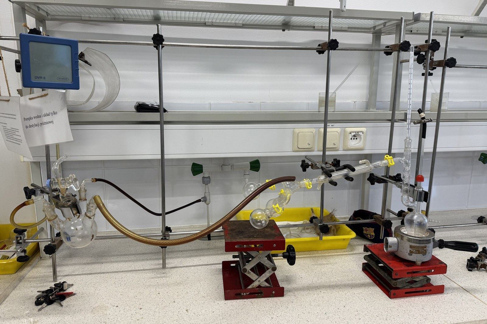
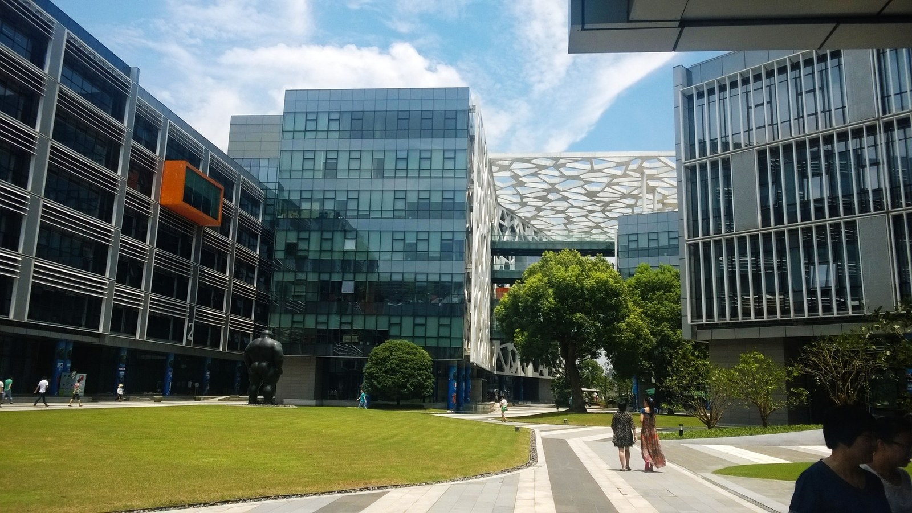
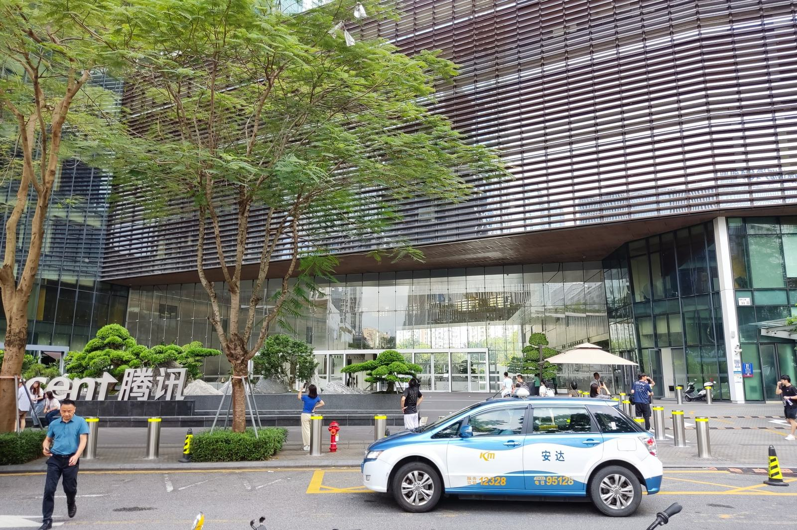

For a year, US officials and American AI labs have said that Chinese companies build their models partly by copying answers from American ones. On 17 November 2026, Reuters added documents to that argument: a review of more than 300 Chinese papers, patents, corporate disclosures, recruitment notices and government papers, which it says shows the practice, called *distillation*, has moved from academic experiments into mainstream industrial use in China, with Beijing's encouragement. The story landed at a tense moment. Washington tightened its chip rules on Monday, DeepSeek began rationing its free chatbot because it is short of computing power, Alibaba and Tencent launched cheaper models, and Donald Trump and Xi Jinping are due to meet in Shenzhen this week.

This report separates what is documented from what is claimed. Findings by journalists and government agencies are **reported facts or allegations**, as labelled. Company launch figures are **company claims**. Views from researchers and commentators are **opinions**. The picture is current as of **17 November 2026**.

## The short version

- **The report.** Reuters (17 November) says Chinese entities increasingly use output from US AI models to train domestic rivals, and that Chinese government documents encourage distillation, though they do not instruct companies to distil American models.
- **Is it legal?** Reuters notes distillation "is not illegal and is prevalent in other parts of the world." The dispute is about unauthorised access, terms of service and scale.
- **The US position.** A joint advisory by the NSA, CISA and FBI (8 September) accuses six Chinese firms of "industrial-scale" distillation. China's foreign ministry calls the accusations "groundless."
- **The squeeze.** On 16 November the US Commerce Department issued an interim rule on remote access to advanced chips, and from 15 November DeepSeek was reported to be limiting free chats because of "insufficient computing power."
- **The expert split.** Commentators disagree sharply on how much distillation explains China's progress; estimates quoted below range from "not crucial" to "about half."
- **What to watch.** The APEC summit in Shenzhen on 18–19 November, where AI safety talks are expected alongside the chip dispute.

## What Reuters found, and what distillation means

*Photo: KiveVictor, “Laboratory vacuum distillation apparatus on a benchtop” (7 April 2025), [CC BY 4.0](https://creativecommons.org/licenses/by/4.0/), via [Wikimedia Commons](https://commons.wikimedia.org/wiki/File:Laboratory_vacuum_distillation_apparatus_on_a_benchtop.jpg). A chemistry apparatus, shown only as a loose picture for the word “distillation”; it is unrelated to AI.*

In AI, distillation means using a strong "teacher" model to produce answers that are used to train a smaller "student" model. Reuters describes the attraction for Chinese developers short of computing power: an American model can answer a hard question once, and a Chinese team can keep the answer and train a local system around it. AI researcher Nathan Lambert, who writes the Interconnects newsletter and works with the open-model group Ai2, notes that the term has drifted from its strict meaning. Today it mostly means *synthetic data*: outputs from a stronger model, usually fetched through its API (the programming interface companies sell access to), used as training material.

Reuters gives concrete examples from published papers: in November 2024, Shanghai Jiao Tong University researchers selected about 5,000 answers from OpenAI's o1 model, translated them with GPT-4o mini, and built 10,750 bilingual training examples to train Alibaba's Qwen2.5-72B. In April 2025, Alibaba researchers described using GPT-4 and GPT-4o to generate non-Chinese training material for smaller Qwen models. A February 2026 paper by Shanghai Jiao Tong and the food-delivery company Meituan used GPT-4o to produce plans for coordinating AI agents. The universities and companies did not respond to Reuters' requests for comment.

Three further points in the Reuters report matter. The Chinese researchers in the 2024 paper themselves warned that over-reliance on distillation "could stifle original innovation." Distillation "cannot reproduce a leading model's full capabilities or eliminate the need for advanced computing power." And a national "AI+Manufacturing" policy package from eight Chinese agencies in January supports "model training, fine-tuning and distillation" for industry, although no document instructs firms to distil American models. Reuters also reports that Chinese developers have asked the industry ministry where ordinary use of foreign models ends and organised collection of output begins; the ministry did not respond.

## The US case and China's reply

The US government's accusation is far stronger than ordinary distillation. The joint advisory of the NSA, CISA and FBI, published on 8 September 2026, says DeepSeek, Moonshot AI, Alibaba, MiniMax, StepFun and Z.AI "extracted billions of tokens across millions of exchanges" from US models since at least late 2024, "likely with Chinese government awareness." A *token* is a small chunk of text, often a word or part of one. The advisory describes bulk fake accounts, a "gray market of proxies" it calls "transfer stations," and prompts that coax models into revealing their step-by-step reasoning. It says the activity violates US providers' terms of use. These are **allegations by US agencies**. Ars Technica reported that none of the US AI companies it contacted responded at the time, and the Chinese side has not accepted the findings.

An earlier, company-level claim came in February from Anthropic, which said three labs (DeepSeek, Moonshot and MiniMax) generated over 16 million exchanges with Claude through about 24,000 fraudulent accounts. In Anthropic's breakdown, as quoted by Lambert, DeepSeek's share was over 150,000 exchanges, Moonshot's over 3.4 million and MiniMax's over 13 million.

China rejects the framing. Foreign ministry spokesperson Mao Ning called the September accusations "groundless" and attributed Chinese progress to "high-level scientific and technological self-reliance," Ars Technica reported. A commerce ministry statement, quoted in an X post by commentator Henry Gao from Xinhua, calls distillation "a normal technical and commercial issue" and the US move an example of "double standards." In July, at meetings in Chengdu, Chinese officials told US counterparts distillation is a standard technique and said they were open to acting on IP theft, "but made no concrete commitments," a US official told Reuters. Treasury Secretary Scott Bessent wrote on 23 July that if firms "cross the line into IP theft, sanctions and Entity List designations will be on the table."

## How much does distillation explain? The experts disagree

*Photo: Danielinblue (architects: HASSELL), “Alibaba Binjiang Park” (17 July 2014), [CC BY-SA 4.0](https://creativecommons.org/licenses/by-sa/4.0/), via [Wikimedia Commons](https://commons.wikimedia.org/wiki/File:Alibaba_Binjiang_Park.jpg). A 2014 photo of an Alibaba campus in Hangzhou; the building does not tell us anything about the allegations.*

This is where reasonable specialists part ways.

**The sceptics.** Lambert wrote in February that he "still wouldn't say it is a crucial factor" in Chinese labs' post-training capabilities, even though the volumes Anthropic described could "meaningfully improve" a model. He added that Chinese labs "likely innovate greatly on distilling from leading API models, due to their restricted access to GPUs." In May he argued that what a few labs do should be called "jailbreaking or abuse," not distillation, and warned that sweeping policy could hurt Western researchers who rely on open Chinese models. The South China Morning Post reported in July that AI researchers on X called the US claims about Moonshot's Kimi K3 "political" and "reckless," pointing out that a model's output is not copyrighted; a Moonshot employee noted the short gap between the releases of Kimi K3 and Anthropic's Fable 5, which it was accused of copying. Reuters adds that two people familiar with Chinese developers' work said distillation is "only one factor alongside advances in engineering, algorithms, data and model design."

**The believers.** Dean Ball, who says he has joined OpenAI, wrote on 18 October that he had guessed distillation explained about 30% of how close Chinese models are on benchmarks, but "after that, more like 50%," citing "the size and sophistication of what we see almost literally every hour of every day." He did not publish data. Another commenter, Henry Gao, replied that he now puts it at "80–90%" after China's commerce ministry called distillation normal. A US official told Reuters Washington believes industrial-scale distillation is "the main reason" Chinese models have narrowed the gap.

**A hardware view.** The Institute for Progress, a US think tank cited by the BBC, estimates top US models lead the best Chinese ones by only about six and a half months, "despite US AI companies having significantly better compute access and financing." In the same thread, Divyansh Kaushik replied that Chinese firms have "way more compute than people realize, thanks to remote access and our failures to crack down on smuggling." None of these figures is a measurement we could check; they are judgments.

## The chip squeeze, and DeepSeek's rationing

*Photo: aamanatullah, “Johor Bahru Skyline” (9 May 2015), [CC BY 2.0](https://creativecommons.org/licenses/by/2.0/), via [Wikimedia Commons](https://commons.wikimedia.org/wiki/File:Johor_Bahru_Skyline_(17300534739).jpg). Johor in Malaysia is one of the data-centre hubs named by the BBC; this is a 2015 city view, not a data centre.*

On Monday 16 November, the US Commerce Department's Bureau of Industry and Security issued an interim final rule on remote access to advanced AI chips. According to CNBC and POLITICO it requires licences to export advanced chips to Indonesia, Malaysia, Singapore, Thailand and Brazil, which it describes as at higher-than-normal risk of diversion, and it targets arrangements in which Chinese firms rent Nvidia computing power in third countries. The Business Times reports exceptions, for example for computing used by content-recommendation systems. The rule followed a scandal around Singapore-based Megaspeed, accused of diverting chips to China; Megaspeed denies this, the BBC reports. China's foreign ministry called the rules "economic coercion."

The Institute for Progress estimates that at least 30% of China's advanced AI computing power will come from renting abroad or smuggling by 2027, the BBC reported. That is a projection. Experts quoted by the BBC weigh the effect differently. Reema Bhattacharya of the advisory firm Verisk Maplecroft said the rule takes away "one of the more practical routes" Chinese developers had to frontier computing. The BBC adds that tighter limits could also push Chinese firms towards domestic chips, a long-standing dilemma for Washington, according to trade expert Naoise McDonagh.

Computing shortage was visible at home too. From 15 November, users of the DeepSeek app and website reported notices that "insufficient computing power" meant long chats inactive for more than seven days could no longer be resumed, with some users hit after 72 hours, input per message capped at about 40,000 Chinese characters, and daily quotas, according to Yicai, TechNode and Lianhe Zaobao. DeepSeek has issued no announcement. TechNode notes the status page recorded eight incidents since October. Lianhe Zaobao recalled that founder Liang Wenfeng said in July that computing resources were the team's real constraint. Yicai reports that DeepSeek's V4.1-Flash model handled 59.2 trillion tokens on the OpenRouter aggregator in the week to 15 November, the most worldwide; that is one platform, not the whole market. Whether DeepSeek will launch paid consumer plans is speculation.

## Cheaper models from Alibaba and Tencent

*Photo: MEAIYAVT 206 Liowcms, “Tencent Binhai Building, Nanshan, Shenzhen” (3 June 2023), [CC BY-SA 4.0](https://creativecommons.org/licenses/by-sa/4.0/), via [Wikimedia Commons](https://commons.wikimedia.org/wiki/File:SZ_%E6%B7%B1%E5%9C%B3_Shenzhen_%E5%8D%97%E5%B1%B1%E5%8C%BA_Nanshan_Haitian_2nd_Road_Binhai_Blvd_Road_Haixue_Road_Houhai_Blvd_%E9%A8%B0%E8%A8%8A%E6%B5%B7%E6%BF%B1%E5%A4%A7%E5%BB%88_Tencent_Binhai_Building_June_2023_Px3.jpg). Scaled down to 1,920 px width. A 2023 street view of a Tencent office building in Shenzhen.*

Both companies answered the compute squeeze with cost. On 16 November Alibaba released **Qwen4-Max**. Its press release says the model has 2.4 trillion parameters in total but activates only 71 billion for each token (a "mixture-of-experts" design, in which just part of the model works on any given piece of text), a one-million-token context window, and an average cost per task about 60% lower than Qwen3.8-Max on Work360, a proprietary Alibaba benchmark. Input with a cache hit costs $0.075 per million tokens. Alibaba says smaller open-weight Qwen4 models will follow.

Those are **company claims**. The independent site Artificial Analysis scores Qwen4-Max 43 on its Intelligence Index, ranking it 47th of 91 models and describing it as "below average in intelligence" for comparable models, "notably slow" and "very verbose" (127 million output tokens on its tests, versus a median of 65.4 million). It lists prices of $1.50 per million input tokens and $4.50 per million output tokens and says Alibaba has not disclosed the model's size, which conflicts with Alibaba's press release. We have not reconciled this.

On the same day Tencent launched **Hy4 flash**, with 224 billion parameters and 12 billion active, a one-million-token context and prices of about $0.070 per million input tokens and $0.281 per million output tokens. Tencent says that on its internal WorkIndex benchmark the cost per task is one thirteenth of its Hy4 Preview and one eighth of DeepSeek-V4.1-Flash-1017 at that model's peak-hour Max-tier pricing. It is free on its WorkBuddy product until 30 November. Again, that is a company benchmark. Together with the Qwen launch, it signals a price war at the cheap end of the market, where distilled or efficiency-tuned models matter most.

## Shenzhen: what to watch this week

The APEC summit takes place in Shenzhen on 18–19 November. Reuters says the Trump–Xi meeting is expected on Thursday. The Business Times reports the two governments are expected to hold their first AI dialogue on safety, possibly coloured by the chip dispute. Reuters adds that a proposed emergency mechanism for notifying each other of serious AI incidents, discussed in September, "has yet to become operational." The Los Angeles Times reports Trump is not expected to raise the Nvidia matter directly with Xi, but Bessent plans to in his own meetings.

## FAQ

**Is distillation illegal?**

Reuters says it "is not illegal" and is widely used. Using it against US providers' terms, with fake accounts or proxies, is what the US calls abuse; OpenAI and Anthropic restrict using their outputs to build rival models.

**Did Chinese companies copy American AI?**

The US agencies allege it, and Reuters documents that Chinese papers use US model output. Chinese officials call it a normal technique. How much it explains is disputed by experts.

**Does this undercut US chip curbs?**

Reuters says wider distillation "could undercut the effectiveness" of the curbs, because developers can acquire capabilities without the original compute. Lambert argues the opposite lesson, that chips are the more effective lever.

**Why is DeepSeek limiting chats?**

DeepSeek's notices cite insufficient computing power. It has not published a wider explanation.

**Are Qwen4-Max and Hy4 flash better than US models?**

Not on the independent evidence we found. Artificial Analysis rates Qwen4-Max below average among comparable models; its main selling point is price.

**Does the new US rule stop China from using Nvidia chips?**

No. Chinese firms can still use computing in US data centres, and exceptions exist; the rule adds licences and approvals for third-country arrangements.

## What we could not verify

- **The Reuters documents.** We read Reuters' summary of its review, not the underlying papers or patents.
- **The US agencies' evidence.** The advisory states findings; the underlying logs are not public.
- **How much distillation explains.** The 30%, 50% and "80–90%" figures quoted online are personal estimates without published data.
- **DeepSeek's actual limits.** They come from user reports and media; DeepSeek has not published a policy.
- **Qwen4-Max's size.** Alibaba says 2.4 trillion parameters; Artificial Analysis says it is undisclosed.
- **Company benchmark claims.** Work360 and WorkIndex are in-house benchmarks.
- **Summit outcomes.** The meetings had not happened when we wrote this.

## Sources

- [Reuters via Investing.com: China taps US AI models to train homegrown rivals as chip curbs bite (17 November 2026)](https://www.investing.com/news/economy-news/exclusivechina-taps-us-ai-models-train-homegrown-rivals-chip-curbs-bite-5031568)
- [CISA, NSA and FBI: China-based AI companies conducting industrial-scale distillation campaigns against US AI companies (8 September 2026)](https://www.cisa.gov/news-events/cybersecurity-advisories/aa26-251a)
- [Ars Technica: Six Chinese AI firms accused of aggressively copying US frontier models (9 September 2026)](https://arstechnica.com/tech-policy/2026/09/six-chinese-ai-firms-accused-of-aggressively-copying-us-frontier-models/)
- [Interconnects (Nathan Lambert): How much does distillation really matter for Chinese LLMs? (24 February 2026)](https://www.interconnects.ai/p/how-much-does-distillation-really)
- [Interconnects (Nathan Lambert): The distillation panic (4 May 2026)](https://www.interconnects.ai/p/the-distillation-panic)
- [Dean W. Ball on X: distillation and Chinese benchmark performance (18 October 2026), via a mirror](https://xitter.cf/deanwball/status/2111802397148471496)
- [South China Morning Post: Global AI experts push back on US "distillation" claims against Moonshot's Kimi K3 (23 July 2026)](https://www.scmp.com/tech/tech-war/article/3361625/global-ai-experts-push-back-us-distillation-claims-against-moonshots-kimi-k3-model)
- [BBC: How new US chip restrictions on South East Asia will hit China (17 November 2026)](https://www.bbc.com/news/articles/cwq6e2qgvmlgo)
- [CNBC: Commerce targets loophole for China's data center use (16 November 2026)](https://www.cnbc.com/2026/11/16/nvidia-commerce-china-lutnick.html)
- [POLITICO: Commerce closes China's backdoor to Nvidia chips (16 November 2026)](https://www.politico.com/news/2026/11/16/commerce-closes-chinas-backdoor-to-nvidia-chips-after-white-house-steps-in-01167199)
- [US Bureau of Industry and Security: Rule addressing remote access to advanced chips and servers (16 November 2026)](https://www.bis.gov/press-release/bis-issues-rule-addressing-remote-access-american-super-intelligence-technology)
- [The Business Times: US chip curbs force Xi to weigh response before Trump summit (17 November 2026)](https://www.businesstimes.com.sg/international/us-chip-curbs-force-xi-jinping-weigh-response-trump-summit)
- [Reuters via Investing.com: Chip tensions loom over Trump–Xi summit (16 November 2026)](https://www.investing.com/news/stock-market-news/chip-tensions-loom-over-trumpxi-summit-as-us-and-china-push-ai-safety-steps-5028728)
- [Los Angeles Times: A divided Trump team closes ranks ahead of AI talks with China (17 November 2026)](https://www.latimes.com/politics/story/2026-11-17/divided-trump-team-closes-ranks-ahead-of-ai-talks-with-china)
- [Yicai Global: DeepSeek scales back free AI usage on computing power crunch (17 November 2026)](https://www.yicaiglobal.com/news/deepseek-sets-new-limits-for-free-users-due-to-insufficient-computing-power)
- [TechNode: DeepSeek users report chat limits as the service cites capacity constraints (16 November 2026)](https://technode.com/2026/11/16/deepseek-users-report-chat-limits-as-the-service-cites-capacity-constraints/)
- [Lianhe Zaobao: DeepSeek usage limits over computing shortages raise doubts about sustainability of free service (16 November 2026)](https://www.zaobao.com.sg/en/news/china/deepseek-usage-limits-over-computing-shortages-raise-doubts-about-sustainability-free-service)
- [Alibaba Cloud: Alibaba unveils Qwen4-Max (16 November 2026)](https://www.alibabacloud.com/en/press-room/alibaba-unveils-qwen4-max)
- [Artificial Analysis: Qwen4 Max, intelligence, performance and price analysis](https://artificialanalysis.ai/models/qwen4-max)
- [Tencent: Launches Hy4 flash (16 November 2026)](https://www.tencent.com/tencent-launches-hy4-flash-to-power-high-speed-cost-efficient-ai-deployment-for-everyday-workflows/)
