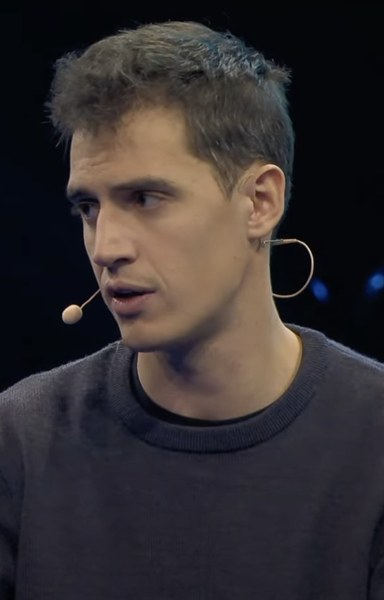
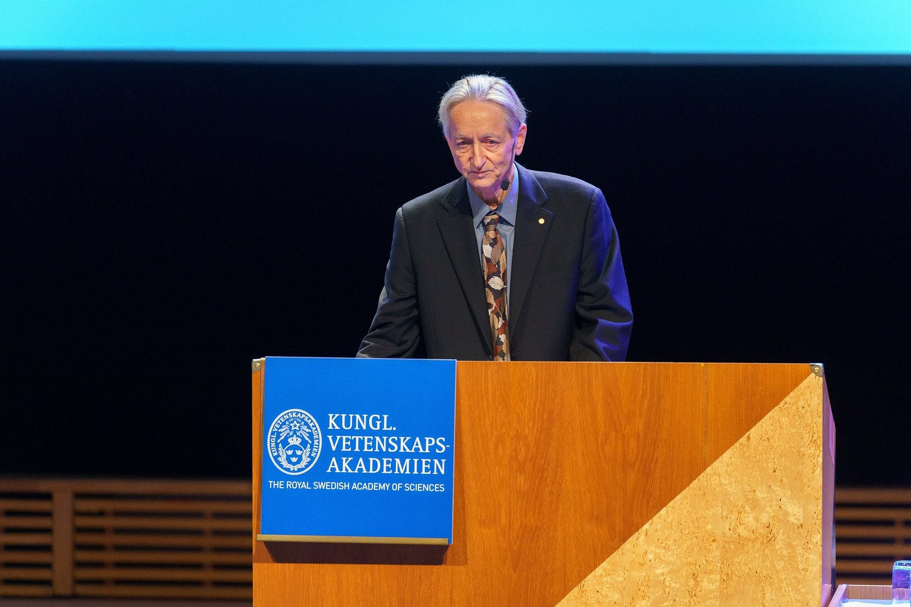
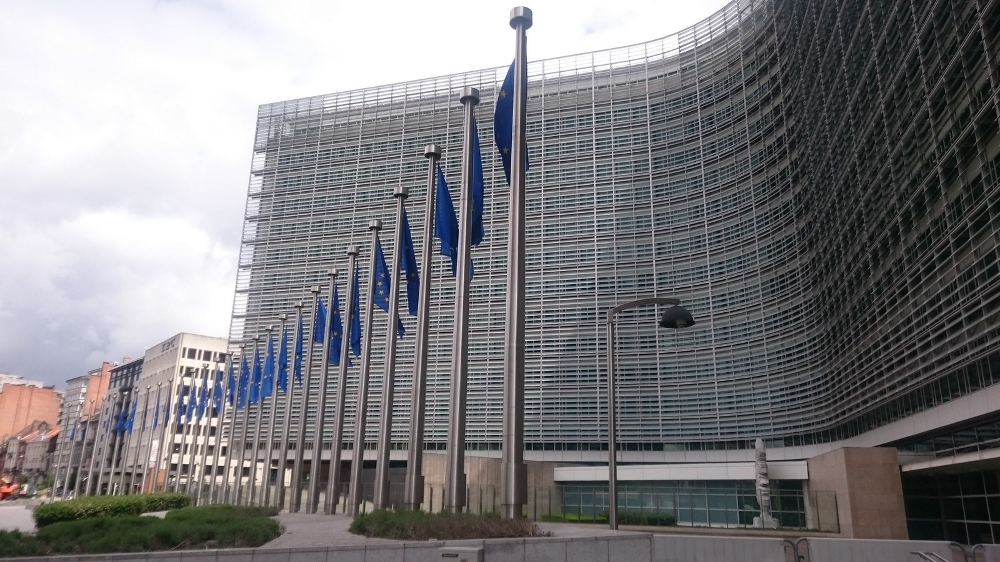
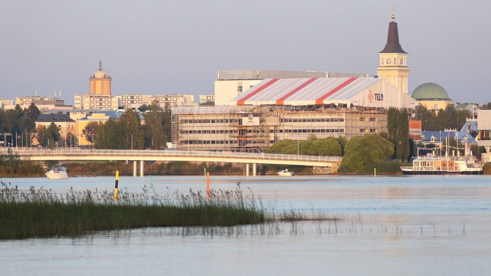

On Friday 13 November 2026, the leaders of the European Union sat down in Dublin and, for the first time, held a strategic discussion devoted to artificial intelligence. Two outside guests spoke to them: Arthur Mensch, chief executive of the French AI company Mistral, and Geoffrey Hinton, the Nobel Prize–winning computer scientist who has become one of the field's best-known warning voices. Five days later, with the Commission's Apply AI Summit just finished and a new advisory statement and a draft compliance template published, it is a fair moment to ask what the week actually changed.

This report draws on the Council's own account of the meeting, reporting by RTÉ, the Irish Examiner, DW, POLITICO and CNN, Commission publications and a company press release. Statements by politicians and companies are **claims or positions**, not results. Assessments by critics are **opinions**. The picture is current as of **17 November 2026**.

## The short version

- **What happened.** At an informal European Council in Dublin on 13 November, leaders held their first strategic discussion on AI, covering competitiveness and "AI sovereignty" on one side and society, security and trust on the other.
- **Who spoke.** Mensch argued Europe needs speed, money and coordination. Hinton warned of "runaway AI" and called for global governance, according to Commission President Ursula von der Leyen and Irish Taoiseach Micheál Martin.
- **The gap.** POLITICO reported on 8 November that 16 member states had missed the AI Act deadline to name a national enforcement authority, and that the call for the EU's AI compute hubs had been postponed for the second time.
- **The rulebook.** The "AI Omnibus", in force since 27 July 2026, delays the main high-risk obligations to 2 December 2027. On 16 November the Commission's scientific advisers said rules must keep pace with the technology.
- **The adoption push.** On 17 November, Executive Vice-President Henna Virkkunen said the Apply AI Strategy has mobilised nearly €2 billion in support actions.

## What happened in Dublin on 13 November

The meeting was an *informal* European Council: it can discuss and signal, but it adopts no binding conclusions. The Irish Examiner reports that 24 of the 27 leaders attended; POLITICO noted that Luxembourg's prime minister stood in for the Netherlands and Belgium, whose leaders stayed home because of domestic political turmoil.

The Council's summary says the leaders took up AI "for the first time" in a strategic discussion. With Mensch, they looked at growth, productivity and industrial transformation: investment at scale, European capabilities and value chains, "reducing critical dependencies", and access to clean and affordable energy. With Hinton, they covered fundamental rights including children's rights, democratic processes, labour markets, market concentration and cybersecurity, and "the need for global safeguards that uphold democratic values and fundamental rights."

Council President António Costa wrote on X that "AI is the most important technology of our time," as quoted by DW. EU foreign-policy chief Kaja Kallas pointed to a "dark side" in AI-equipped drones in Ukraine. Estonia and Finland wrote before the summit that Europe must "establish EU-level arrangements for responding to serious AI incidents," DW reported.

Not every leader treated AI as the main event. POLITICO's Brussels Playbook said the AI talks had "not been the center of attention" and were overtaken by the dispute over who should speak for Europe in Russia–Ukraine peace talks. Latvian Prime Minister Andris Kulbergs is quoted arriving: "There are much more important things." That is one politician's remark, not the position of the Council, but it shows how crowded the agenda was.

## Mensch and Hinton: two very different messages

*Photo: Slush, “Arthur Mensch” (16 March 2024), [CC BY 4.0](https://creativecommons.org/licenses/by/4.0/), via [Wikimedia Commons](https://commons.wikimedia.org/wiki/File:Arthur_Mensch.jpg). A 2024 conference photo, not from the Dublin meeting.*

**Mensch: "speed, financing and a strong coordination."** DW quotes him: "Europe has all the technology and the talent to lead the AI race. What it needs is speed, financing and a strong coordination between member states." In remarks Mistral shared with POLITICO, he added: "€260 billion a year currently paid to foreign providers could be reinvested here, on infrastructure we control and finance European R&D."

That figure is a **company claim**; we could not find the calculation behind it. Mistral is also an interested party, because it sells AI models and gains if governments buy more European technology. That does not make the argument wrong; it is context a reader should have. Parliament President Roberta Metsola took the same line: "I hate the mantra that Europe has somehow lost the AI race," POLITICO quotes her.

Analysts are less sure. CNN reported in October that private AI investment in Europe was roughly $21 billion in 2025, against $285.9 billion in the United States (Stanford's AI Index), and that the US produced 59 notable AI models that year, China 35, and France and the UK one each. Nobel-winning economist Philippe Aghion warned that Europe "is at acute risk of marginalization," and ECB President Christine Lagarde called the position "awkward": adopt AI quickly and become dependent, or hold back and forgo growth.

*Photo: Jay Dixit, “Geoffrey Hinton at the 2024 Nobel Lectures” (8 December 2024), [CC BY-SA 4.0](https://creativecommons.org/licenses/by-sa/4.0/), via [Wikimedia Commons](https://commons.wikimedia.org/wiki/File:Geoffrey_Hinton_at_the_2024_Nobel_Lectures.jpg). Taken in Stockholm in 2024, not in Dublin.*

**Hinton: "runaway AI" and global rules.** Von der Leyen said, per RTÉ, that Hinton set out "the enormous risks" of AI, "specifically runaway AI", and that discussion turned to controlling new frontier AI. A *frontier model* is one of the most capable general-purpose systems of the day. She offered a pharmaceutical analogy: "intense testing and, of course, transparency about the product before it is released." Taoiseach Martin said Hinton "was advocating strongly for global governance and global regulation of AI" and had described himself as a scientist, not a policy expert.

Hinton's public statements around the summit were sharper. The Irish Examiner reports he told RTÉ Radio's *Liveline* that "chatbots have less regulation on them than a ham sandwich," and said earlier in the week that he would warn leaders AI could wipe out humankind within three years. POLITICO summarises his view as a 10–20% chance of AI eventually causing human extinction over coming decades.

These are **opinions and probability estimates by one expert**, not measurements, and other leading researchers disagree with such figures. What is verifiable is narrower: leaders heard the warning, von der Leyen summarised it publicly, and the Council's summary reflects it.

## The credibility gap: missed deadlines and delayed hubs

*Photo: KenSwe72, “Berlaymont building Brussels” (14 May 2017), [CC BY 4.0](https://creativecommons.org/licenses/by/4.0/), via [Wikimedia Commons](https://commons.wikimedia.org/wiki/File:Berlaymont_building_Brussels.jpg). The Berlaymont is the seat of the European Commission.*

The sharpest criticism concerns what member states have not yet done. POLITICO reported on 8 November, citing the Commission, that **16 of 27 capitals had missed the August 2025 deadline to appoint a national authority to enforce the AI Act**. Six (Austria, Belgium, Bulgaria, Croatia, Slovakia and Hungary) had selected none; ten had made only provisional decisions.

German Green MEP Sergey Lagodinsky told POLITICO: "Stop blaming the EU for missing the race if you miss your own deadlines," and asked the Commission, in a letter POLITICO saw, to open formal proceedings. That is a **political demand**; we found no report that the Commission has acted.

A second delay concerns compute. POLITICO reported that the Commission department running the €30 billion effort to support AI compute hubs extended its deadline for expressions of interest at the end of October, to let member states "complete their national budgetary process and submit financial commitments." It was the second postponement; the first moved the original November deadline to February. Jan Kavalírek, who is involved in the Czech bid, posted on LinkedIn: "Apparently, some paperwork wasn't submitted on time."

POLITICO's analysis of 15 November describes "paralysis, distraction and defeatism in Europe's capitals," and notes that a Microsoft outage on Thursday and Friday affected EU institutions, "an uncomfortable reminder" of dependence on US technology. An unnamed Brussels official, asked what happens if Europe does not wean itself off that dependence, answered: "We're doomed." That is an anonymous opinion, but it mirrors the sovereignty argument Mensch and Costa made. According to POLITICO, Costa said leaders will return to the topic at a summit in three months.

## The rulebook: softened in July, questioned again in November

The AI Act is the world's first comprehensive AI law. Von der Leyen said in Dublin, per RTÉ, that critics first said it would "stifle innovation" and that "today, we get a lot of praise that we were the first ones to regulate AI. It's not perfect, no question."

It has also been loosened. The "AI Omnibus", proposed on 19 November 2025, entered into force on 27 July 2026. According to the Commission it moves the rules for stand-alone high-risk systems (the "Annex III" list, which includes areas such as hiring) to **2 December 2027** and for high-risk AI built into regulated products such as machinery, toys or lifts to **2 August 2028**. It extends relief for small firms to "small mid-caps", simplifies AI-literacy and registration duties, widens the AI Office's oversight, and adds a ban on "nudification" apps.

Critics quoted by CNN in October were split. Amir Banifatemi of Cognizant's AI lab called the prohibitions "broadly sound" but said "the high-risk regime is the weak point, and it has not yet begun to apply." Eléonore Crespo, co-founder of the Paris software firm Pigment, said the rules are "slowing us down."

Two Commission publications followed Dublin:

- **16 November: a joint statement by the Commission's chief scientific advisers and its ethics group**, which the Commission itself calls "an unusual step." It recommends keeping rules strong, calibrating development and deployment to potential danger, and building the EU's own capacity to evaluate models rather than "delegating this task to commercial developers." It warns that "external efforts to delay or weaken legislation could further compromise safeguards." It does not name the Omnibus, so we do not claim it targets it.
- **16 November: a draft template for fundamental-rights impact assessments.** Under Article 27 of the AI Act, certain deployers of high-risk systems must assess how a system could affect people's rights before using it, from 2 December 2027. Comments are open until **15 January 2027**.

## Apply AI and a Nordic-Baltic infrastructure bid

On 17 November the Commission hosted the Apply AI Summit in Brussels, marking one year since its Apply AI Strategy and closing the first "European AI Innovation Month". According to ANSA, Virkkunen said the strategy "mobilised nearly €2 billion in support actions," citing AI-supported cancer screening (350 centres across the EU now take part), next-generation robotics, and open-source models that help authorities prepare for floods and wildfires. A secondary report, based on ANSA, names the first Apply AI Startup Award winners as Better Medicine (Estonia), Prewave (Austria) and blueOASIS (Portugal).

*Photo: Estormiz, “View of Oulu” (4 September 2024), [CC0 1.0](https://creativecommons.org/publicdomain/zero/1.0/), via [Wikimedia Commons](https://commons.wikimedia.org/wiki/File:View_of_Oulu_20240904_04.jpg). Oulu is one of the sites named by the Nordic-Baltic consortium; the photo does not show any AI facility.*

Infrastructure is the other half of the sovereignty argument. In November, Nokia, Nscale, Skeleton, Telia and Verda announced **AI Gigafactory Northern**. Their press release says they "intend to submit a bid" under the call for AI gigafactory consortia from the EU's High-Performance Computing Joint Undertaking, which runs the EU's supercomputers. Sites named are Oulu (Finland), Iru (Estonia) and Valmiera (Latvia), with Sweden's "yet to be determined." The partners cite decarbonised electricity and a cool climate that reduces cooling needs.

Three cautions apply. This is a **company announcement of an intention to bid**, not a funding decision. The release gives no cost, chip count or power figure, so the scale is unknown. And it depends on the member-state financial commitments that POLITICO says have already delayed the timetable twice.

## FAQ

**Did EU leaders adopt any new AI rules in Dublin?**

No. The meeting was informal, and the Council's summary lists topics, not decisions.

**What did Mistral's Arthur Mensch ask for?**

Speed, financing and coordination between member states (DW), and investment in European-controlled infrastructure (remarks shared with POLITICO). His "€260 billion a year" figure is a company claim we could not verify.

**Did Hinton really say AI could end humanity "in three years"?**

The Irish Examiner reports he said earlier in the week that he would warn leaders of that. POLITICO describes his estimate as a 10–20% chance of extinction over coming decades. Treat both as one expert's opinion.

**What is the AI Omnibus?**

A simplification law in force since 27 July 2026. It delays the main high-risk obligations of the AI Act to 2 December 2027 and 2 August 2028, extends relief to small mid-cap firms and bans nudification apps.

**Has the AI Act failed?**

It is too early to say. Legal experts told CNN the law is still being phased in. What is documented is that 16 member states were behind on naming enforcement authorities in early November and that the high-risk rules have been postponed.

**What are "AI gigafactories"?**

Large EU-backed AI computing sites to be built and run by consortia under a call from the EU's High-Performance Computing Joint Undertaking. The Nordic-Baltic group has so far announced only an intention to bid.

**Does anything here change what ordinary users see today?**

Not directly. The week produced policy signals, a draft template and funding announcements, not product rules that take effect now.

## What we could not verify

- **Exact attendance in Dublin.** The Irish Examiner says 24 of 27 leaders attended; we found no Council list.
- **Hinton's "three years" remark.** We found no transcript, only the Irish Examiner's summary, and do not know the context.
- **The €260 billion figure.** It comes from Mistral's remarks as shared with POLITICO; we could not find its data.
- **The start-up award winners.** Names come from a secondary report based on ANSA; we did not find the Commission's own announcement.
- **The date of the AI Gigafactory Northern press release.** The page says "November 2026" but not the day.
- **Whether the Commission will open proceedings** against member states that missed the AI Act authority deadline, or whether more authorities have been named since 8 November.
- **What was said inside the room.** We rely on press conferences, the Council summary and a few quoted remarks, not a full record.

## Sources

- [Council of the EU: Informal meeting of heads of state or government, 13 November 2026](https://www.consilium.europa.eu/en/meetings/european-council/2026/11/13/)
- [RTÉ: "AI should be for the benefit of mankind" – Taoiseach (13 November 2026)](https://www.rte.ie/news/ireland/2026/1113/1599186-ai-taoiseach-eu/)
- [Irish Examiner: "Godfather of AI" warns humanity could be "toast" (14 November 2026)](https://www.irishexaminer.com/news/arid-41937552.html)
- [DW: EU leaders urged to "act now" on AI to stay competitive (13 November 2026)](https://www.dw.com/en/eu-leaders-urged-to-act-now-to-stay-ai-competitive-with-us-china/a-79937463)
- [POLITICO: Dithering in Dublin as leaders finally talk about AI threats (13 November 2026)](https://www.politico.eu/newsletter/brussels-playbook-capitals/dithering-in-dublin-as-leaders-finally-talk-about-ai-threats/)
- [POLITICO: The EU has always found a way through. On AI, it's struggling to see it (15 November 2026)](https://www.politico.eu/article/eu-way-through-ai-struggle/)
- [POLITICO: EU countries still can't get it together on AI (8 November 2026)](https://www.politico.eu/article/eu-countries-still-cant-get-it-together-on-ai/)
- [CNN Business: Europe leads the world on AI rules. So why is it missing from the AI safety debate? (14 October 2026)](https://www.cnn.com/2026/10/14/business/europe-ai-act-safety-debate-intl)
- [European Commission: AI Omnibus enters into force (27 July 2026)](https://digital-strategy.ec.europa.eu/en/news/ai-omnibus-enters-force)
- [European Commission, Research and Innovation: AI requires rigorous safeguards and rules that keep pace with technological advances (16 November 2026)](https://research-and-innovation.ec.europa.eu/news/all-research-and-innovation-news/ai-requires-rigorous-safeguards-and-rules-keep-pace-technological-advances-experts-tell-european-2026-11-16_en)
- [European Commission: Draft template for the fundamental rights impact assessment under the AI Act (16 November 2026)](https://digital-strategy.ec.europa.eu/en/news/commission-seeks-feedback-draft-template-fundamental-rights-impact-assessment-under-ai-act)
- [European Commission: Commission hosts Apply AI Summit (16 November 2026)](https://digital-strategy.ec.europa.eu/en/news/commission-hosts-apply-ai-summit-boost-europes-ai-innovation-and-uptake)
- [ANSA: Virkkunen on the Apply AI strategy, almost €2 billion mobilised (17 November 2026, in Italian)](https://www.ansa.it/canale_tecnologia/notizie/tecnologia/2026/11/17/virkkunen-con-strategia-ue-per-ladozione-dellia-mobilitati-2-miliardi_4799506c-7798-4b9b-a035-268beeb799a4.html)
- [Europreneurs Media: EU names first Apply AI Startup Award winners (17 November 2026, secondary report)](https://europreneursmedia.com/news/apply-ai-startup-award-winners-europe-2026/)
- [Nokia: European technology leaders form AI Gigafactory Northern consortium (November 2026)](https://www.nokia.com/newsroom/european-technology-leaders-form-ai-gigafactory-northern-consortium-to-build-trusted-sustainable-ai-infrastructure/)
