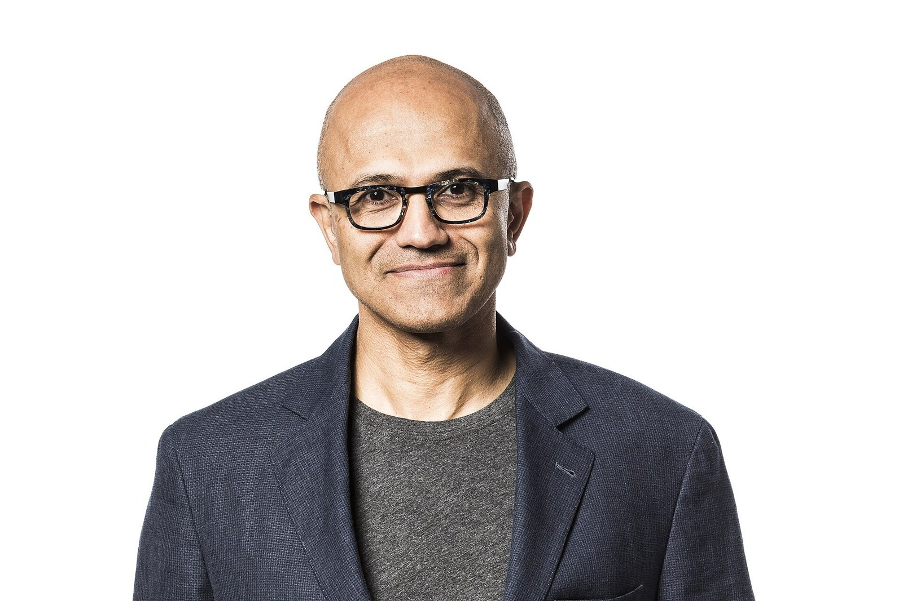
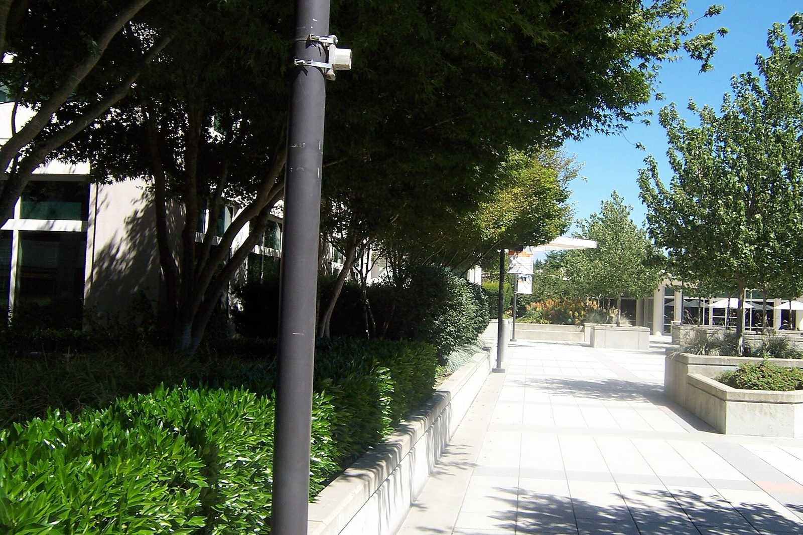

On Tuesday, 17 November 2026, Microsoft opened its Ignite conference in San Francisco with a message that was less about the smartest AI and more about the cheapest AI that is good enough. CEO Satya Nadella called Copilot "the new OS for work". Microsoft's AI division announced a family of new models, among them **MAI Code 2**, a coding model that Microsoft says reaches 98% of the quality of OpenAI's GPT-6.1 Sol at 40% of the cost. On the same day, OpenAI released GPT-6.2. For anyone who pays for AI coding tools or Copilot seats, the pricing story matters more than any single benchmark score.

Figures from Microsoft, OpenAI or GitHub pages are **company claims** unless an outside party is named. Statements by executives are **their words**. Comments by analysts, journalists and developers are **opinions**. The picture is current as of the evening of **17 November 2026**.

## The short version and key terms

- **What happened.** Microsoft announced new in-house "MAI" models for coding, security, images and voice, plus Copilot and agent updates. MAI Code 2 and MAI Code 2 Flash went live in GitHub Copilot the same day ([Microsoft AI](https://microsoft.ai/news/microsoft-ignite-2026/), [GitHub](https://github.blog/changelog/2026-11-17-mai-code-2-and-mai-code-2-flash-in-github-copilot/)).
- **The claim.** On four coding benchmarks, MAI Code 2 delivers 98% of GPT-6.1 Sol's performance at 40% of the cost, and 96% of Claude Opus 5.5's at 5%.
- **The catch.** Microsoft's footnote says its cost is shown "at its 50% promotional price", which GitHub says ends on **17 May 2027**.
- **Independent check.** The testing firm Artificial Analysis confirmed a different Microsoft claim, on image editing. The coding results had not been independently reproduced when this was written.
- **Same day, same fight.** OpenAI launched GPT-6.2 and also stressed lower cost per task.
- **Agents on a meter.** Autopilot, an always-on Copilot agent, began rolling out to early-access customers; analysts warn its usage-based billing is hard to budget.

**Key terms in plain English**

- **Benchmark:** a standard set of test tasks for comparing AI models. Results depend on the tasks, the settings and who runs them.
- **Token:** a small chunk of text. Models are billed per million tokens read (input) and written (output).
- **Active parameters:** parameters are a model's adjustable numbers. In a "mixture-of-experts" design only some are used per token; these active ones largely set the running cost.
- **Reasoning effort:** how long a model "thinks". "Max" costs more and usually scores higher.
- **Agent:** an AI system that carries out multi-step tasks with tools, with or without a person watching each step.

## What Microsoft announced at Ignite

Microsoft AI, the in-house lab led by Mustafa Suleyman, announced "a family of seven new world class models" ([Microsoft AI](https://microsoft.ai/news/microsoft-ignite-2026/)); Axios counted six. The lineup, in Microsoft's words:

- **MAI Code 2 and MAI Code 2 Flash**, coding models for "everyday enterprise" work. Flash is the smaller, cheaper one.
- **MAI Cyber 2 Flash**, a security model that Microsoft says matches OpenAI's GPT-6 Astra on a security benchmark at under 2% of the cost per task. Reuters reports it will be offered only to a limited group of customers.
- **MAI Image 2.7** (images), **MAI Realtime 1** (live speech), **Dragon Copilot Transcribe** (medical transcription) and **Decision 1.1**, a routing model that decides when a bigger, pricier model is needed.
- Microsoft also said its second-generation AI chip, **Maia 200**, is in production with "1.7x more tokens per watt", a company claim without an outside test.

Availability is narrower than the headlines suggest. MAI Code 2 is in GitHub Copilot on the Pro, Pro+, Max, Business and Enterprise plans; MAI Code 2 Flash is also on Free and Student. Flash is in limited preview in Microsoft Foundry, Microsoft's developer platform, and Microsoft says it will "soon" reach OpenRouter, Vercel and others ([GitHub](https://github.blog/changelog/2026-11-17-mai-code-2-and-mai-code-2-flash-in-github-copilot/), [Microsoft AI](https://microsoft.ai/news/introducing-mai-code-2-and-mai-code-2-flash/)). A further offer, **MAI Licensed Weights**, would let companies tune a MAI model on their own data and run it inside their own Azure environment. Suleyman told Axios it would "feel like open source"; it is "coming soon", not self-service.

*Photo: Spicypepper999, “San Francisco Downtown Aerial, August 2025” (18 August 2025), [CC0 1.0](https://creativecommons.org/publicdomain/zero/1.0/), via [Wikimedia Commons](https://commons.wikimedia.org/wiki/File:San_Francisco_Downtown_Aerial,_August_2025.jpg). Scaled down to 1,920 px width, otherwise unchanged. Ignite 2026 runs from 17 to 20 November in San Francisco; the photo is a general view of the city and does not show the conference.*

## MAI Code 2: the claim and the small print

Microsoft's headline is an average over four benchmarks that it says reflect "the everyday enterprise coding tasks" seen in GitHub Copilot: DeepSWE 1.1, Terminal Bench 2.1, SWE-Atlas and FrontierCode v1.1. Against GPT-6.1 Sol it claims 98% of the performance at 40% of the cost; against Claude Opus 5.5, 96% at 5%.

The footnotes on Microsoft's page matter as much as the headline:

- All models were run at **maximum reasoning effort**.
- DeepSWE, Terminal Bench and SWE-Atlas were run on **MSBench, Microsoft's internal evaluation platform**, through the GitHub Copilot command-line tool without subagents.
- Only the FrontierCode scores and costs come from **Artificial Analysis**, an outside firm.
- "MAI-Code-2 cost is shown at its **50% promotional price**."
- Microsoft adds that results "vary by workload, model configuration, reasoning effort, and pricing assumptions".

Microsoft's model card gives MAI Code 2's own scores on its three internal benchmarks: **73.2%** on DeepSWE 1.1, **84.6%** on Terminal Bench 2.1 and **43.1%** on SWE-Atlas ([model card](https://microsoft.ai/pdf/MAI-Code-2-And-MAI-Code-2-Flash-Model-Card.pdf?v=2)). The rival scores sit in a chart we could not open. The tech site Fello AI, which read it, reports average pass rates of 63.2% for MAI Code 2, 64.1% for GPT-6.1 Sol and 65.3% for Claude Opus 5.5, and average costs per task of $0.309, $0.761 and $6.306 ([Fello AI](https://felloai.com/mai-code-2/)). That matches Microsoft's 98% and 96%. Fello also reports that MAI Code 2 trails Opus clearly on SWE-Atlas, 43.1% against 57.5%. Treat the rival numbers as second-hand.

**What the promotion does.** GitHub's pricing page lists MAI Code 2 at $0.50 per million input tokens and $2.50 per million output tokens until 17 May 2027, and $1 and $5 afterwards ([GitHub Docs](https://docs.github.com/en/copilot/reference/copilot-billing/models-and-pricing)). The same page lists GPT-6.2 Sol at $2 and $10, Claude Opus 5.5 at $4 and $20, and GPT-6.2 Astra at $8 and $40. If a task uses the same tokens, doubling the price doubles the cost per task. By our own approximate calculation, MAI Code 2 would then cost about **$0.62** per task against $0.76 for GPT-6.1 Sol, around four-fifths rather than 40%, and still about a tenth of Opus. Axios noted that "some pricing advantages reflect promotional discounts".

**What Microsoft admits.** Both models are "explicitly not yet tuned for harder problems, like fundamental science research and very long horizon agentic work." The model card adds that in long sessions the models "can repeat tool calls, under-use the existing code base, drift from instructions or stop before fully verifying their work". It also says Microsoft assesses the models as "similar in alignment to GPT-5.6 Sol but less aligned than GPT-6", where alignment means how reliably a model does what its makers intend.

**How it is built.** The card describes a mixture-of-experts model with about 2.8 trillion parameters in total and 77 billion active per token. Suleyman told Axios that specialising "means that you cram more tokens and knowledge and expertise into the same amount of parameters"; the trade-off is weaker performance on advanced maths or science. He told Reuters the strategy is "a system, a hill-climbing machine that we have built, which co-optimizes performance and price."

*Photo: Derrick Coetzee, “Technician with laptop working on server rack at NERSC” (14 October 2011), [CC0 1.0](https://creativecommons.org/publicdomain/zero/1.0/), via [Wikimedia Commons](https://commons.wikimedia.org/wiki/File:Technician_with_laptop_working_on_server_rack_at_NERSC.jpg). Scaled down to 1,920 px width, otherwise unchanged. The photo shows a US research computing centre in 2011, not a Microsoft facility.*

## What developers and analysts say

Reactions from Tuesday:

- **Independent confirmation, partly.** Artificial Analysis, which runs public AI leaderboards, wrote on X that MAI Image 2.7 is "the new #1 in AA-Image-Editing v2.1 at one sixth the price of the four models behind it", at $34.82 per 1,000 images ([post](https://x.com/ArtificialAnlys/status/2122754535206846610)). That supports one Microsoft claim. It says nothing about the coding model.
- **Interested users.** On Hacker News (216 points, 105 comments when we looked), one commenter (CharlieDigital) wrote that "price and performance look good based on benchmarks" and planned to test it, since much of their coding already goes to cheaper models.
- **Benchmark sceptics.** Another (johnfn) argued that DeepSWE 1.1 "has been busted for a while" and that newer versions of the other tests exist, which "does not bring a lot of confidence". A third (user43928) noted the comparison pits a 50% discount against rivals at maximum effort.
- **Price and access.** A commenter (thisisit) wrote that "both Google and Microsoft are using promotional pricing to push their models". Another (pseudosavant) saw a different risk: that OpenAI's and Anthropic's lead is only a few months.
- **Earlier doubts.** A months-old r/GithubCopilot thread, "MAI is very far behind", faulted Microsoft for not submitting earlier models to Artificial Analysis. We found no Reddit thread on Code 2 itself.

These are individual opinions, not measurements, but they show the questions practitioners ask first: which tasks, which settings, and what price after the promotion.

## The same day: OpenAI's GPT-6.2

OpenAI released **GPT-6.2 Astra**, its top model, and **GPT-6.2 Sol**, an "efficient, versatile model for everyday work", on 17 November ([OpenAI](https://openai.com/index/introducing-gpt-6-2-astra-sol/), [The Verge](https://www.theverge.com/tech/1035483/openai-releases-its-updated-gpt-6-2-astra-model)). OpenAI's claims, again company-reported:

- On "Agents' Last Exam", a test of long professional workflows, Astra scores 5.2 points above GPT-6 Astra "at less than a third of the cost", and 5.5 points above Claude Fable 5.2 "at just 5% of the cost". OpenAI's footnote says Fable 5.2's results exclude nine tasks that used a fallback model.
- Astra's API prices are 20% lower than GPT-6 Astra's ($8 per million input tokens, $40 per million output tokens). Sol keeps GPT-6.1 Sol's prices.

Artificial Analysis measured the models independently on X: Astra leads its 3D-building and robotics tests, but the two models "hallucinate at a rate of 59% and 55%" on its factual test at maximum effort, meaning how often they guess instead of admitting they do not know ([post](https://x.com/ArtificialAnlys/status/2122751025325183306)). Fello AI notes that Microsoft's charts compare against GPT-6.1 Sol, which GPT-6.2 Sol, at the same price, has now replaced.

The pattern is clear: the big US labs now compete on cost per completed task, not only peak scores. Whether that helps users depends on whether cheaper models are good enough for the task, and on what happens when promotions end.

## Autopilot, Agent 365 and the meter

The other Ignite thread was agents. Microsoft says Copilot Home (chat plus the delegated-task feature Cowork) and Office inside Copilot are generally available, with Copilot Code due "in the coming weeks". **Autopilot** began rolling out to early-access "Frontier" customers ([Microsoft Copilot blog](https://www.microsoft.com/en-us/copilot/blog/2026/11/17/copilot-at-microsoft-ignite-expanding-whats-possible-with-intelligence-built-for-work/)). Microsoft calls it "a trusted autonomous agent that is personal to you, always on, and working for you", with its own identity, memory and tools inside the customer's Microsoft environment. It can be @mentioned "like a colleague", watch Teams channels, follow up on emails and run recurring work.

**Agent 365** is Microsoft's control panel for agents. Microsoft says more than **50 million agents** have been registered since May 2026, a figure we could not check, and announced "Business Analytics" for spend, which Nadella called "your ERP system for AI usage" ([Microsoft Community Hub](https://techcommunity.microsoft.com/blog/agent-365-blog/whats-new-in-microsoft-agent-365-ignite-2026/4571753)).

The billing is the sticking point. Cowork, Code and Autopilot are billed by usage on top of the per-user subscription, according to [The Register](https://www.theregister.com/ai-and-ml/2026/09/28/microsofts-copilot-super-app-comes-with-a-meter-attached/5299515). Outside voices:

- **Analyst Simon Baxter of TechMarketView** said customers "will have to adopt a consumption mindset, along with the cost governance that goes with it", and that "an agent working without prompts is no longer tied to someone sitting at a keyboard".
- **Gartner**, in a note on Autopilots in June 2026, concluded that "without these controls, evaluation, accountability and costs are unmanageable".
- **Jefferies**, which rates Microsoft a Buy, wrote in September that usage-based revenue is an opportunity but adoption will build gradually as companies scrutinise AI budgets.
- **The Verge's Tom Warren** wrote in September that Microsoft "has certainly fallen behind the likes of Google, OpenAI, Anthropic, and now Meta" in this field. That is a journalist's opinion, not a fact.

*Photo: Brian Smale and Microsoft, “MS-Exec-Nadella-Satya-2017-08-31-8” (31 August 2017), [CC BY-SA 4.0](https://creativecommons.org/licenses/by-sa/4.0/), via [Wikimedia Commons](https://commons.wikimedia.org/wiki/File:MS-Exec-Nadella-Satya-2017-08-31-8.jpg). Cropped from a full-length portrait to a 3:2 frame and scaled to 1,920 px width. This is an official 2017 portrait, not a photo from Ignite.*

## Microsoft, OpenAI and the road to its own frontier model

Axios reports that Suleyman said Microsoft is making "significant progress" toward its own general-purpose frontier model, without giving a release date. He also said "my team is building true superintelligence", which is ambition, not a result. A Microsoft research post of 15 October says pre-training of a base model, MAI Base 2, with 80 billion active and 2.8 trillion total parameters, is finished and post-training is under way ([Microsoft AI](https://microsoft.ai/news/frontier-pre-training-at-microsoft-ai/)).

Axios's own reading is that MAI Code 2 in GitHub Copilot could shift some coding work away from outside models; Suleyman declined to name a target. That is an inference. For now, GitHub's model list still shows OpenAI, Anthropic and Google models beside the MAI ones.

Safety framed part of the pitch. Reuters reports that Suleyman said the recent "cybersecurity reckoning", illustrated by OpenAI agents' hacking of Hugging Face in July, made alignment his top priority. California's attorney general sued OpenAI over that incident on 16 November ([Ars Technica](https://arstechnica.com/tech-policy/2026/11/california-sues-openai-to-stop-public-nuisance-of-out-of-control-ai-agents/)). Whether Microsoft's own admission that its coding models are "less aligned than GPT-6" fits that message is a fair question.

*Photo: Jonathan Schilling, “Plaza on the Microsoft Redmond campus” (27 July 2006), [CC BY-SA 4.0](https://creativecommons.org/licenses/by-sa/4.0/), via [Wikimedia Commons](https://commons.wikimedia.org/wiki/File:Plaza_on_the_Microsoft_Redmond_campus.jpg). Scaled down to 1,920 px width, otherwise unchanged. The photograph is from 2006; the campus has changed since.*

## FAQ

**Is MAI Code 2 better than GPT or Claude?**

Not on Microsoft's own numbers. On the reported averages it scores slightly below GPT-6.1 Sol and Claude Opus 5.5, and it loses clearly on one of the four tests. What it offers is a much lower cost per task, at least until the promotion ends.

**Can I use it today?**

Yes, if you have a paid GitHub Copilot plan (Pro, Pro+, Max, Business or Enterprise). MAI Code 2 Flash is also on Copilot Free and Student. Outside Copilot, Flash is in limited preview in Foundry; wider availability is announced as "coming soon".

**Will it stay that cheap?**

The listed Copilot price doubles on 17 May 2027, when the 50% promotion ends.

**What is Autopilot?**

An always-on agent that lives in a company's Microsoft environment, with its own identity and memory. It can follow up on emails, watch Teams channels and run recurring tasks. It is in early access and billed by usage.

**Should a team switch to a cheaper coding model?**

That depends on the work. Microsoft says the models are tuned for everyday tasks, and its model card says code should be reviewed and tested before production use. Test on your own repositories, at the list price.

## What we could not verify

- **The benchmark chart.** We could not open Microsoft's chart. Rival scores and per-task costs come from Fello AI's reading; only MAI Code 2's three internal scores come from the model card.
- **Independent reproduction.** No outside group had rerun the coding results by the evening of 17 November. Only the FrontierCode scores were produced by Artificial Analysis.
- **The size of MAI Code 2.** The model card gives about 2.8 trillion total and 77 billion active parameters in one place and "50B-100B (80B active)" in its summary table.
- **Company figures** such as "50 million agents", "10 million patient encounters a month" and the Maia 200 efficiency claim.
- **The model count.** Microsoft says seven models, Axios six.
- **Reactions beyond one day.** The Hacker News comments are a snapshot of Tuesday evening, and the r/GithubCopilot post is months old. We saw only the title of a r/sysadmin thread about Copilot's usage charges and did not rely on it.
- **Real-world coding quality.** We found no hands-on results across real repositories.

## Sources

- [Microsoft AI: Seven new world class models at scalable price-performance (17 November 2026)](https://microsoft.ai/news/microsoft-ignite-2026/)
- [Microsoft AI: MAI Code 2 and Code 2 Flash: Everyday coding at scalable prices (17 November 2026)](https://microsoft.ai/news/introducing-mai-code-2-and-mai-code-2-flash/)
- [Microsoft AI: MAI Code 2 and MAI Code 2 Flash model card (PDF, 17 November 2026)](https://microsoft.ai/pdf/MAI-Code-2-And-MAI-Code-2-Flash-Model-Card.pdf?v=2)
- [Microsoft AI: Frontier Pre-training at Microsoft AI (15 October 2026)](https://microsoft.ai/news/frontier-pre-training-at-microsoft-ai/)
- [GitHub Changelog: MAI Code 2 and MAI Code 2 Flash in GitHub Copilot (17 November 2026)](https://github.blog/changelog/2026-11-17-mai-code-2-and-mai-code-2-flash-in-github-copilot/)
- [GitHub Docs: Models and pricing for GitHub Copilot](https://docs.github.com/en/copilot/reference/copilot-billing/models-and-pricing)
- [Reuters via Investing.com: Microsoft unveils AI models for coding, cybersecurity as it takes on Anthropic, OpenAI (17 November 2026)](https://www.investing.com/news/stock-market-news/microsoft-unveils-ai-models-for-coding-cybersecurity-as-it-takes-on-anthropic-openai-5033766)
- [Axios, Ina Fried: Microsoft debuts six AI models as it pushes toward frontier (17 November 2026)](https://www.axios.com/2026/11/17/microsoft-ai-models-openai-anthropic-ignite)
- [Fello AI: MAI Code 2: Price, Benchmarks and Copilot Plans (17 November 2026)](https://felloai.com/mai-code-2/)
- [Hacker News: MAI Code 2 and Code 2 Flash (17 November 2026)](https://news.ycombinator.com/item?id=50535885)
- [Reddit r/GithubCopilot: MAI is very far behind](https://www.reddit.com/r/GithubCopilot/comments/1uzbjjv/mai_is_very_far_behind/)
- [Artificial Analysis on X: MAI-Image-2.7 (17 November 2026)](https://x.com/ArtificialAnlys/status/2122754535206846610)
- [Artificial Analysis on X: GPT-6.2 hallucination rates (17 November 2026)](https://x.com/ArtificialAnlys/status/2122751025325183306)
- [OpenAI: Introducing GPT-6.2 Astra and Sol (17 November 2026)](https://openai.com/index/introducing-gpt-6-2-astra-sol/)
- [The Verge, Emma Roth: OpenAI releases its updated GPT-6.2 Astra model (17 November 2026)](https://www.theverge.com/tech/1035483/openai-releases-its-updated-gpt-6-2-astra-model)
- [Microsoft Copilot Blog: Copilot at Microsoft Ignite (17 November 2026)](https://www.microsoft.com/en-us/copilot/blog/2026/11/17/copilot-at-microsoft-ignite-expanding-whats-possible-with-intelligence-built-for-work/)
- [The Official Microsoft Blog: Ignite 2026: Building the frontier ecosystem, Satya Nadella's keynote remarks (17 November 2026)](https://blogs.microsoft.com/blog/2026/11/17/ignite-2026-building-the-frontier-ecosystem/)
- [Redmond Channel Partner: Microsoft Ignite 2026: Nadella Makes the Case for an End-to-End Enterprise AI Stack (17 November 2026)](https://rcpmag.com/articles/2026/11/17/microsoft-ignite-2026-nadella-makes-the-case.aspx)
- [Microsoft Community Hub: What's new in Microsoft Agent 365: Ignite 2026](https://techcommunity.microsoft.com/blog/agent-365-blog/whats-new-in-microsoft-agent-365-ignite-2026/4571753)
- [The Register, Carly Page: Microsoft's Copilot super app comes with a meter attached (28 September 2026)](https://www.theregister.com/ai-and-ml/2026/09/28/microsofts-copilot-super-app-comes-with-a-meter-attached/5299515)
- [The Verge, Tom Warren: Microsoft thinks its new Copilot 'super app' will be as influential as Office (25 September 2026)](https://www.theverge.com/news/1000532/microsoft-copilot-super-app-chat-coding-autopilot)
- [Gartner: First Take: Microsoft's New Autopilots Pose Governance and Cost Challenges (2 June 2026)](https://www.gartner.com/en/documents/7948573)
- [Proactive Investors: Microsoft's Autopilot opens new AI revenue path, Jefferies writes (28 September 2026)](https://www.proactiveinvestors.com/companies/news/1099249/microsoft-s-autopilot-opens-new-ai-revenue-path-jefferies-writes-1099249.html)
- [Ars Technica, Jon Brodkin: OpenAI sued by California after admitting to 80 loss-of-control incidents (17 November 2026)](https://arstechnica.com/tech-policy/2026/11/california-sues-openai-to-stop-public-nuisance-of-out-of-control-ai-agents/)
