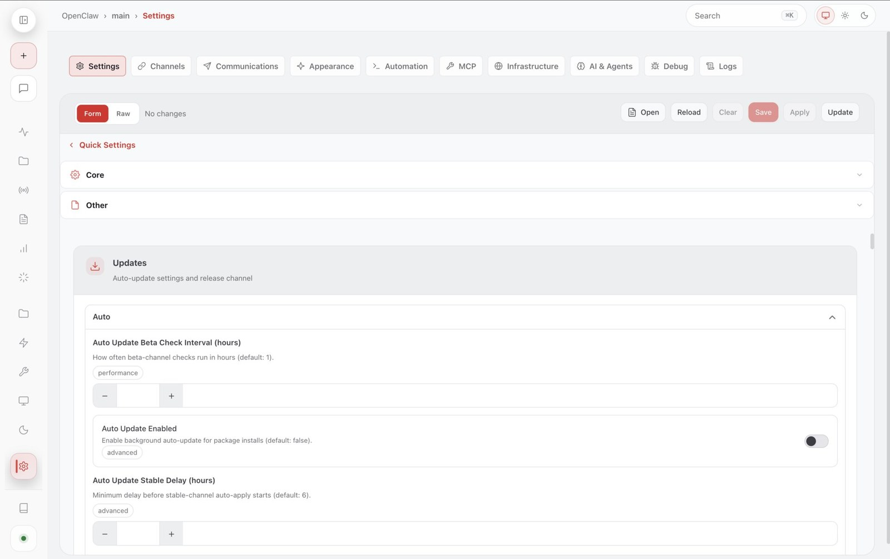
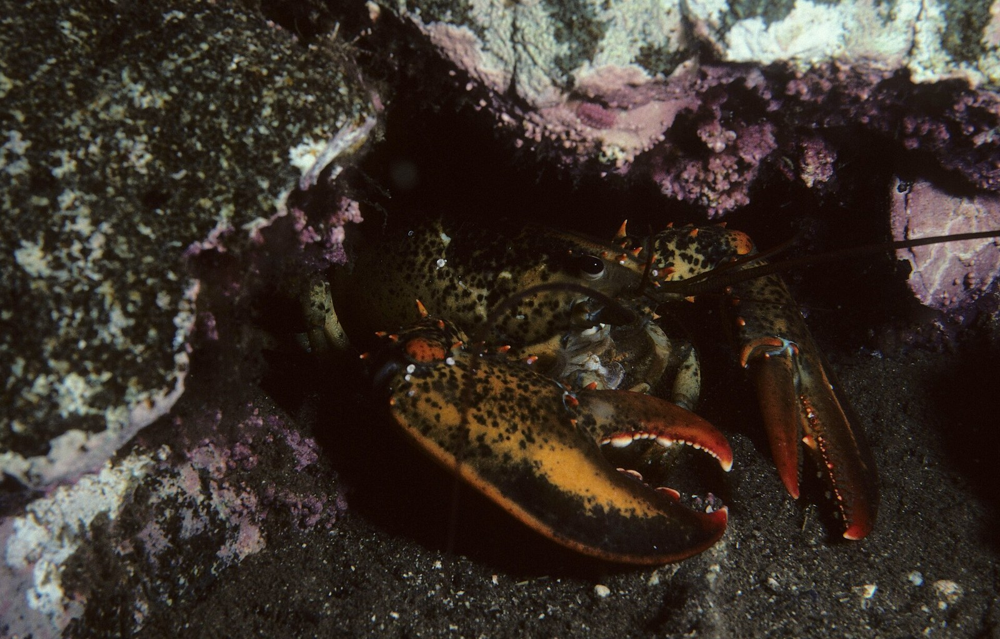
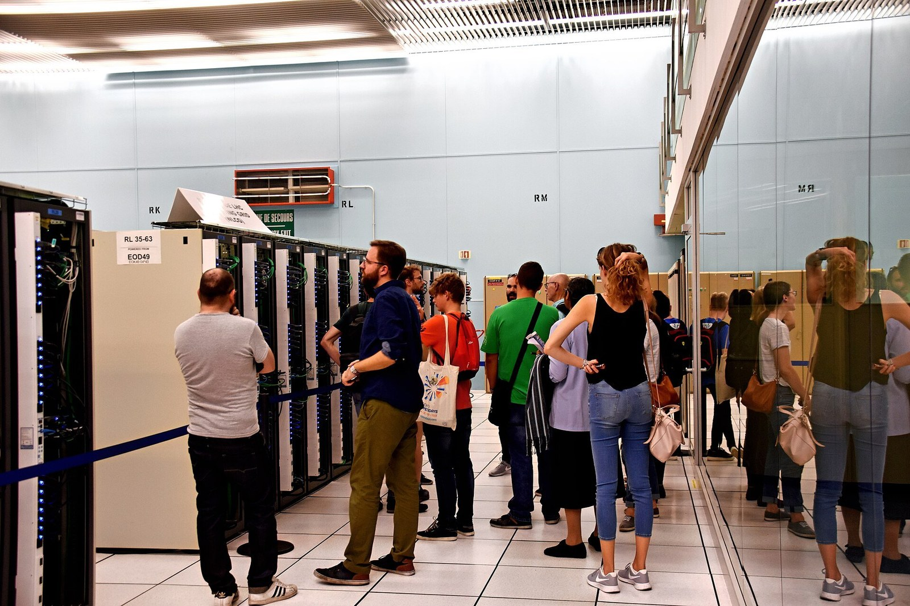

OpenClaw is one of the most talked-about open-source AI agents. An **AI agent** is a program that does not just answer questions but acts for you: it runs commands, reads messages, writes code and runs tasks on a schedule. OpenClaw runs as a **Gateway**, an always-on program on your own computer or server that connects chat apps such as Telegram or Slack to AI models ([OpenClaw docs](https://docs.openclaw.ai/)). Its code is MIT-licensed on GitHub ([repository](https://github.com/openclaw/openclaw)), and its X profile describes it as a 501(c)(3) nonprofit foundation ([@openclaw](https://x.com/openclaw)).

This article follows one rule: **what the release notes, code and project blog confirm is reported as confirmed; what we only found in posts on X is labelled as a claim.** We read the official account’s posts since mid-October, posts by maintainers, and searched X for users and critics. Then we checked the claims against GitHub releases, the changelog, the docs and the OpenClaw blog.

## The short version

- **Confirmed:** Six stable releases (v2026.10.10 and v2026.11.1 to v2026.11.5) appeared between 3 and 17 November. Headline features: a Chat Details panel, an experimental “Advisor”, split-speech voice and a relay that links ChatGPT or Claude to OpenClaw. Most later notes are repairs.
- **Confirmed by the project’s blog:** New AI models can appear without a new release, because a hosted model catalog is rebuilt every four hours.
- **Confirmed:** “Multiplayer”, one shared agent for a whole team, and “OpenClaw Enterprise”, a control layer for companies, are real, open-source projects. OpenAI says it runs several hundred OpenClaw agents internally.
- **Claim (self-reported):** A maintainer says the estimated value of test-server usage fell 95.5%.
- **Critics:** Users complain about broken updates and complexity, and security voices point at prompt injection. The project answers with public advisories and an independent audit.

## What the release notes confirm

OpenClaw numbers its versions by year and month, so v2026.11.5 means “November 2026, fifth build”. Here is what the official notes say, in order.

- **v2026.10.10 (3 November):** 3,028 pull requests, which are proposed code changes, from 454 contributors. New: a **Details** panel beside the chat; an experimental **Advisor** that reviews a running task and may suggest a correction, switched on under Settings → System → Labs, which the notes say uses extra model calls and “can miss a problem”; a **split speech** mode that uses separately configured services for transcription and speech output; the option to let an agent **work in a folder on another computer** you have connected; an optional **MCP Relay** that connects ChatGPT or Claude to your OpenClaw conversations without opening an internet-facing port; and **event-triggered automations** ([release notes](https://docs.openclaw.ai/releases/2026.10.10), [changelog](https://raw.githubusercontent.com/openclaw/openclaw/main/CHANGELOG/2026.10.10.md)). MCP, short for Model Context Protocol, is a common standard for connecting AI apps to tools and services. The relay plugin is off by default, and the notes warn that it “can read content passing through it”.
- **v2026.11.1 to v2026.11.3 (5 to 11 November):** fixes for crashed updates, lost Telegram and Discord replies, reminders that did not fire, duplicate chat widgets and credential handling ([v2026.11.1](https://github.com/openclaw/openclaw/releases/tag/v2026.11.1), [v2026.11.2](https://docs.openclaw.ai/releases/2026.11.2), [v2026.11.3](https://github.com/openclaw/openclaw/releases/tag/v2026.11.3)). The first also changed how Gemini Flash models connect and supports saved Claude subscription accounts.
- **v2026.11.4 (16 November):** 125 pull requests, 90 contributors. It stops buffered Signal messages from being skipped after a reconnect, adds a **delegated change approval** setting, and lets **policy plugins inspect images** before they reach a model ([changelog](https://raw.githubusercontent.com/openclaw/openclaw/main/CHANGELOG/2026.11.4.md)).
- **v2026.11.5 (stable on 17 November):** restart-safe conversations (queued messages survive a Gateway restart), automatic rollback if an update breaks startup, **interactive Telegram widgets**, faster memory recovery, steadier fallback between models, and “personal” and “corporate” security presets ([release v2026.11.5](https://github.com/openclaw/openclaw/releases/tag/v2026.11.5)). It also contains a **breaking change** for developers of third-party plugins and harnesses, the layers that run an agent’s work.

*Screenshot: OpenClaw, “OpenClaw Screenshot” (8 June 2026), [MIT License](https://opensource.org/license/mit), via [Wikimedia Commons](https://commons.wikimedia.org/wiki/File:OpenClaw_Screenshot.png). Converted to JPEG and scaled to 1,920 px width, otherwise unchanged. It shows the Settings page of the Control UI as of June 2026, not the newer Details panel or Advisor.*

## New models without a new release

The loudest stream on X is the “now available in OpenClaw” series from the official account. Its posts, all claims by the project itself, include:

- **Particle-1** on 3 November ([post](https://x.com/openclaw/status/2117637498902077498)) and **Tencent Hy4** on 4 November ([post](https://x.com/openclaw/status/2118034317024923652)).
- **Claude Fable 5.2** on 11 November. Anthropic “reports up to 30% faster output generation” than Fable 5.1 ([post](https://x.com/openclaw/status/2120550160128467398)).
- **Gemini 4 Hydrogen** on 13 November: “Gemini 4 Hydrogen is out and you can already use it in OpenClaw!” ([post](https://x.com/openclaw/status/2121098531205501401)).
- **Tencent Hy4 Flash** on 17 November, with Tencent’s own figures of 70% shorter average task time “at roughly 1/15 the cost” in its WorkBuddy tests ([post](https://x.com/openclaw/status/2122485133597114682)).
- **GPT-6.2 Astra and Sol** on 17 November: “Running v2026.10.1 or newer? No OpenClaw update needed.” ([post](https://x.com/openclaw/status/2122778563829174468)). A second post says “Sign in with ChatGPT is out of beta”, so a ChatGPT plan, including ChatGPT Business, can power OpenClaw ([post](https://x.com/openclaw/status/2122809472271958517)).

The claim “no update needed” is backed by a blog post from 6 November. Maintainer Ayaan Zaidi explains that, when OpenAI shipped GPT-6.1 Sol, ChatGPT sign-in users could not select it, because OpenClaw bundled an older Codex version than ChatGPT required. Over about five weeks and roughly 80 pull requests the team rebuilt model discovery. A hosted catalog at catalog.openclaw.ai, rebuilt every four hours and listing about 1,000 models, now feeds running Gateways. Your own provider account can also list models directly. The post even describes a first fix that was shipped and then reverted because models appeared in the picker but failed on the first message ([blog](https://openclaw.ai/blog/use-new-models-in-openclaw-without-an-update)).

The individual model claims are corroborated only in mechanism, not by testing; we did not run these models in OpenClaw.

*Photo: Derek Keats, “American lobster, Homarus americanus in Newfoundland, Canada” (6 September 2015), [CC BY 2.0](https://creativecommons.org/licenses/by/2.0/), via [Wikimedia Commons](https://commons.wikimedia.org/wiki/File:American_lobster,_Homarus_americanus_in_Newfoundland,_Canada_(21184223265).jpg). Scaled to 1,920 px width, otherwise unchanged. A lobster is the project’s mascot (its posts end in the 🦞 emoji); the animal in the picture has no connection with the software.*

## One shared agent for teams, and OpenAI’s own use

**Multiplayer** is the feature most users on X mention. The project blog (5 November) describes two laptops connected to the same agent: one person types a request, the second sees it appear live, and a shared queue shows when the agent is busy. The Foundation says about 50 people already collaborate this way, and calls the feature free and open source ([blog](https://openclaw.ai/blog/shattering-silos-with-openclaw-multiplayer), [post](https://x.com/openclaw/status/2118404891911864536)).

Reactions differ. Jacob Tomlinson, who says in his bio that he builds open-source software at NVIDIA, wrote on 6 November: “I now spend a huge chunk of my time working in OpenClaw multiplayer mode, and it has seriously changed the way that I want to work” ([post](https://x.com/_JacobTomlinson/status/2118647364550369663)). A user named Luis Marques reported on 7 November: “I’m using OpenClaw Enterprise with a team of accountants, and so far it has been very useful” ([post](https://x.com/Luis_MMF/status/2118857506310987936)). A sceptical developer, Eric (@ericjung), asked on 14 November: “openclaw uses a central gateway. isn’t it more friction/redundant to have different local agents trying to collaborate?” ([post](https://x.com/ericjung/status/2121693339007525275)).

**OpenClaw Enterprise** is the version for companies. The project describes it as open source, vendor-neutral and still before version 1.0, but “ready for pilots”. It separates trusted parts (access roles, audit logs, enforced policy) from untrusted ones, the agent and its tools ([thread](https://x.com/openclaw/status/2113756870313951480)). On 13 November, Peter Steinberger posted “My team wrote about how we run persistent agents inside OpenAI” ([post](https://x.com/steipete/status/2121058770767982997)). The OpenAI article says the company runs “hundreds” of OpenClaw agents and later “over 500”, keeps the Gateway apart from the agent in a separate container, blocks the most dangerous sandbox mode and uses a second model to review actions ([OpenAI blog](https://developers.openai.com/blog/securing-persistent-agents-like-openclaw-at-openai)). Note the closeness: Steinberger and Kevin Lin, who wrote the Enterprise announcement, both list OpenAI in their X bios, so this is not an independent assessment.

*Photo: SimonWaldherr, “CERN Computer Center 09” (15 September 2019), [CC BY-SA 4.0](https://creativecommons.org/licenses/by-sa/4.0/), via [Wikimedia Commons](https://commons.wikimedia.org/wiki/File:CERN_Computer_Center_09.jpg). Scaled to 1,920 px width, otherwise unchanged. This is a data centre at CERN, shown only to illustrate rented computing capacity; it is not OpenClaw’s infrastructure.*

## Behind the scenes: a cheaper test bill and a trip to Shenzhen

On 16 November, Chief Architect Vincent Koc published an essay on cutting the cost of **CI**, the automatic tests that run on every code change. The official account said OpenClaw “was spending a claw and a tail on CI” until Koc dug in ([post](https://x.com/openclaw/status/2122451216093573217)). His figures: weekly runner time fell from 158,546 hours (17 to 23 September) to 21,395 hours (6 to 13 November), which is 86.5% less, and the estimated value of the sponsored computing fell 95.5%, from about 1.27 million US dollars to about 57,000 US dollars per 30 days at published prices ([essay](https://vincent.build/openclaw-ci-cost-reduction/)). He is open about the caveats: Blacksmith sponsors the capacity, so the project did not pay those amounts, and the workload changed between the weeks. On X he added: “More than 60% of our code is tests, AI generates more and more tests and its counter-productive” ([post](https://x.com/vincent_koc/status/2122464647924297996)). These numbers are self-reported; we could not audit them.

Next up is **ClawCon Shenzhen**, 4 to 6 December 2026, with a hackathon first. The blog lists a software track and a hardware track with development boards and a robot arm, speakers including a Tencent open-source director, and a 25 November application deadline ([blog post](https://openclaw.ai/blog/openclaw-shenzhen-claw-hack-2026)). On X, Koc showed “Tiny Shenzhen”, a model of the city in a browser, and said he is building open-source components “for @clawcon in SZ” ([post](https://x.com/vincent_koc/status/2122537100667174953)). He also announced “a computer use for iphones very soon on MIT licence” ([post](https://x.com/vincent_koc/status/2121869633531842615)). That last one is **only a claim on X**: we found no release, code or documentation for it.

*Photo: Mx. Granger, “华强电子世界 1” (3 September 2018), [CC0 1.0](https://creativecommons.org/publicdomain/zero/1.0/), via [Wikimedia Commons](https://commons.wikimedia.org/wiki/File:%E5%8D%8E%E5%BC%BA%E7%94%B5%E5%AD%90%E4%B8%96%E7%95%8C_1.jpg). Scaled to 1,920 px width, otherwise unchanged. It shows the Huaqiang Electronics World market in Shenzhen’s Huaqiangbei district in 2018, not the conference venue.*

## Security: advisories, an audit and the warnings

Security is where critics aim. An agent with access to your files, messages and browser is a target for **prompt injection**: hidden instructions in an email or web page that trick the AI into acting. A security vendor, NeuralTrust, posted on 12 November: “On GitHub, OpenClaw has 659+ security advisories. Hermes Agent has none.” It added that this “doesn’t make Hermes safe” ([post](https://x.com/NeuralTrustAI/status/2120814255641620706)). NeuralTrust sells agent security, so it has a commercial interest. We queried GitHub’s public API on 17 November and counted **722 published advisories** for the OpenClaw repository (14 critical, 249 high, 390 medium, 69 low), the newest dated 11 September. An advisory is a published report of a flaw and its fix; a high count shows that issues are being found and disclosed, not how many are still open. We cannot compare it with Hermes.

The project’s own evidence: a Trail of Bits audit through OpenAI’s “Patch the Planet” programme, reported on 21 September. It produced 27 private advisories and 3 hardening changes, 24 severity-rated flaws (0 critical, 2 high, 16 medium, 6 low), and the project says every actionable issue was fixed. The most common problem was permissions getting lost between steps ([blog](https://openclaw.ai/blog/openclaw-trail-of-bits-engagement-recap)). A 2 October post says Tencent’s AIG team joined “ClawScan”, security review of skills uploaded to the ClawHub store ([blog index](https://openclaw.ai/blog)).

New defences are in the latest notes: approval for delegated persistent changes, image checks by policy plugins, blocking of page-initiated navigation to policy-blocked addresses, and keeping authenticated browser addresses out of tool results ([v2026.11.4 changelog](https://raw.githubusercontent.com/openclaw/openclaw/main/CHANGELOG/2026.11.4.md), [v2026.11.5](https://github.com/openclaw/openclaw/releases/tag/v2026.11.5)).

Critical voices remain. Developer Arnav Gupta wrote on 3 November: “Prompt injection and marketing is a blurry line if you have given your inbox to agents” and was doubtful about “a vibe coded openclaw” ([post](https://x.com/championswimmer/status/2117675829266419928)). Emmanuel Belo asked the maintainers on 7 November for a guide on securing agents “against prompt injection, malicious files and worm-like propagation” ([post](https://x.com/emmanuel_belo/status/2119132243956252781)). Another user judged Hermes better on security than OpenClaw but still not fully trustworthy ([post](https://x.com/JoelDeTeves/status/2119231150896148954)). Steinberger himself warned on 12 November that marketers pay for praise of new agents, so “keep a lookout on honest reviews” ([post](https://x.com/steipete/status/2121009372470067544)).

*Photo: Nxr-at, “15mm Boss Padlocks Vorhangschloss” (31 May 2017), [CC BY-SA 4.0](https://creativecommons.org/licenses/by-sa/4.0/), via [Wikimedia Commons](https://commons.wikimedia.org/wiki/File:15mm_Boss_Padlocks_Vorhangschloss.JPG). Scaled to 1,920 px width, otherwise unchanged. A symbolic image of a physical padlock; it is not related to OpenClaw’s software.*

## What users and critics say on X

Many posts that mention OpenClaw promote add-on or competing products, so we did not treat them as evidence of features. Genuine users are split.

**Supportive:**
- “I tried open claw, switched to Hermes, and came back to open claw. Hermes felt like a robot. OpenClaw feels more human” (@jtaby, 17 November, [post](https://x.com/jtaby/status/2122481213160165600)). Hermes Agent is a competing open-source agent from Nous Research.
- Mike Gannotti, whose bio lists a Principal AI role at Microsoft and says the opinions are his own, singled out the scheduled-job fixes in v2026.11.5: a late wake-up “could just eat a run. no record, no error” ([post](https://x.com/MichaelGannotti/status/2122662355297505639)). That matches the release notes’ cron entries, so we count it as corroborated.

**Balanced:** “I love how autonomous Openclaw is, but I find Openclaw more likely to take off down a road I don’t want them to go down than Hermes does” (@GodinPatri43620, 15 November, [post](https://x.com/GodinPatri43620/status/2122003866199765497)).

**Critical:**
- Conor O’Neill wrote on 14 November: “Every OpenClaw update has been a disaster for months. Never just works.” He also described a bug that had created 20,000+ directories and 870,000+ files ([post](https://x.com/conoro/status/2121538039092597155)).
- “Too complicated, just like OpenClaw. I installed it, then dragged it straight to the Trash” (@smoothdvd, 13 November, [post](https://x.com/smoothdvd/status/2121074237666632149)).
- One user claimed that “no one even uses openclaw anymore” ([post](https://x.com/capsraunak/status/2121882704128119265)). GitHub shows about 395,000 stars and 83,000 forks, but stars are not users, and we found no reliable usage figure.

The project’s account answered a critic on 15 November: “We don’t sell tokens or give out credits or free models. We’re not a business” ([post](https://x.com/openclaw/status/2121853719356878943)). The release notes themselves are dominated by repairs, which supports critics’ point about stability as well as maintainers’ point about fast fixing.

## FAQ

**What is OpenClaw?** A free, MIT-licensed AI agent that runs on your own machine and connects chat apps to AI models. It does not include its own model.

**Do I need to update to use a new model?** According to the official posts, not always: GPT-6.2 works on v2026.10.1 or newer, and the hosted catalog is meant to add models between releases. Check the docs for your provider.

**Is OpenClaw safe to use?** No agent with broad access is risk-free. The project publishes advisories, had an external audit and keeps adding approval rules, but prompt injection remains an industry-wide problem. Use a sandbox, limit permissions and update.

## What we could not verify

- **Model availability on launch day.** We did not test GPT-6.2, Gemini 4 Hydrogen, Claude Fable 5.2 or Hy4 Flash inside OpenClaw. The notes do not list them, so this rests on official posts and the catalog mechanism.
- **Vendor figures.** Anthropic’s “up to 30% faster” and Tencent’s “70% … 1/15 the cost” are company claims.
- **Vincent Koc’s iPhone computer-use package** and its “2.1 ms” typing speed appear only in X posts.
- **CI savings and “about 50 people” using Multiplayer.** Both are self-reported by maintainers; the workload also changed.
- **Advisory counts.** Our 722 comes from GitHub’s API on 17 November and may differ from NeuralTrust’s 659+. We cannot confirm Hermes has none or how many OpenClaw issues remain open.
- **A study that tested OpenClaw against the OWASP Agentic Top 10.** It is only summarised in a low-reach X post ([post](https://x.com/eforus_overseer/status/2122695031840755894)); we found no paper.
- **Active users.** No reliable number exists in the sources we saw.
- **Completeness.** X search is not exhaustive, post counts change, and some accounts may be deleted later.

## Image credits and sources

**Images:** all pictures are free licences from Wikimedia Commons, with credits in the captions above: LogicFlow99 (CC0), OpenClaw (MIT), Derek Keats (CC BY 2.0), SimonWaldherr (CC BY-SA 4.0), Mx. Granger (CC0), Nxr-at (CC BY-SA 4.0). Some images are scaled; none are altered otherwise.

**Primary sources**
- [OpenClaw on GitHub (MIT licence, releases)](https://github.com/openclaw/openclaw/releases)
- [OpenClaw docs: release notes](https://docs.openclaw.ai/releases/)
- [v2026.10.10 changelog](https://raw.githubusercontent.com/openclaw/openclaw/main/CHANGELOG/2026.10.10.md)
- [v2026.11.4 changelog](https://raw.githubusercontent.com/openclaw/openclaw/main/CHANGELOG/2026.11.4.md)
- [Release v2026.11.5](https://github.com/openclaw/openclaw/releases/tag/v2026.11.5)
- [OpenClaw blog](https://openclaw.ai/blog)
- [Use new models without an update (6 Nov)](https://openclaw.ai/blog/use-new-models-in-openclaw-without-an-update)
- [Shattering silos with Multiplayer (5 Nov)](https://openclaw.ai/blog/shattering-silos-with-openclaw-multiplayer)
- [Trail of Bits audit recap (21 Sep)](https://openclaw.ai/blog/openclaw-trail-of-bits-engagement-recap)
- [OpenClaw is coming to Shenzhen (13 Nov)](https://openclaw.ai/blog/openclaw-shenzhen-claw-hack-2026)
- [Vincent Koc: Making OpenClaw CI faster and 95% cheaper](https://vincent.build/openclaw-ci-cost-reduction/)
- [OpenAI: Securing persistent agents like OpenClaw at OpenAI](https://developers.openai.com/blog/securing-persistent-agents-like-openclaw-at-openai)
- [GitHub security advisories API (OpenClaw)](https://api.github.com/repos/openclaw/openclaw/security-advisories)

**Posts on X** (quoted as written, posted 2 to 17 November 2026)
- [@openclaw](https://x.com/openclaw), [@steipete](https://x.com/steipete), [@vincent_koc](https://x.com/vincent_koc), [@_JacobTomlinson](https://x.com/_JacobTomlinson/status/2118647364550369663), [@Luis_MMF](https://x.com/Luis_MMF/status/2118857506310987936), [@ericjung](https://x.com/ericjung/status/2121693339007525275), [@NeuralTrustAI](https://x.com/NeuralTrustAI/status/2120814255641620706), [@championswimmer](https://x.com/championswimmer/status/2117675829266419928), [@emmanuel_belo](https://x.com/emmanuel_belo/status/2119132243956252781), [@JoelDeTeves](https://x.com/JoelDeTeves/status/2119231150896148954), [@jtaby](https://x.com/jtaby/status/2122481213160165600), [@MichaelGannotti](https://x.com/MichaelGannotti/status/2122662355297505639), [@GodinPatri43620](https://x.com/GodinPatri43620/status/2122003866199765497), [@PriorReason](https://x.com/PriorReason/status/2119244079297138762), [@conoro](https://x.com/conoro/status/2121538039092597155), [@smoothdvd](https://x.com/smoothdvd/status/2121074237666632149), [@capsraunak](https://x.com/capsraunak/status/2121882704128119265)
