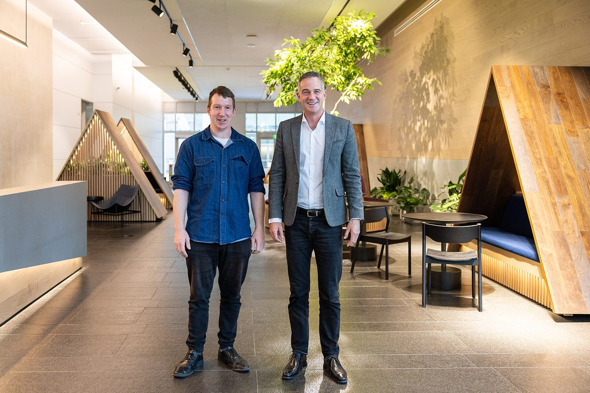

Anthropic, the company behind the **Claude** AI models, is now a listed company. On **Thursday, 19 November 2026**, its shares started trading on the Nasdaq under the ticker **ANT**, one day after the company priced what is now the **largest initial public offering (IPO) on record**.

The day had two stories. The share itself had a strong start and closed well above its offer price. The wider market, and especially other AI stocks, had a bad day. This article sums up what happened, based on Anthropic's own announcement, Nasdaq, and reporting by CNBC, AP, Reuters and Yahoo Finance. It follows our [explainer from 16 November](https://thearchitecthighlevel.com/2026/11/16/anthropic-ipo-explained-ant-nasdaq/), written before the pricing.

## The short version

- **Price (fact):** $83 per share, above the planned range of $70 to $78 ([Anthropic](https://www.anthropic.com/news/anthropic-prices-initial-public-offering)).
- **Size (fact):** 980 million shares, upsized from 825 million; about **$81.3 billion** raised, more than SpaceX's IPO in June ([CNBC](https://www.cnbc.com/2026/11/18/anthropic-ipo-ai-offering-price.html)).
- **First trade (fact):** **$111.50**, about 34% above the offer price ([Nasdaq](https://www.nasdaq.com/newsroom/anthropic-marks-ipo-at-nasdaq)).
- **Close (fact):** **$97.17**, up 17.1% on the offer price but about 13% below the first trade. The day's range was $92.72 to $115.10, on roughly 852 million shares traded ([Yahoo Finance](https://finance.yahoo.com/quote/ANT/history/)).
- **Market (fact):** the Nasdaq Composite fell 2.25%, the S&P 500 2.02% and the Dow about 1,100 points ([CNBC](https://www.cnbc.com/2026/11/18/stock-market-today-live-updates.html)).
- **Interpretation (reported view, not fact):** many traders appear to have used the long-awaited debut to sell other AI holdings, a classic "sell the news" move.

## Key terms in plain English

**Offer price:** the price at which the banks sold the new shares to investors before trading began. Here: $83.

**First trade / opening price:** the first price at which the share changed hands on the exchange. For big IPOs this can take hours, because the exchange has to match a flood of buy and sell orders first.

**"Pop":** the gain between the offer price and the first trade. A big pop is good news for investors who got shares in the IPO, but it also means the company could have sold its shares for more.

**Greenshoe (over-allotment option):** the right of the underwriting banks to sell extra shares, here up to **147 million** more within 30 days, mainly to help steady the price after the listing ([Anthropic](https://www.anthropic.com/news/anthropic-prices-initial-public-offering)).

**Fully diluted valuation:** the company's value counting not only the shares already issued but also options, restricted stock and convertible securities. This is why different outlets quote different "market values" for the same share price.

## From pricing to the opening bell

On **18 November** Anthropic announced the final terms. Of the 980 million Class A shares, about 956 million were sold by the company itself and about 23.6 million by existing shareholders, so the company does not receive money for that smaller part ([Anthropic](https://www.anthropic.com/news/anthropic-prices-initial-public-offering)). According to CNBC, citing the prospectus, each of the seven co-founders sold 3.38 million shares ([CNBC](https://www.cnbc.com/2026/11/18/anthropic-ipo-ai-offering-price.html)). The deal is expected to formally close on **20 November**.

At the offer price, AP and Yahoo Finance put Anthropic's valuation at about **$1.5 trillion** ([AP](https://apnews.com/article/anthropic-ipo-nasdaq-ai-b6a74b8949021207dc162fcc876c4649), [Yahoo Finance](https://finance.yahoo.com/technology/live/anthropic-ipo-live-anthropic-stock-begins-trading-in-record-81b-raise-with-15t-valuation-192410598.html)). For comparison, its private funding round in May valued it at $965 billion, as noted in our earlier post.

On Thursday morning, co-founders **Dario Amodei** (CEO) and **Daniela Amodei** (President) rang the opening bell at the Nasdaq MarketSite in New York; CFO Krishna Rao and Chief Commercial Officer Paul Smith rang the closing bell ([Nasdaq](https://www.nasdaq.com/newsroom/anthropic-marks-ipo-at-nasdaq)).

*Photo: Department for Science, Innovation and Technology (UK), “Secretary of State Peter Kyle visits Anthropic in San Francisco” (25 October 2024), [CC BY 2.0](https://creativecommons.org/licenses/by/2.0/), via [Wikimedia Commons](https://commons.wikimedia.org/wiki/File:Secretary_of_State_Peter_Kyle_visits_Anthropic_in_San_Francisco._(54098999333).jpg). Scaled to 1,920 px width, otherwise unchanged. Taken during a UK government visit to Anthropic's San Francisco office two years before the IPO; it does not show the listing.*

## How ANT traded on day one

The first trade came only around midday New York time: Yahoo Finance reports trading began just after 11:30 a.m. ET, CNBC says shortly before noon. The opening price of **$111.50** was a gain of about 34% on the offer price ([CNBC](https://www.cnbc.com/2026/11/18/stock-market-today-live-updates.html)).

From there the share drifted lower for most of the afternoon. It reached a high of **$115.10** and a low of **$92.72** and closed at **$97.17**. In after-hours trading the price slipped further to about $92.60, around 4.7% below the close ([Yahoo Finance](https://finance.yahoo.com/quote/ANT/history/)). After-hours prices are based on thin trading and are not a reliable signal on their own.

**What was Anthropic worth at the close?** It depends on the counting method. Yahoo Finance put the valuation at about **$1.27 trillion** at the close, while AP reported that the company was briefly worth **more than $2 trillion** during the day ([Yahoo Finance](https://finance.yahoo.com/technology/live/anthropic-ipo-live-anthropic-stock-begins-trading-in-record-81b-raise-with-15t-valuation-192410598.html), [AP](https://apnews.com/article/anthropic-ipo-nasdaq-ai-b6a74b8949021207dc162fcc876c4649)). The gap reflects different share counts (basic versus fully diluted) and different moments of the day, so treat any single "market cap" headline with care.

## The market reaction: a strong debut, a weak day for AI stocks

The wider market did not share the enthusiasm. According to CNBC, stocks hit their lows of the session at the very moment ANT began trading, after the Nasdaq had been up as much as 2% in the morning ([CNBC](https://www.cnbc.com/2026/11/18/stock-market-today-live-updates.html)):

| Index or stock | Move on 19 November | Note |
| --- | --- | --- |
| Nasdaq Composite | −2.25% (23,879.20) | was up as much as 2% earlier |
| S&P 500 | −2.02% (7,175.83) | |
| Dow Jones | −1,101 points (−2.19%) | first close below 50,000 since June |
| Nvidia | lower | gave up morning gains |
| AMD | nearly −8% | after a short seller published allegations |
| Micron | lower | gave up morning gains |
| VIX ("fear gauge") | intraday high near 29 | highest since March |

*Sources: [CNBC market report](https://www.cnbc.com/2026/11/18/stock-market-today-live-updates.html), [CNBC on AI stocks](https://www.cnbc.com/2026/11/19/anthropic-ipo-ai-stocks-selloff.html), [Reuters via Investing.com](https://www.investing.com/news/stock-market-news/wall-street-ends-sharply-lower-asanthropics-debut-fails-to-revive-ai-fervor-5040108). Index figures as reported by CNBC; AMD move rounded.*

AP described it as Wall Street's **longest losing streak since 2024** ([AP](https://apnews.com/article/stocks-markets-ai-us-anthropic-206c84045137824feabe052a29ff6140)). The AMD drop has its own cause: CNBC reports that the short seller Hunterbrook Capital disclosed a position against the company, pointing to alleged breaches of US export controls involving China. These are **allegations**, not established findings.

*Photo: ehnmark, “Market centre in Tokyo stock exchange” (1 October 2009), [CC BY 2.0](https://creativecommons.org/licenses/by/2.0/), via [Wikimedia Commons](https://commons.wikimedia.org/wiki/File:Market_centre_in_Tokyo_stock_exchange.jpg). Unchanged. A general symbol of share trading; it shows the Tokyo exchange, not the Nasdaq or the ANT listing.*

## Why the market fell on Anthropic's big day

Nobody can prove why millions of investors sold on a given day, so the following are **explanations offered by reporters and analysts**, not facts:

- **"Sell the news":** CNBC writes that investors appeared to take profits at the culmination of a much-hyped moment for the AI trade. Some may also have sold other AI shares to make room for ANT in their portfolios.
- **Growing doubts about AI spending:** according to CNBC, investors are increasingly asking whether the huge investment in data centres and chips will turn into profits. An AI-focused ETF had fallen almost 14% in November, and Nvidia about 28% this month amid the departure of CEO Jensen Huang.
- **Credit worries:** CNBC notes that bonds of the cloud provider CoreWeave had traded at yields above 16% earlier in November, a sign that lenders see more risk in parts of the AI build-out.

## What to watch next

- **Volatility:** some wealth managers quoted by CNBC expect choppy trading in the coming weeks. A first day says little about where a share stands after months.
- **The greenshoe:** whether the banks use the option for up to 147 million extra shares within 30 days.
- **Lock-up expiry:** insiders and early investors are usually barred from selling for a period after an IPO; check the prospectus on [SEC EDGAR](https://www.sec.gov/edgar/search/#/q=Anthropic) for the exact terms. When such periods end, extra supply can weigh on a share.
- **First quarterly report as a public company:** the first hard test of whether revenue growth justifies a valuation in the trillions.
- **Competition:** as our earlier post noted, investors want to know whether Claude can keep its lead and grow beyond coding.

## Facts versus predictions

**Facts (from Anthropic, Nasdaq and market data):** offer price $83; 980 million shares; about $81.3 billion raised; first trade $111.50; close $97.17; day range $92.72 to $115.10; index declines as listed above.

**Reported, attributed to media:** valuation figures ($1.5 trillion at the offer price, about $1.27 trillion at the close, briefly above $2 trillion), the "sell the news" interpretation, and the context on AI stocks and CoreWeave.

**Allegations:** the export-control claims against AMD by a short seller.

**Predictions:** anything about future volatility, the greenshoe or lock-up effects. They may or may not happen.

This article is for information only and is not investment advice.

## Sources

- Anthropic: [Anthropic prices initial public offering](https://www.anthropic.com/news/anthropic-prices-initial-public-offering) (18 November 2026)
- Nasdaq: [Anthropic marks its IPO at Nasdaq](https://www.nasdaq.com/newsroom/anthropic-marks-ipo-at-nasdaq) (19 November 2026)
- CNBC: [Anthropic IPO raises over $81 billion in largest offering on record](https://www.cnbc.com/2026/11/18/anthropic-ipo-ai-offering-price.html)
- CNBC: [Stock market news for 19 November 2026](https://www.cnbc.com/2026/11/18/stock-market-today-live-updates.html)
- CNBC: [Anthropic IPO fails to lift AI stocks](https://www.cnbc.com/2026/11/19/anthropic-ipo-ai-stocks-selloff.html)
- AP: [Anthropic surges in market debut after biggest IPO on record](https://apnews.com/article/anthropic-ipo-nasdaq-ai-b6a74b8949021207dc162fcc876c4649)
- AP: [Wall Street tumbles to its longest losing streak since 2024](https://apnews.com/article/stocks-markets-ai-us-anthropic-206c84045137824feabe052a29ff6140)
- Reuters via Investing.com: [Wall Street ends sharply lower as Anthropic's debut fails to revive AI fervor](https://www.investing.com/news/stock-market-news/wall-street-ends-sharply-lower-asanthropics-debut-fails-to-revive-ai-fervor-5040108)
- Yahoo Finance: [ANT historical prices](https://finance.yahoo.com/quote/ANT/history/) and [live coverage of the debut](https://finance.yahoo.com/technology/live/anthropic-ipo-live-anthropic-stock-begins-trading-in-record-81b-raise-with-15t-valuation-192410598.html)
