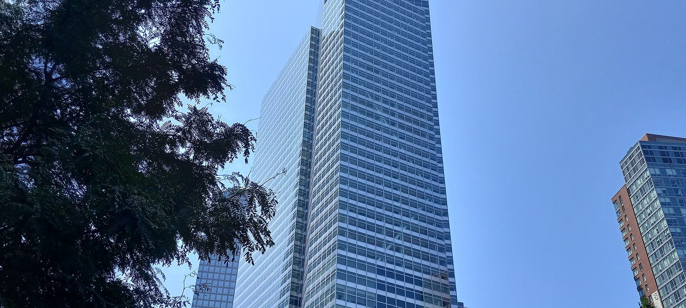
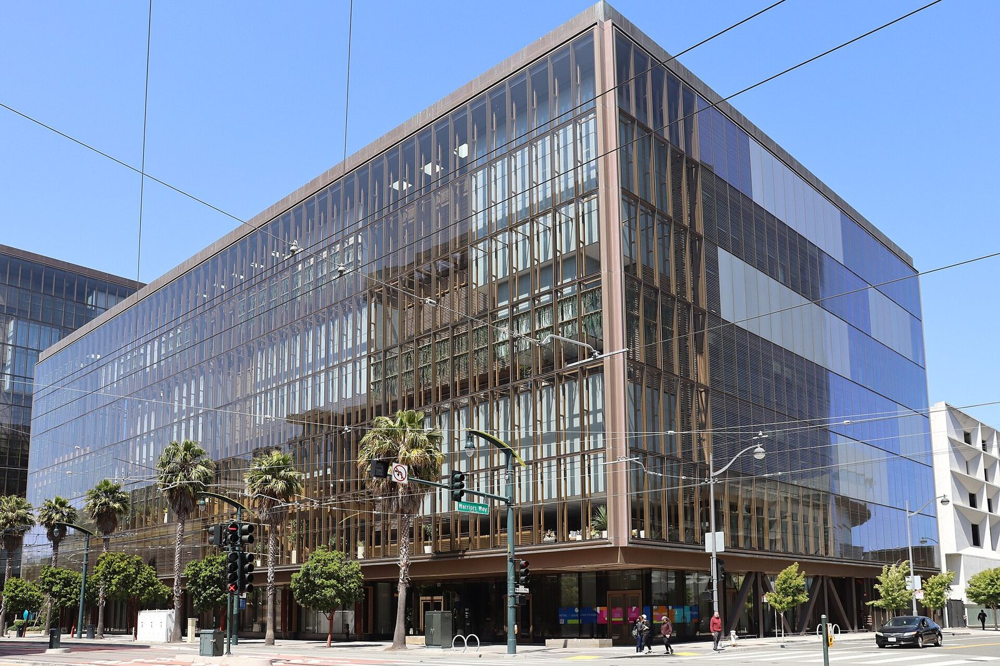

Two days, two very different moods. On Thursday, **Anthropic** (Nasdaq: **ANT**), the maker of the **Claude** AI models, closed its first trading day 17% above its offer price. On **Friday, 20 November 2026**, the share gave back much of that gain and briefly came within a few cents of the **$83** IPO price.

This article covers the second trading day, the "greenshoe" the banks used on Friday, the lock-up rules in the prospectus, the quiet period before bank analysts may publish, and what the listing means for OpenAI and other AI labs. For the background, see our [IPO explainer from 16 November](https://thearchitecthighlevel.com/2026/11/16/anthropic-ipo-explained-ant-nasdaq/) and our [recap of the first trading day](https://thearchitecthighlevel.com/2026/11/20/anthropic-first-trading-day-ant-market-reaction/).

## The short version

- **Friday close (fact):** **$88.91**, down **8.5%** from Thursday's close of $97.17 and about 7% above the $83 offer price. Open $89.86, range $83.05 to $92.56, about 400 million shares traded ([Yahoo Finance](https://finance.yahoo.com/quote/ANT/history/), [Reuters via Investing.com](https://www.investing.com/news/economy-news/anthropics-postdebut-stumble-delivers-reality-check-for-ai-trade-5041125)).
- **Low point (fact):** at $83.05 the share traded just 5 cents above its IPO price ([Fortune](https://www.fortune.com/2026/11/20/anthropic-stock-teeters-close-to-ipo-price-in-second-day-of-trading/)).
- **Greenshoe (fact):** the underwriters bought the full **147 million** extra shares from Anthropic at $83. The IPO thus sold **1.127 billion** shares for about **$93.5 billion** gross ([Anthropic](https://www.anthropic.com/news/ipo-close)).
- **Lock-up (fact, from the prospectus):** about **15.5 billion** shares are covered by lock-up or market-standoff agreements for **up to 180 days**, or **up to 365 days** for the co-founders and large holders, with staged early releases ([prospectus](https://ipo.anthropic.com/documents/us/prospectus.pdf)).
- **Analyst coverage (expectation, not fact):** market calendars expect the underwriting banks to start research on **14 December 2026**; no bank has confirmed a date ([Huli Calendar](https://hulicalendar.com/catalyst/ant-quiet-period-end-2026-12)).
- **OpenAI (opinion):** IPO experts quoted by CNBC say the cool reception suggests it was wise for OpenAI to wait until 2027.

## Key terms in plain English

**Greenshoe (over-allotment option):** banks usually sell up to 15% more shares than the official deal size. If the share falls, they cover that extra position by buying on the market, which supports the price. If the share rises, they buy the extra shares from the company at the offer price instead.

**Stabilisation agent:** the bank responsible for this support. For Anthropic it is **Morgan Stanley**.

**Lock-up:** a contract in which insiders and early investors promise not to sell their shares for a set period after the IPO. When it ends, many more shares can come onto the market.

**Market standoff:** a similar selling ban, but agreed with the company rather than with the banks.

**Quiet period:** the time after an IPO during which the banks that sold the shares do not publish research on the company.

## How ANT traded on day two

The fall started before the bell. CNBC reported the share down more than 6% in premarket trading at one point, later 12%, during a broad sell-off in technology shares ([CNBC Morning Squawk](https://www.cnbc.com/2026/11/20/tech-wreck-drags-anthropic-into-the-red-on-its-second-day-of-trading.html), [CNBC](https://www.cnbc.com/2026/11/20/anthropic-ipo-greenshoe.html)).

| | Price | vs. $83 offer |
| --- | --- | --- |
| Day 1 open (19 Nov) | $111.50 | +34% |
| Day 1 high | $115.10 | +39% |
| Day 1 close | $97.17 | +17% |
| Day 2 open (20 Nov) | $89.86 | +8% |
| Day 2 low | $83.05 | +0.1% |
| Day 2 close | $88.91 | +7% |

*Source: [Yahoo Finance ANT history](https://finance.yahoo.com/quote/ANT/history/). Percentages rounded.*

After hours on Friday, Yahoo Finance showed a further slip to about $87.79. As in our first recap: after-hours prices rest on thin trading and say little on their own. Volume fell from about 857 million shares on Thursday to about 400 million on Friday.

The drop came on a bad day for AI stocks in general. According to Reuters, **Nvidia fell about 14%**, Meta nearly 6%, Amazon about 4% and Microsoft 3%; AMD lost about 13%, Marvell about 12% and Intel roughly 8% ([Reuters via Investing.com](https://www.investing.com/news/economy-news/anthropics-postdebut-stumble-delivers-reality-check-for-ai-trade-5041125)). We could not verify final index figures for Friday from a primary source in time, so they are left out here.

**Valuation:** Reuters put Anthropic's fully diluted value at about **$1.6 trillion** at the latest price and its market capitalisation, based on shares outstanding, at **$1.2 trillion**. Reuters also notes that the share trades at about **40 times** sales of the past 12 months.

## What analysts and media say

These are **opinions**, quoted as reported:

- **Robert Pavlik**, Dakota Wealth, to Reuters: "I don't think investors believe there's something inherently wrong with the company, management or business. I think they're just skeptical of this market."
- **Kaush Amin**, US Bank Asset Management, to Reuters: "We favor patience on Anthropic and recommend evaluating the company as it reports public results." He added that the valuation "assumes years of rapid growth."
- **Avery Marquez**, Renaissance Capital, on CNBC: the IPO has "heightened and highlighted" worries about AI valuations and whether there is a bubble ([CNBC](https://www.cnbc.com/2026/11/20/anthropic-ipo-ai-stock-market-selloff.html)).
- **Steve Grasso**, Grasso Global, on CNBC: "Be patient. I wouldn't buy it all at once."
- **A possible tailwind (estimate):** index analytics firm Intropic estimates that index-tracking funds could buy up to 30% of Anthropic's shares by year-end, Reuters reports. That is a projection, not a certainty.

Reuters also points out that **options trading** on ANT is due to start next week, which could add to the swings.

*Photo: Kidfly182, “200 West Street 001” (19 July 2024), [CC BY 4.0](https://creativecommons.org/licenses/by/4.0/), via [Wikimedia Commons](https://commons.wikimedia.org/wiki/File:200_West_Street_001.jpg). Scaled to 1,920 px width, otherwise unchanged. 200 West Street in New York is the headquarters of Goldman Sachs, one of the two lead banks on the Anthropic IPO. The photo was taken in 2024 and has no direct connection with the deal.*

## The greenshoe: used up after one day

On Friday Anthropic announced the **closing of its IPO**. The underwriters exercised their option in full and bought **147 million** extra shares from the company at $83. In total, **1,127,000,000** Class A shares were sold: about 1.103 billion by Anthropic and about 23.6 million by existing shareholders. Gross proceeds were about **$93.5 billion**, of which about **$91.6 billion** went to Anthropic ([Anthropic](https://www.anthropic.com/news/ipo-close)).

At the same time Anthropic closed a **private placement** of about 313 million Class N shares at $83 to AMD, Broadcom, Google, Micron, Microsoft, Nvidia and TSMC Partners, worth about **$26 billion**. Including that, gross proceeds were about **$119.5 billion**.

**Why it matters for the share:** banks have up to 30 days to exercise the greenshoe. Because Morgan Stanley exercised it straight away at the offer price, it can no longer cover the extra position by buying on the market if the price falls below $83, Reuters explains ([Reuters via Investing.com](https://www.investing.com/news/stock-market-news/anthropics-ipo-bank-closed-position-meant-to-stabilize-stock-removing-source-of-support-5042311)). Carsten Hesse of Berenberg called it positive for Anthropic but "less positive for investors, who are losing an important potential source of buying support." Morgan Stanley declined to comment to Reuters. Note: this does not stop the banks from buying shares in general; it only removes this one support mechanism.

## The lock-up: who may sell, and when

The prospectus says Anthropic's directors, officers and holders of **substantially all** of its stock, about **15.5 billion** Class A shares including convertible and issuable shares, have signed lock-up or market-standoff agreements. They restrict transfers for **up to 180 days**, or **up to 365 days** for the **co-founders** and shareholders holding more than 0.5% of the fully diluted shares before the IPO ([preliminary prospectus](https://ipo.anthropic.com/documents/us/prospectus.pdf)).

There is no single expiry date. Key points from the prospectus:

- **From day one:** non-founder directors, officers, current and former employees and consultants may sell **up to 10%** of their locked-up shares.
- **Early releases:** of the shares under the 180-day lock-up, **3.7 billion** may become eligible for sale before that period ends.
- **180-day group:** the lock-up ends at the earlier of the second full trading day after the **Q1 2027 results** or the end of the 180th day. Analyses of the final prospectus (Form 424B4) put that at **17 May 2027** ([ECM Source](https://ecmsource.com/anthropic-ant-lock-up-schedule-quiet-period/), [Major Holders](https://majorholders.com/anthropic-lockup-insider-selling.html)).
- **365-day group:** ends at the earlier of the second full trading day after the **Q3 2027 results** or the 365th day, which those analyses give as **18 November 2027**.

ECM Source counts **23 staged release dates** in the final prospectus. The first fixed one after the listing is **15 December 2026** for up to 303 million shares, and the largest, up to 3.0 billion shares, is tied to the Q1 2027 results or 17 May 2027. We could not check these figures against the 424B4 itself in time, so they are quoted as that firm's reading. The banks can also release shares early at their discretion.

## Quiet period: when bank analysts may start

The prospectus does **not** set an end date for a quiet period. It does say that dealers may have to deliver a prospectus **through 13 December 2026**, the 25th day after its date. Banks have traditionally waited until after this window before publishing research. Because 13 December is a Sunday, market calendars expect the first reports from the 22-bank syndicate led by Goldman Sachs and Morgan Stanley on **Monday, 14 December 2026** ([Huli Calendar](https://hulicalendar.com/catalyst/ant-quiet-period-end-2026-12), [ECM Source](https://ecmsource.com/anthropic-ant-lock-up-schedule-quiet-period/)). This is an **expectation**, not a confirmed date. Research by firms outside the syndicate already exists: CNBC quotes a Seaport Research Partners note from 18 November.

*Photo: Coolcaesar, “1515 Third Street” (15 June 2025), [CC BY 4.0](https://creativecommons.org/licenses/by/4.0/), via [Wikimedia Commons](https://commons.wikimedia.org/wiki/File:1515_Third_Street.jpg). Scaled to 1,920 px width, otherwise unchanged. According to the file description, the building housed OpenAI's headquarters when the photo was taken in 2025.*

## What the listing means for OpenAI and other AI labs

**Facts:** OpenAI has suggested it will be ready to go public in **2027**, CNBC reports. PitchBook writes that OpenAI was reportedly valued at **$1.25 trillion** in a recent private round, below Anthropic's $1.5 trillion fully diluted value at the offer price ([PitchBook](https://pitchbook.com/news/articles/anthropics-historic-ipo-is-the-ai-industrys-validation-moment)). Reuters notes that many AI and infrastructure companies have pushed their IPO plans to 2027.

**Opinions:**

- "Every AI company, OpenAI included, now has a traded benchmark. Its next valuation will be judged against it," PitchBook's Rolfes said.
- Renaissance Capital's Marquez told CNBC the reaction may signal it was "a good idea to wait," giving OpenAI time to build "more quarters of better financials" before facing "a market that is really quite discerning."
- PitchBook quotes an expert expecting "a slew of IPOs" in 2027 and 2028.

**Our assessment (opinion):** two trading days are far too short to judge anything. But the debut has made one thing clear: public investors pay for scarcity on day one and then look hard at the valuation. For OpenAI and any other AI lab planning to list, Anthropic's share price is now the yardstick, in both directions.

## What to watch next

- **The $83 line:** without the greenshoe support, a close below the offer price would be a symbolic test.
- **Options trading**, expected to start next week (Reuters).
- **14 December (expected):** first research from the underwriting banks.
- **15 December (per ECM Source):** first fixed lock-up release.
- **First quarterly report** as a public company, and index inclusion.

## Facts versus predictions

**Facts:** prices and volumes from Yahoo Finance; greenshoe, share counts and proceeds from Anthropic; lock-up framework from the prospectus; moves of other stocks as reported by Reuters.

**Attributed analyses:** the detailed lock-up calendar (ECM Source, Major Holders), valuation figures (Reuters).

**Expectations and opinions:** the 14 December coverage date, Intropic's index-buying estimate, analyst quotes and anything about OpenAI's timing.

This article is for information only and is not investment advice.

## Sources

- Anthropic: [Anthropic announces closing of initial public offering, including full exercise of underwriters' option](https://www.anthropic.com/news/ipo-close) (20 November 2026)
- Anthropic: [Preliminary prospectus](https://ipo.anthropic.com/documents/us/prospectus.pdf) (17 November 2026); final prospectus via [SEC EDGAR](https://www.sec.gov/edgar/search/#/q=Anthropic)
- Yahoo Finance: [ANT historical prices](https://finance.yahoo.com/quote/ANT/history/)
- Reuters via Investing.com: [Anthropic's post-debut stumble delivers reality check for AI trade](https://www.investing.com/news/economy-news/anthropics-postdebut-stumble-delivers-reality-check-for-ai-trade-5041125)
- Reuters via Investing.com: [Anthropic's IPO bank closed position meant to stabilize stock](https://www.investing.com/news/stock-market-news/anthropics-ipo-bank-closed-position-meant-to-stabilize-stock-removing-source-of-support-5042311)
- CNBC: [Anthropic raises $93.5 billion total as underwriters scoop up 'greenshoe'](https://www.cnbc.com/2026/11/20/anthropic-ipo-greenshoe.html)
- CNBC: [Why Anthropic's blockbuster IPO couldn't escape the market correction](https://www.cnbc.com/2026/11/20/anthropic-ipo-ai-stock-market-selloff.html)
- CNBC: [Tech wreck drags Anthropic into the red on its second day of trading](https://www.cnbc.com/2026/11/20/tech-wreck-drags-anthropic-into-the-red-on-its-second-day-of-trading.html)
- Fortune: [Anthropic stock teeters close to IPO price in second day of trading](https://www.fortune.com/2026/11/20/anthropic-stock-teeters-close-to-ipo-price-in-second-day-of-trading/)
- PitchBook: [Anthropic's historic IPO is the AI industry's validation moment](https://pitchbook.com/news/articles/anthropics-historic-ipo-is-the-ai-industrys-validation-moment)
- ECM Source: [Anthropic (ANT) lock-up expiration schedule and quiet period dates](https://ecmsource.com/anthropic-ant-lock-up-schedule-quiet-period/)
- Major Holders: [Anthropic's lock-up calendar](https://majorholders.com/anthropic-lockup-insider-selling.html)
- Huli Calendar: [ANT quiet period ends](https://hulicalendar.com/catalyst/ant-quiet-period-end-2026-12)
