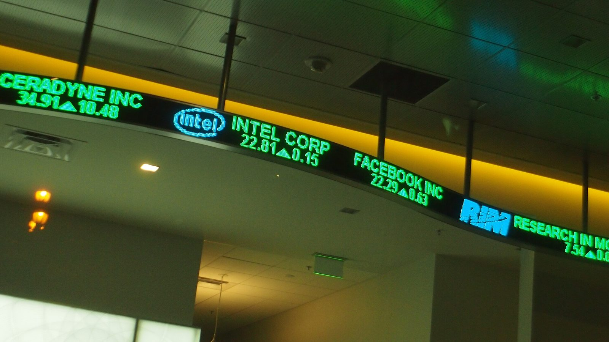

Anthropic's first week as a public company lasted only two trading days, but it packed in a lot: a record IPO, a 17% first-day jump, a sharp fall the next day and a wave of analyst reports. On **Friday, 20 November 2026**, **Anthropic** (Nasdaq: **ANT**), the maker of the **Claude** AI models, closed at **$88.91**.

We covered the [first trading day](https://thearchitecthighlevel.com/2026/11/20/anthropic-first-trading-day-ant-market-reaction/) and the [second day, the greenshoe and the lock-up](https://thearchitecthighlevel.com/2026/11/21/anthropic-ant-second-day-lockup-greenshoe-openai/) in earlier posts. This article looks at the week as a whole: where the share stands, what analysts say and how they value it, when the big banks may publish, and what all this means for **OpenAI**. Monday's trading had not started when we wrote this, so no Monday prices are included.

## The short version

- **Weekly result (fact):** ANT ended the week at **$88.91**, about **7.1% above** the $83 offer price and about **20% below** its first trade at $111.50 ([CNBC](https://www.cnbc.com/2026/11/21/anthropic-ipo-tech-selloff.html), [Yahoo Finance](https://finance.yahoo.com/quote/ANT/history/)).
- **Market backdrop (fact):** the **Nasdaq fell 10%** over the past five trading days, its worst week since 2020, and **Nvidia dropped 23%** ([CNBC](https://www.cnbc.com/2026/11/21/anthropic-ipo-tech-selloff.html)).
- **Valuation (fact, as reported):** about **$1.6 trillion** fully diluted at Friday's close. Only six US companies are worth more ([CNBC](https://www.cnbc.com/2026/11/21/anthropic-ipo-tech-selloff.html)).
- **Analysts (opinions):** five independent firms set price targets between **$105 and $155**, an average of **$134**. William Blair rates the share Outperform without a target, and Seaport is Neutral ([Reuters via Investing.com](https://www.investing.com/news/stock-market-news/anthropic-draws-bullish-wall-street-calls-ahead-of-nasdaq-debut-5039587), [CNBC](https://www.cnbc.com/2026/11/20/fridays-biggest-analyst-calls-like-anthropic.html)).
- **Underwriting banks (expectation):** they have not published research yet. The earliest date is not confirmed.
- **OpenAI (fact and opinion):** OpenAI is aiming for an IPO in 2027. From now on, its valuation will be compared with the price of a listed rival ([PitchBook](https://pitchbook.com/news/articles/anthropics-historic-ipo-is-the-ai-industrys-validation-moment)).

## ANT share price after week one

| Reference point | Price | Change to Friday close |
|---|---|---|
| IPO offer price (18 Nov) | $83.00 | +7.1% |
| First trade (19 Nov) | $111.50 | −20.3% |
| First-day close (19 Nov) | $97.17 | −8.5% |
| **Friday close (20 Nov)** | **$88.91** | – |

*Sources: [CNBC](https://www.cnbc.com/2026/11/21/anthropic-ipo-tech-selloff.html), [Yahoo Finance ANT history](https://finance.yahoo.com/quote/ANT/history/). Percentages are our own calculation, rounded.*

**Not confirmed:** an investor website quotes StockAnalysis with an after-hours price of **$87.80** on Friday evening ([Capital That Works](https://capitalthatworks.com/2026/11/22/anthropic-stock-88-91-5-analyst-targets-average-134/)). We could not check this against a primary source. After-hours trading (trading after the 16:00 New York close) is usually thin, so these prices are a weak signal.

The week was hard for technology shares in general. According to CNBC, the Nasdaq lost 10% in five trading days. Nvidia, an investor in both Anthropic and OpenAI and their most important chip supplier, fell 23%, its sharpest weekly drop in 18 years. CNBC names several causes: rising interest rates, growing anti-AI sentiment and the leadership crisis at Nvidia after Jensen Huang's sudden departure ([CNBC](https://www.cnbc.com/2026/11/21/anthropic-ipo-tech-selloff.html)).

Against that background, a share that is still above its offer price can be read two ways. Optimists say ANT held up comparatively well. Sceptics point out that most of the first-day gain has gone.

## How big is Anthropic now? Market value explained

**Market capitalisation** is the share price multiplied by the number of shares. **Fully diluted** means that options, restricted stock units and other rights that could become shares are counted too. That gives a larger, more cautious figure.

CNBC puts Anthropic's fully diluted value at about **$1.6 trillion** at Friday's close, down from about $1.8 trillion after the first day. At the $83 offer price it was about $1.5 trillion ([CNBC](https://www.cnbc.com/2026/11/21/anthropic-ipo-tech-selloff.html), [PitchBook](https://pitchbook.com/news/articles/anthropics-historic-ipo-is-the-ai-industrys-validation-moment)). In its private Series H round in May 2026 the company was valued at **$965 billion** ([TechCrunch](https://techcrunch.com/2026/11/18/anthropic-reportedly-prices-ipo-at-83-a-share-above-projected-range/)).

Two business figures come up again and again in the coverage:

- **Run-rate revenue** (current monthly revenue multiplied by twelve) of more than **$80 billion**, and gross margin after inference costs "in the mid-80s" percent. These figures are cited by William Blair ([Investing.com](https://www.investing.com/news/stock-market-news/5-big-analyst-ai-moves-nvidia-downgrade-anthropic-seen-as-generational-company-5043652)).
- **Compute efficiency:** Anthropic said it earned **$1.72 in revenue per dollar of computing** in the third quarter, up from 68 cents a year earlier ([CNBC](https://www.cnbc.com/2026/11/21/anthropic-ipo-tech-selloff.html)).

The other side of the ledger: Anthropic has almost **$900 billion** in computing commitments with partners such as Amazon and Google ([Reuters via Investing.com](https://www.investing.com/news/stock-market-news/anthropic-draws-bullish-wall-street-calls-ahead-of-nasdaq-debut-5039587)). The Motley Fool, citing the prospectus, puts the figure at $900.9 billion, many of them non-cancellable ([Motley Fool](https://www.fool.com/investing/2026/11/22/anthropic-stock-could-soar-by-72-according-to-this-wall-street-analyst/)).

*Photo: Francisco Gonzalez, “Tickers” (1 October 2012), [CC BY 2.0](https://creativecommons.org/licenses/by/2.0/), via [Wikimedia Commons](https://commons.wikimedia.org/wiki/File:Tickers_(8085342806).jpg). Scaled to 1,920 px width, otherwise unchanged. A stock ticker board on Market Street, San Francisco, in 2012. It is a general symbol of share prices and does not show the ANT share.*

## Anthropic analyst ratings and price targets

A **price target** is the price an analyst expects a share to reach within a set period, usually 12 months. It is an opinion, not a forecast you can rely on. All of the research published so far comes from firms that were **not** part of the IPO syndicate.

| Firm | Rating | Price target | Horizon / note |
|---|---|---|---|
| Melius Research (Ben Reitzes) | Buy | $155 | 24 months |
| Needham (Scott Berg) | Buy | $150 | – |
| Wolfe Research (Alex Zukin) | Outperform | $135 | – |
| Citizens (Patrick Walravens) | Market Outperform | $125 | – |
| New Street Research | Buy | $105 | 12 months |
| William Blair (Arjun Bhatia) | Outperform | none | – |
| Seaport (Jay Goldberg) | Neutral | none | – |

*Sources: [Reuters via Investing.com](https://www.investing.com/news/stock-market-news/anthropic-draws-bullish-wall-street-calls-ahead-of-nasdaq-debut-5039587), [Reuters via Investing.com (New Street)](https://www.investing.com/news/stock-market-news/new-street-startsanthropic-coverage-with-buy-rating-estimates-revenue-above-500billion-by-2030-5033444), [Benzinga](https://www.benzinga.com/quote/ANT/price-targets), [CNBC](https://www.cnbc.com/2026/11/20/fridays-biggest-analyst-calls-like-anthropic.html).*

The five targets average **$134** (our calculation), about **51% above** Friday's close. Even the lowest, $105, is about 18% above it. Some of these reports were published before or on the first trading day.

**The bulls:**

- **Melius** says ANT "may be one of the few AI stocks that holds up in the near term". It also sees Anthropic as a possible hedge within AI: if demand for computing slowed, chipmakers would suffer, but Anthropic's costs would fall. Melius sees "$5+ in long-term earnings power" and operating margins above 30% ([Investing.com](https://www.investing.com/news/stock-market-news/anthropic-gets-bullish-starts-from-citizens-melius-ahead-of-stock-market-debut-5038789)).
- **Needham** puts Anthropic "in the same dominant bucket" as Amazon, Google and Microsoft ([Reuters via Investing.com](https://www.investing.com/news/stock-market-news/anthropic-draws-bullish-wall-street-calls-ahead-of-nasdaq-debut-5039587)).
- **William Blair** calls Anthropic "a generational company driving a generational technology shift". It sees the price at about **9 times expected 2027 revenue** and **6 times 2028 revenue** as "very reasonable" and thinks 17 to 20 times would not be unreasonable, which implies **$130 to $150** a share ([Investing.com](https://www.investing.com/news/stock-market-news/5-big-analyst-ai-moves-nvidia-downgrade-anthropic-seen-as-generational-company-5043652)).
- **New Street** expects revenue to rise from $53 billion in 2026 to **$505 billion in 2030**, and computing capacity to grow from 5 gigawatts to 30 gigawatts ([Reuters via Investing.com](https://www.investing.com/news/stock-market-news/new-street-startsanthropic-coverage-with-buy-rating-estimates-revenue-above-500billion-by-2030-5033444)).

**The sceptic:** **Seaport** advises investors to wait. "We are concerned about Anthropic's revenue growth. It slowed sharply in Q3 and may not improve much in Q4," the firm wrote. "If Anthropic really is the greatest company ever, there will be time to buy later" ([CNBC](https://www.cnbc.com/2026/11/20/fridays-biggest-analyst-calls-like-anthropic.html)).

**What "times revenue" means:** a **price-to-sales multiple** compares a company's market value with its annual revenue. A multiple of 9 means investors pay $9 for every dollar of expected yearly revenue. For a fast-growing company that is not yet profitable, this ratio is often used in place of the price-to-earnings ratio.

## When the underwriting banks may publish research

The 22 banks led by Goldman Sachs and Morgan Stanley that sold the shares have not published research on Anthropic yet. This waiting time is called the **research quiet period**.

- **The rule (fact):** under the US FINRA Rule 2241, banks that managed or co-managed an IPO may not publish research for **10 days** after the offering ([FINRA Rule 2241](https://www.finra.org/rules-guidance/rulebooks/finra-rules/2241)).
- **Practice (expectation):** banks have traditionally waited longer, until the end of the 25-day prospectus delivery period. Market calendars therefore expect the first reports on **Monday, 14 December 2026** ([Huli Calendar](https://hulicalendar.com/catalyst/ant-quiet-period-end-2026-12)). An investor website, citing a calculation by FinanceFeeds, says the 10-day rule would allow research from around **30 November** ([Capital That Works](https://capitalthatworks.com/2026/11/22/anthropic-stock-88-91-5-analyst-targets-average-134/)).

No bank has announced a date, so both dates are **unconfirmed**. Underwriters usually start with positive ratings, and such "initiations" can move the share.

## What Anthropic's listing means for OpenAI

**Facts:**

- Anthropic and OpenAI filed confidentially for IPOs within a week of each other in June. In September OpenAI postponed its offering to **2027**, citing AI safety concerns ([PitchBook](https://pitchbook.com/news/articles/anthropics-historic-ipo-is-the-ai-industrys-validation-moment)).
- OpenAI was most recently reported to be valued at **$1.25 trillion** ([PitchBook](https://pitchbook.com/news/articles/anthropics-historic-ipo-is-the-ai-industrys-validation-moment)). In October Reuters reported that OpenAI was trying to raise about **$30 billion** before Anthropic's debut, at a valuation that could exceed **$1.4 trillion** ([Reuters](https://www.reuters.com/5f374b32b07b/world/openai-seeks-accelerate-fundraising-ahead-anthropic-ipo-sources-say-2026-10-19/)). We could not confirm whether that round has closed.
- At about $1.6 trillion, the listed Anthropic is now worth more than its older rival's last reported private valuation.

**Interpretation and opinions:**

- **A public benchmark.** "Every AI company, OpenAI included, now has a traded benchmark. Its next valuation will be judged against it," PitchBook's Rolfes said ([PitchBook](https://pitchbook.com/news/articles/anthropics-historic-ipo-is-the-ai-industrys-validation-moment)). In practice, investors in an OpenAI round can now compare its price with a daily market price for the closest competitor, rather than with another private round.
- **Volatility cuts both ways.** If ANT rises, a high OpenAI valuation is easier to justify. If it falls, buyers of OpenAI shares will push for a lower price. By our rough estimate from CNBC's figures, every $1 move in ANT changes Anthropic's fully diluted value by about $18 billion.
- **A window for others.** PitchBook expects a "slew of IPOs" in 2027 and 2028. IVP's Somesh Dash hopes for at least half a dozen AI listings at valuations above $10 billion in the second half of 2027 ([CNBC](https://www.cnbc.com/2026/11/21/anthropic-ipo-tech-selloff.html)).
- **Headwinds.** CNBC points to political risks: in January Democrats take control of Congress, and several ballot measures passed in this month's elections could hold back data-centre construction ([CNBC](https://www.cnbc.com/2026/11/21/anthropic-ipo-tech-selloff.html)). That would affect OpenAI as much as Anthropic.

Whether OpenAI keeps to its 2027 timetable, speeds it up or delays it is open. There are no new official statements from OpenAI on this.

## What to watch this week

- **Thanksgiving:** US stock markets are closed on **Thursday, 26 November**, and close early on **Friday, 27 November**, at 13:00 New York time (19:00 Vienna time). Short holiday weeks often have low trading volume, which can cause larger price swings.
- **The $83 and $97 levels:** the offer price and the first-day close are the reference points many traders watch.
- **Options:** Reuters reported last week that options trading on ANT was expected to start soon. We have not seen a confirmed start date.
- **More independent research:** further firms outside the syndicate can start coverage at any time.
- **Nvidia and interest rates:** the broader AI trade drove ANT in week one and is likely to do so again.

## Facts versus predictions

**Facts:** closing prices (Yahoo Finance, CNBC), market value and index moves as reported by CNBC, analyst ratings and targets as reported by Reuters, Benzinga and CNBC, the FINRA 10-day rule, OpenAI's postponement to 2027 as reported by PitchBook.

**Attributed figures:** revenue, margin and compute data come from analyst reports and media coverage of the prospectus. We did not check them against the prospectus itself for this article.

**Opinions and expectations:** all price targets and ratings, revenue forecasts for 2029 and 2030, quiet-period end dates, statements about OpenAI's valuation and timing, and the IPO pipeline for 2027.

**Not confirmed:** Friday's after-hours price of $87.80, the start of options trading, and whether OpenAI's latest funding round has closed.

This article is for information only and is not investment advice.

## Sources

- CNBC: [Anthropic's record IPO collides with tech's worst week on Wall Street since 2020](https://www.cnbc.com/2026/11/21/anthropic-ipo-tech-selloff.html) (21 November 2026)
- CNBC: [Friday's biggest analyst calls like Anthropic](https://www.cnbc.com/2026/11/20/fridays-biggest-analyst-calls-like-anthropic.html) (20 November 2026)
- CNBC: [Melius initiates coverage of Anthropic with buy rating and price target of $155](https://www.cnbc.com/video/2026/11/19/melius-initiates-coverage-of-anthropic-with-buy-rating-and-price-target-of-155.html) (video, 19 November 2026)
- Reuters via Investing.com: [Anthropic draws bullish Wall Street calls ahead of Nasdaq debut](https://www.investing.com/news/stock-market-news/anthropic-draws-bullish-wall-street-calls-ahead-of-nasdaq-debut-5039587) (19 November 2026)
- Reuters via Investing.com: [New Street starts Anthropic coverage with 'buy' rating](https://www.investing.com/news/stock-market-news/new-street-startsanthropic-coverage-with-buy-rating-estimates-revenue-above-500billion-by-2030-5033444) (17 November 2026)
- Investing.com: [Anthropic gets bullish starts from Citizens, Melius ahead of stock market debut](https://www.investing.com/news/stock-market-news/anthropic-gets-bullish-starts-from-citizens-melius-ahead-of-stock-market-debut-5038789) (19 November 2026)
- Investing.com: [5 big analyst AI moves: Nvidia downgrade, Anthropic seen as 'generational company'](https://www.investing.com/news/stock-market-news/5-big-analyst-ai-moves-nvidia-downgrade-anthropic-seen-as-generational-company-5043652) (21 November 2026)
- Reuters: [OpenAI seeks to accelerate fundraising ahead of Anthropic IPO, sources say](https://www.reuters.com/5f374b32b07b/world/openai-seeks-accelerate-fundraising-ahead-anthropic-ipo-sources-say-2026-10-19/) (19 October 2026)
- PitchBook: [Anthropic's historic IPO is the AI industry's validation moment](https://pitchbook.com/news/articles/anthropics-historic-ipo-is-the-ai-industrys-validation-moment)
- TechCrunch: [Anthropic prices IPO at $83 a share, above projected range](https://techcrunch.com/2026/11/18/anthropic-reportedly-prices-ipo-at-83-a-share-above-projected-range/) (18 November 2026)
- Benzinga: [Anthropic (ANT) price targets](https://www.benzinga.com/quote/ANT/price-targets)
- The Motley Fool: [Anthropic Stock Could Soar by 72%, According to This Wall Street Analyst](https://www.fool.com/investing/2026/11/22/anthropic-stock-could-soar-by-72-according-to-this-wall-street-analyst/) (22 November 2026)
- Capital That Works: [Anthropic Stock $88.91: 5 Analyst Targets Average $134](https://capitalthatworks.com/2026/11/22/anthropic-stock-88-91-5-analyst-targets-average-134/) (22 November 2026; secondary source)
- Yahoo Finance: [ANT historical prices](https://finance.yahoo.com/quote/ANT/history/)
- FINRA: [Rule 2241, Research Analysts and Research Reports](https://www.finra.org/rules-guidance/rulebooks/finra-rules/2241)
- Huli Calendar: [ANT quiet period ends](https://hulicalendar.com/catalyst/ant-quiet-period-end-2026-12)
- Earlier posts: [Anthropic's first trading day](https://thearchitecthighlevel.com/2026/11/20/anthropic-first-trading-day-ant-market-reaction/) and [day two, greenshoe and lock-up](https://thearchitecthighlevel.com/2026/11/21/anthropic-ant-second-day-lockup-greenshoe-openai/)
