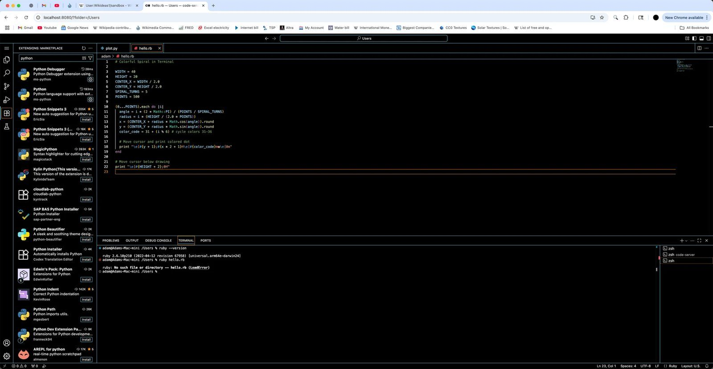

Monday, 23 November 2026, brought three AI announcements that point in the same direction: **AI agents are moving from suggesting work to doing, checking and approving it**. Anthropic now lets agents approve routine code changes, OpenAI and Cisco want AI to help protect running servers, and Google DeepMind used teams of AI agents to improve quantum algorithms and prove the results mathematically.

This roundup explains each announcement, separates company claims from independent reporting, and closes with what people on X and Reddit are discussing.

## The short version

- **Anthropic – Claude Ship (fact):** a set of AI agents that review, fix and, under team rules, **approve** routine code changes. Code Review is generally available; PR Steward and Claude Approvals are in beta for Claude Team and Enterprise plans on GitHub ([TechCrunch](https://techcrunch.com/2026/11/23/anthropic-launches-claude-ship-letting-ai-agents-review-fix-and-approve-code-changes/)).
- **OpenAI and Cisco – Shirudo (fact):** an **open-source** runtime that places temporary "shields" on running Linux systems to block an exploit until a patch is rolled out, without a restart ([OpenAI](https://openai.com/index/introducing-shirudo/)).
- **Google DeepMind – quantum algorithms (fact, as reported by DeepMind):** teams of Gemini 4 agents found quantum circuits that are up to **11.8 times cheaper** for one fusion-energy calculation, and every result was proven in the Lean theorem prover ([Google DeepMind](https://deepmind.google/blog/finding-faster-quantum-algorithms-with-agents-and-formal-verification/)).
- **Online debate (opinion):** on X and Reddit, the week's arguments were about jobs, over-reliance on AI answers, and AI's water footprint.

## Anthropic's Claude Ship: AI agents that approve code

**What happened.** Anthropic, which listed on the Nasdaq last week, launched **Claude Ship** on 23 November. According to [TechCrunch](https://techcrunch.com/2026/11/23/anthropic-launches-claude-ship-letting-ai-agents-review-fix-and-approve-code-changes/), it consists of three parts:

| Component | What it does | Status |
|---|---|---|
| Code Review | Reviews pull requests and flags problems | Generally available |
| PR Steward | Fixes failing CI checks, merge conflicts and review feedback; comments after each push on what it changed and how to roll it back | Beta |
| Claude Approvals | Approves changes based on a policy the team writes, in natural language, as a file in the repository | Beta |

*Source: [TechCrunch](https://techcrunch.com/2026/11/23/anthropic-launches-claude-ship-letting-ai-agents-review-fix-and-approve-code-changes/).*

**Terms explained.** A *pull request* (PR) is a proposed change to a code base that is reviewed before it is merged. *CI* (continuous integration) means automatic tests that run on every change.

**Why it matters.** AI coding tools already write large amounts of code, and human review has become the bottleneck. Anthropic's blog post, as quoted by TechCrunch, says: "On the Claude Code team, Claude writes most of our code, and we wanted everything after the PR to move that fast too." The new step is that an agent may give the final approval for routine changes.

**Safeguards (company statement).** Anthropic recommends running approvals in observe-only mode first, starting with one repository and setting monthly spending limits. Teams decide which changes are escalated to a human.

**Our assessment (opinion).** Letting an AI approve code shifts responsibility. Teams that try it should keep clear rules for security-relevant files and keep human sign-off for anything beyond routine changes.

*Image: Wikideas1, “Coder screen shot”, CC0 1.0 (public domain dedication), via Wikimedia Commons – https://commons.wikimedia.org/wiki/File:Coder_screen_shot.webp (converted to JPG, resized). Symbolic image, not Claude Ship.*

## OpenAI and Cisco's Shirudo: shielding servers before the patch

**What happened.** On 23 November, [OpenAI](https://openai.com/index/introducing-shirudo/) and Cisco introduced **Shirudo** (Japanese for "shield"), an open-source runtime for Linux.

**The problem it addresses.** Testing and rolling out a security patch can take days or weeks. Blocking the vulnerable function entirely could take a service offline, because an attack and a normal request may use the same operating-system operation.

**How it works (company description).** Shirudo uses **eBPF**, a Linux technology that runs small, checked programs at specific points inside the operating system. A temporary *shield* blocks only the behaviour that exposes the vulnerability. OpenAI names four core capabilities:

- **Live protection:** shields block vulnerable code paths without a restart, and teams can watch a shield's effect before enforcing it.
- **Agents with controls:** AI agents can investigate a vulnerability, draft a shield and test it, while security teams decide what is deployed.
- **Trusted deployment:** shields are cryptographically signed and checked before loading.
- **Hardware-backed records:** a Trusted Platform Module (TPM), a security chip, keeps a verifiable record of which protections were loaded or removed.

**The test claim.** According to OpenAI, in a controlled test a shield generated with its Codex model blocked an exploit attempt against a running Elasticsearch service without a restart. That is a company test, not an independent evaluation.

**Why it matters.** OpenAI President Greg Brockman said in the announcement: "finding a bug today doesn't mean you can patch every system tomorrow." Making the project open source means other teams can reuse shields instead of starting from scratch.

## Google DeepMind: AI agent teams improve quantum algorithms

**What happened.** In a [Google DeepMind blog post](https://deepmind.google/blog/finding-faster-quantum-algorithms-with-agents-and-formal-verification/) from 23 November, researchers Sergey Shirobokov, Ben Jaderberg and Ryan Babbush describe how **teams of Gemini 4 agents** improved known quantum algorithms.

**Why proofs were needed.** These quantum circuits are too large to test on today's computers or small quantum chips. So every improvement had to be **proven mathematically** in **Lean**, a program that checks proofs step by step. Every four hours, agents from separate teams met at a "virtual conference" to compare ideas.

**Reported results (DeepMind's figures):**

| Application | Reported improvement |
|---|---|
| Inertial confinement fusion (lasers compress hydrogen fuel) | Computing cost 11.8× lower; memory from 5,650 to 4,338 error-corrected qubits |
| A common light-sensitive molecule (photochemistry) | Simulation 8× cheaper |
| Cytochrome P450, an enzyme that breaks down most medicines | 2.5× improvement; memory from 481 to 333 qubits |
| A specific implementation of Grover's search algorithm | 2.57× speedup |

*Source: [Google DeepMind](https://deepmind.google/blog/finding-faster-quantum-algorithms-with-agents-and-formal-verification/).*

**Terms explained.** A *qubit* is the basic unit of a quantum computer. *Error-corrected* qubits are reliable logical qubits built from many physical ones.

**What it does not mean (fact vs. prediction).** These are cheaper *recipes* for future quantum computers. No fusion or drug simulation has been run on quantum hardware here. DeepMind says it is open-sourcing its Lean library, problem specifications and verified solutions on GitHub so others can check the work.

## What X and Reddit are debating

These are discussions, not verified findings:

- **Jobs:** posts about warnings that AI agents could replace many entry-level jobs drew strong reactions on X. We have not verified the exact quotes circulating.
- **Over-reliance on AI:** an X discussion cites a Wharton School study in which participants did better when an AI helper was right but worse when it was wrong, because they deferred to it. We have not yet read the paper itself.
- **AI and water:** users compared AI's projected water use with that of animal farming. The figures quoted vary widely.
- **A big maths claim:** posts say an Anthropic mathematician used Claude to produce a formal Lean proof of the Riemann Hypothesis. **This is an extraordinary claim that we have not verified**; treat it with caution until mathematicians publish a clear assessment.

## Sources

- TechCrunch, Sarah Perez: [Anthropic launches Claude Ship, letting AI agents review, fix, and approve code changes](https://techcrunch.com/2026/11/23/anthropic-launches-claude-ship-letting-ai-agents-review-fix-and-approve-code-changes/) (23 Nov 2026)
- OpenAI: [OpenAI and Cisco introduce Shirudo](https://openai.com/index/introducing-shirudo/) (23 Nov 2026)
- Google DeepMind: [Finding faster quantum algorithms with agents and formal verification](https://deepmind.google/blog/finding-faster-quantum-algorithms-with-agents-and-formal-verification/) (23 Nov 2026)
- [Forward Future](https://www.forwardfuture.com/) – AI news, tools and model reviews
- X News summaries (22–24 Nov 2026), used only for the "debating" section
