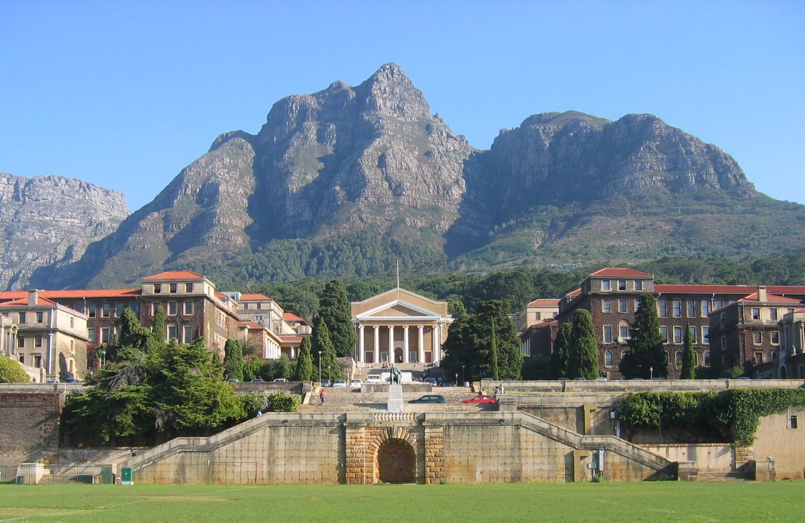
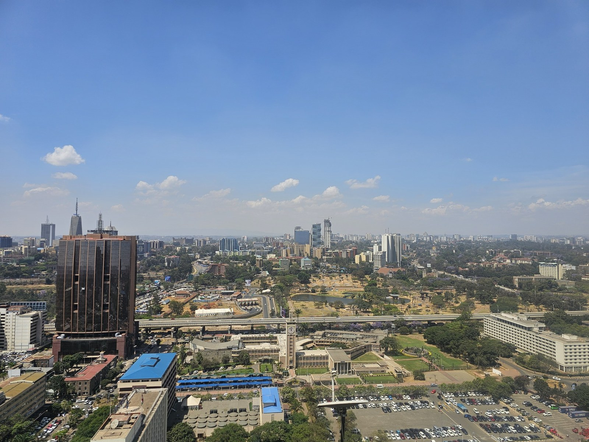

Yes, there are African AI models. They are real, they have names, and some of their weights are public. What they are *not*, on the evidence available in late 2026, is a set of frontier-scale systems trained entirely from scratch on African data and then shown to beat the best global models overall.

This article answers a simple question — **are there African AI models?** — by checking what has actually been released, who built it, and which claims have independent tests behind them. We look in particular at **Lelapa AI’s InkubaLM**, Nigeria’s **N-ATLaS** (powered by **Awarri**), the **Masakhane** community, and a few other documented projects. We separate **company or government statements** from **independent evaluations**.

## The short version

- **Yes, African-built models exist.** The best-documented text models are Lelapa AI’s **InkubaLM-0.4B** (trained from scratch, 400 million parameters) and Nigeria’s **N-ATLaS** (an adaptation of Meta’s Llama-3-8B, announced on 21 September 2025).
- **They are mostly small or specialised.** InkubaLM is designed to run with modest computing resources. N-ATLaS covers Yoruba, Hausa, Igbo and Nigerian English; it is not a from-scratch foundation model.
- **Masakhane is a community, not a chatbot.** It is a well-known African natural-language-processing network, not a single large language model.
- **Independent tests are scarce, but not absent.** A Hugging Face evaluation of N-ATLaS found clear gains over Llama-3-8B-Instruct on Yoruba, Igbo and Hausa. That is an improvement on a base model, not a claim that N-ATLaS leads the world.
- **The strongest general systems on African-language benchmarks are still mostly foreign**, according to a September 2026 snapshot of the DataLens Africa leaderboard cited in a regional overview. We treat that as a reported snapshot, not as a number we re-ran.

## Are there African AI models?

Yes. By late 2026, several teams on the continent have released language models, speech models or research baselines that were built or substantially adapted in Africa, for African languages. The honest picture is uneven: **small models trained from scratch** exist, **government-backed adaptations** of foreign foundation models exist, and a large research community has published datasets and translation systems. What has not been shown, in sources we could verify, is a mid-sized or frontier African foundation model, trained from scratch at tens of billions of parameters and competitively scored against the leading global systems across general tasks.

That distinction matters, because “an African AI model” can mean three different things: a system whose **weights were trained from scratch** on local data; a **fine-tune** of a foreign model (for example a Meta Llama checkpoint) on African languages; or a **product or research community** that uses models without being a model itself. The rest of this article keeps those categories separate.

## What is Lelapa AI’s InkubaLM, and was it trained from scratch?

Yes, according to the developer. **Lelapa AI**, a South African company, released **InkubaLM-0.4B** in October 2024. In its [own technical blog](https://lelapa.ai/blog/inkubalm-small-language-model) and on the [Hugging Face model card](https://huggingface.co/lelapa/InkubaLM-0.4B), Lelapa describes it as a 400-million-parameter autoregressive model **trained from scratch** on **2.4 billion tokens**, of which **1.9 billion** come from five African languages — **isiZulu, Yoruba, Hausa, Swahili and isiXhosa** — plus English and French. The vocabulary size is given as 61,788. The architecture is described as similar to MobileLLM and, on the model card, to LLaMA-7B. The licence is **CC BY-NC 4.0**, which allows reuse with credit but not commercial use without further permission.

The name refers to the dung beetle, which can move many times its own weight: a metaphor for a small model that is meant to do useful work. Lelapa says the model can be deployed on CPU or GPU, including on a laptop, and released accompanying **Inkuba-Mono** and **Inkuba-Instruct** datasets. The research, the company says, was supported by compute credits from the Microsoft AI4Good lab.

On quality, the company reports that InkubaLM outperformed several larger open models on some African-language sentiment and inference tests, while larger models such as Gemma-7B and Llama 3-8B were stronger on AfriMMLU, a multiple-choice knowledge benchmark. Those figures are **vendor-reported**. We did not re-run the tests. The model card also states clear limits: outputs may be inaccurate or inconsistent, and the model may mix languages.

**Our assessment:** InkubaLM is a credible, documented example of an African model trained from scratch. It is a *small* language model, not a substitute for a general-purpose frontier system.

*Photo: Adrian Frith (Htonl), “UCT Upper Campus landscape view” (6 June 2006), [CC BY-SA 3.0](https://creativecommons.org/licenses/by-sa/3.0/), via [Wikimedia Commons](https://commons.wikimedia.org/wiki/File:UCT_Upper_Campus_landscape_view.jpg) (unchanged in composition, not enlarged). The University of Cape Town is the institution behind the MzansiLM research baseline discussed below; the photograph does not show that model.*

## What is N-ATLaS, and did Nigeria and Awarri build it from scratch?

N-ATLaS is real; “from scratch” is the part that needs care.

On **21 September 2025**, Nigeria’s [Federal Ministry of Communications, Innovation and Digital Economy](https://fmcide.gov.ng/nigeria-launches-landmark-ai-model-powered-by-awarri-to-advance-languages-and-ai-at-scale/) announced the **Nigerian Atlas for Languages and AI at Scale (N-ATLaS)**, also written **N-ATLAS** in the ministry’s release, on the sidelines of the 80th United Nations General Assembly in New York. The ministry said the open-source multilingual model was “powered by Awarri” and was designed to understand and generate “Nigeria’s diverse voices.” Minister **Bosun Tijani** called it “a national commitment to unity, inclusion, and global contribution” and said the goal was to advance natural-language processing for under-represented languages.

Nigeria has **more than 500 languages**, the ministry noted. The first public model is narrower: reporting and later technical write-ups describe coverage of **Yoruba, Hausa, Igbo and Nigerian English**, together with speech-recognition models. The official announcement is a policy and product launch, not a technical model card. It does not, in the text we reviewed, state a parameter count or say whether the system was trained from scratch.

An [independent evaluation posted on Hugging Face](https://huggingface.co/blog/seun-ajayi/n-atlas-evaluation-report) by Seun Ajayi treats **N-ATLaS-LLM as a fine-tuned Llama-3-8B model**. On AfroBench-LITE, in a like-for-like comparison of instruction-tuned models with a chat template, N-ATLaS improved average scores in a zero-shot setting from 24.4 to 38.4 on Yoruba, 27.7 to 38.7 on Igbo, 28.9 to 44.1 on Hausa, and 54.8 to 62.8 on English, relative to Llama-3-8B-Instruct. In a few-shot setting the gaps widened further, while the unmodified Llama instruct model often got worse when examples were added. Those are **replicable benchmark numbers from one independent author**, not an official government scorecard, and they measure a slice of tasks, not “overall intelligence.”

A 5 October 2026 overview by [AI Reports Africa](https://aireportsafrica.com/2026/10/05/can-africa-build-its-own-llm-ready-for-some-versions-not-yet-for-others/) similarly describes N-ATLaS as a fine-tune of Llama-3 8B on roughly 400 million tokens of instruction data, shipped with four speech-recognition models, and notes that it is “a skilled adaptation of someone else’s foundation model, not a model trained from scratch.” We did not independently count those tokens.

**Our assessment:** N-ATLaS is a credible, government-backed African language model with at least one independent evaluation showing gains on Nigerian languages. It should be described as an **adaptation** of a U.S. foundation model, unless and until a primary technical document says otherwise.

## Is Masakhane an African language model?

No. **Masakhane** is a research community for natural language processing in African languages, not a single large language model or consumer chatbot. It is often named in the same sentence as African AI, which is why the confusion is common.

What Masakhane has actually built, over several years, is a large body of **open datasets, translation systems and workshop research** covering many African languages — more than 45, according to the October 2026 AI Reports Africa overview, which also noted that co-founder **Vukosi Marivate** was appointed in 2026 to the United Nations Independent International Scientific Panel on AI. We did not re-count the language coverage from Masakhane’s own repositories for this article, so that “45+” figure is attributed, not re-verified here.

The community’s work still matters for the model question: without shared datasets and evaluation tasks, small laboratories cannot train or test language models in a comparable way. Masakhane is part of the infrastructure. It is not itself “the African LLM.”

## What other African models have been documented?

A few further examples appear in recent research summaries. We list them with their sources, because we have not tested the systems ourselves.

- **MzansiLM**, presented at the LREC 2026 conference by researchers at the **University of Cape Town**, is described as a 125-million-parameter baseline trained on all 11 official written South African languages, nine of them low-resource. The authors, as quoted in the AI Reports Africa overview, present it as a small baseline, not a production assistant.
- **UlizaLlama**, from **Jacaranda Health**, extends Meta’s Llama models for maternal-health support in several of the same East and Southern African languages covered by InkubaLM. It is a domain-specific adaptation, not a general foundation model.
- **AfriqueLLM**, a paper accepted to ACL 2026, studied continued pre-training of open models on African languages and reported that open models still trail proprietary ones, with the gap widest for African languages, and that the choice of base architecture can matter more than raw size.

The same October 2026 overview said the **DataLens Africa** leaderboard showed Google’s **Gemini** family leading as of September 2026 on African-language and medical benchmarks, with Anthropic’s Claude models also strong on medical question answering. That is a **reported snapshot** of one leaderboard, not a test we ran, and leaderboards change.

*Photo: Cynthia Omondi, “Skyline of Nairobi 06” (22 October 2026), [CC BY 4.0](https://creativecommons.org/licenses/by/4.0/), via [Wikimedia Commons](https://commons.wikimedia.org/wiki/File:Skyline_of_Nairobi_06.jpg) (resized). A recent view of Nairobi from the Kenyatta International Convention Centre; it does not show a specific model or laboratory.*

## How do African models compare with global systems?

There is no single ranking that settles this, and anyone who offers one without naming the benchmark should be treated with caution.

What the verified evidence supports is more modest:

1. **African teams have shipped working models**, including at least one trained from scratch (InkubaLM) and at least one nationally promoted adaptation (N-ATLaS).
2. **On the African languages they target, careful fine-tuning can lift results well above the unmodified foreign base model**, as the N-ATLaS evaluation shows.
3. **On broader African-language and professional benchmarks, the leading scores reported in 2026 still belong mainly to large general-purpose systems from Google, Anthropic and similar laboratories.** That is not surprising: those systems are far larger, trained on far more data, and evaluated more often.
4. **Compute, capital and energy remain the binding constraints** for a from-scratch mid-sized “sovereign” model, a point made in the same regional analysis. We have not independently audited African GPU capacity, so we treat that as analysis, not as a measured inventory.

For readers used to headlines about GPT, Claude or Gemini, the practical implication is straightforward: if you need a general assistant today, the global models are still usually stronger, including on many African-language tasks. If you need a small, local, or research-friendly model for a specific language — and especially if you need to run it cheaply — InkubaLM and N-ATLaS are the documented places to start, with their limits in mind.

## FAQ

**Are there African AI models?**
Yes. Documented examples include Lelapa AI’s InkubaLM-0.4B and Nigeria’s N-ATLaS, developed with Awarri. They are small or adapted models, not frontier-scale systems trained from scratch at the size of GPT or Gemini.

**Is InkubaLM open to use?**
The weights are on Hugging Face under CC BY-NC 4.0. That generally allows non-commercial use with attribution. Commercial use needs a closer reading of the licence, which we are not providing as legal advice.

**Did Nigeria train N-ATLaS from scratch?**
The official launch announcement does not say so clearly. An independent evaluation, and later technical summaries, describe it as a fine-tune of Meta’s Llama-3-8B. Until a primary model card says otherwise, “adaptation” is the accurate word.

**Is Masakhane a chatbot?**
No. It is a research community for African-language natural language processing.

**Which model is “the best” for African languages?**
It depends on the language and the task. For a general assistant, reported 2026 leaderboards still favoured large foreign models. For targeted Nigerian or Southern African language work, N-ATLaS and InkubaLM are the leading *local* documented options we could verify.

## What we could not verify

- A complete, up-to-date catalogue of every African model on Hugging Face or in private labs; this article covers the most cited public examples, not every checkpoint.
- Lelapa’s and other vendors’ own benchmark tables, which we did not re-run.
- The “roughly 400 million tokens” figure for N-ATLaS instruction data, and the exact contents of its speech models; those come from secondary technical summaries.
- Masakhane’s exact current language count, and the UN panel appointment, beyond the 2026 overview cited above.
- The DataLens Africa leaderboard itself, which we did not query directly for this article.
- Claims of a pan-African frontier laboratory or a mid-sized sovereign model comparable to India’s largest public releases; we found reporting that no such model yet exists, but absence of evidence is not a completed census.

## Sources

- Lelapa AI: [InkubaLM: A Small Language Model for Low-Resource African Languages](https://lelapa.ai/blog/inkubalm-small-language-model) (25 October 2024)
- Hugging Face: [lelapa/InkubaLM-0.4B model card](https://huggingface.co/lelapa/InkubaLM-0.4B)
- Nigeria Federal Ministry of Communications, Innovation and Digital Economy: [Nigeria Launches Landmark AI Model Powered by Awarri](https://fmcide.gov.ng/nigeria-launches-landmark-ai-model-powered-by-awarri-to-advance-languages-and-ai-at-scale/) (21 September 2025)
- Seun Ajayi, Hugging Face blog: [How much did N-ATLaS-LLM move the needle?](https://huggingface.co/blog/seun-ajayi/n-atlas-evaluation-report)
- AI Reports Africa: [Can Africa Build Its Own LLM?](https://aireportsafrica.com/2026/10/05/can-africa-build-its-own-llm-ready-for-some-versions-not-yet-for-others/) (5 October 2026)
