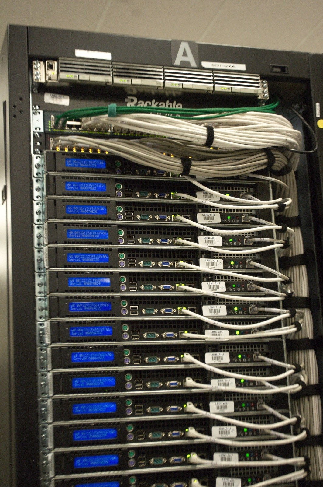
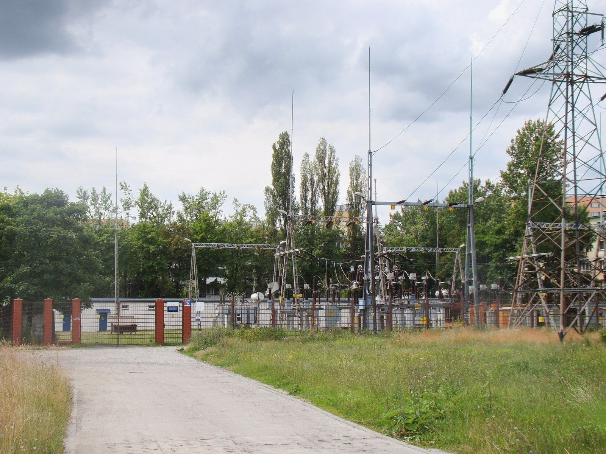

AI systems do not run on slogans. They run on **chips** packed into **data centers**, and those buildings draw a continuous supply of electricity. The more capable the chip, the more densely it is packed, and the more hours it spends at high load, the larger the power bill becomes. This article asks why AI chips drive data-center energy demand, what official hardware ratings and energy-agency figures actually say in late 2026, and where forecasts still disagree with what can be measured.

It is a status check as of **26 November 2026**. It complements our earlier, Europe-focused guide, [AI’s Power Problem in Europe](https://thearchitecthighlevel.com/2026/11/11/ai-energy-data-centers-europe-power/), which looked at grids, queues and heat reuse. This one starts with the chips themselves and then steps out to the global electricity numbers. All units are metric.

## The short version

- **Measured (IEA):** global data-center electricity use grew **17%** in 2025; use in AI-focused sites grew **50%**. World electricity demand grew about **3%**.
- **Forecast (IEA, April 2026):** data-center consumption roughly doubles from **485 terawatt-hours (TWh)** in 2025 to **950 TWh** in 2030, around **3%** of world electricity. Use in AI-focused data centers is projected to **triple**.
- **Official hardware rating:** a Lenovo guide published on 10 November 2026 puts the **Nvidia Vera Rubin NVL72** rack at up to **227 kilowatts (kW)** thermal design power in MaxP mode, or **187 kW** in MaxQ mode, for 72 GPUs and 36 CPUs in one rack. That is a manufacturer rating, not a measured annual bill.
- **Investment (IEA):** capital expenditure by five large technology companies exceeded **US$400 billion** in 2025 and is expected to rise by a further **75%** in 2026. Not every announced data center will be built.
- **Bottlenecks, not just demand:** the IEA says shortages of turbines, transformers, advanced chips and memory, plus slow grid connections, are limiting how fast sites can actually switch on.

## Why do AI chips use so much electricity?

Because they are designed to do a huge number of calculations at once, and because the industry now packs many of them into a single rack that is meant to run hard for long periods. A **graphics processing unit (GPU)**, here used as an AI accelerator, is a specialised chip that performs many arithmetic operations in parallel. Training a large model, or running a busy assistant, keeps thousands of these chips working for hours or weeks. Unlike a laptop, which spends much of the day idle, a training cluster is often held at a high fraction of its rated power.

A few units help to read the rest of the figures:

- A **watt (W)** or **kilowatt (kW)** is a rate of power, like speed. A **kilowatt-hour (kWh)** or **terawatt-hour (TWh)** is an amount of energy, like distance. One TWh is a billion kWh.
- **Thermal design power (TDP)** is the maximum sustained power a chip or a rack is designed to draw and to have cooled away when it is working hard. It is a rating, not a guarantee of what a particular site will use every hour.
- **PUE** (power usage effectiveness) is the facility’s total energy divided by the energy that reaches the IT equipment. A PUE above 1.0 means extra energy for cooling, power conversion and building services.

The latest flagship rack shows how far density has gone. According to the [Lenovo NVIDIA Vera Rubin NVL72 product guide](https://lenovopress.lenovo.com/lp2527-lenovo-nvidia-vera-rubin-nvl72) of 10 November 2026, the system puts **72 Nvidia Rubin GPUs** and **36 Arm-based Nvidia Vera CPUs** in one standard rack, with hybrid liquid and air cooling. Lenovo states that rack TDP is **up to 227 kW at MaxP** and **187 kW at MaxQ**, and that about **96%** of the heat is captured by liquid and **4%** by air. The rack is fed by four **110 kW** power shelves. Those shelves provide up to **440 kW** of power-supply *capacity*; that is not the same as the 227 kW TDP, and should not be quoted as the rack’s typical draw.

On 17 November 2026, Nvidia said it had begun shipping Vera Rubin NVL72, calling it the fastest product ramp in the company’s history, with racks running at cloud partners including CoreWeave, Google Cloud, Microsoft Azure, Oracle Cloud Infrastructure and Nebius ([Nvidia earnings release](https://investor.nvidia.com/news/press-release-details/2026/NVIDIA-Announces-Financial-Results-for-Third-Quarter-Fiscal-2027/default.aspx)). In the same quarter Nvidia reported **US$107.6 billion** of data-center revenue, up 110% from a year earlier. Those are sales figures, not electricity measurements, but they show how quickly the hardware is being deployed.

A 227 kW rack, if it ran at that rating without pause for a year, would use about **1,990 megawatt-hours**. Real use is lower, because racks are not always full, and chips are not always at maximum TDP. The direction, however, is unmistakable: each new generation packs more compute, and more electrical load, into the same floor area.

*Photo: Derrick Coetzee, “Rear of rack at NERSC data center - closeup” (14 October 2011), [CC0](https://creativecommons.org/publicdomain/zero/1.0/), via [Wikimedia Commons](https://commons.wikimedia.org/wiki/File:Rear_of_rack_at_NERSC_data_center_-_closeup.jpg) (resized). A scientific computing rack at the National Energy Research Scientific Computing Center; it is not a 2026 AI training cluster.*

## How much electricity do data centers use, and what is only a forecast?

The most careful global numbers still come from the International Energy Agency. In *Key Questions on Energy and AI*, published on **16 April 2026**, and in the accompanying [press release](https://www.iea.org/news/data-centre-electricity-use-surged-in-2025-even-with-tightening-bottlenecks-driving-a-scramble-for-solutions), the IEA reported that:

- global data-center electricity demand grew **17%** in 2025, in line with its earlier projection;
- electricity consumption from **AI-focused** data centers surged **50%** in 2025;
- the central forecast is a rise from **485 TWh in 2025** to **950 TWh in 2030**, around **3%** of global electricity demand;
- consumption from AI-focused data centers is expected to **triple** over that period.

The agency also said, in its [executive summary](https://www.iea.org/reports/key-questions-on-energy-and-ai/executive-summary), that satellite tracking showed “AI factories” — data centers designed specifically for AI — had **more than tripled** in capacity in the previous 18 months. Capital expenditure by five large technology companies exceeded **US$400 billion** in 2025 and is expected to increase by another **75%** in 2026, an amount the IEA says is now larger than global investment in oil and gas production. Many announced projects will not be finished.

Two efficiency facts sit alongside that growth, and they pull in opposite directions. The IEA says energy use **per AI task** has been falling by at least an order of magnitude a year, “unprecedented in energy history.” A simple text query, it says, typically uses less electricity than running a television for the same time; if all conventional internet searches were done that way, the total would be less than **4 TWh** a year, under 1% of today’s data-center use. At the same time, video generation, multi-step reasoning and software agents can use **hundreds or thousands of times** more energy per request than a short text answer. Which effect wins is the main uncertainty in every 2030 forecast.

Major model providers, the IEA added, reported a threefold increase in active users and a fivefold increase in revenue over the previous year. Those are company-reported activity figures, not metered electricity.

## If demand is so high, why is growth still constrained?

Because a chip shipment is faster than a substation. The IEA’s April 2026 update emphasises that physical bottlenecks have tightened: supply chains for **gas turbines** and **transformers**, and for advanced chips and IT components, including a shortage of high-bandwidth memory expected to last at least until the end of 2027. Planning systems are crowded. Grid-connection queues remain long. We described the European version of that queue problem in our 11 November post; the IEA now says the same pattern is global.

The result is a scramble rather than a smooth curve. The IEA says the technology sector accounted for about **40%** of all corporate renewable **power purchase agreements** signed in 2025. A power purchase agreement (PPA) is a long-term contract to buy electricity, often from a named wind or solar farm. It pays for generation somewhere on the grid; it does not, by itself, deliver a cable to a particular building.

The pipeline of conditional offtake agreements between data-center operators and **small modular reactor (SMR)** projects, the IEA says, has grown from **25 gigawatts** at the end of 2024 to **45 gigawatts**. These are agreements to buy power *if* the reactors are built, not operating plants. First units are still years away. Constrained by slow grid connections, developers are also advancing many projects with **onsite natural-gas** generation, especially in the United States. The IEA’s satellite tracking finds that many of those projects remain in early stages. Because AI loads swing up and down quickly, the agency says **onsite batteries** are becoming essential, and could, with the right incentives, turn data centers from pure grid loads into more flexible resources.

IEA Executive Director Fatih Birol put the two roles in one sentence: AI is “still an energy taker,” but it is also becoming “an energy maker,” by pulling forward nuclear, flexible sites and long-duration storage. That is an assessment, not a measurement of today’s mix.

*Photo: Darekm135, “Electrical substation Łódź-Retkinia” (25 June 2014), [CC BY-SA 3.0](https://creativecommons.org/licenses/by-sa/3.0/), via [Wikimedia Commons](https://commons.wikimedia.org/wiki/File:Electrical_substation_%C5%81%C3%B3d%C5%BA-Retkinia.JPG) (resized). A distribution substation used here to illustrate the grid equipment that data centers depend on; no claim is made that this site serves an AI data center.*

## Does more data-center demand always raise household bills?

Not automatically, the IEA says, if investment in generation and grids keeps up and if costs are allocated fairly. But data centers pose a special problem: they are large, concentrated loads that can appear quickly, triggering new plants and lines. Communities have become more willing to push back, as we noted in our 25 November regulation update, where data-center construction itself has become a campaign issue in some U.S. states. Social acceptability, the IEA warns, now sits alongside transformers and chips as a constraint.

The agency also says proven uses of AI in energy-intensive industries could cut firms’ energy costs by **3 to 10 percentage points**, but that the energy sector is not yet making full use of that potential, because of skills and data gaps. Those savings, if they appear, would be in other industries, not a deduction from the data-center total.

**Our assessment:** the chip ratings and the IEA’s 2025 growth figures are solid enough to take seriously. The 2030 totals are still a central forecast, not a destiny. The practical limit this year is less often “is there a theory of enough electricity?” and more often “can this rack be connected, cooled and filled with memory?”

## FAQ

**Why do AI chips use so much electricity?**
They perform vast numbers of calculations in parallel and are packed tightly into racks that are meant to run at high load for long periods. A Vera Rubin NVL72 rack is rated at up to 227 kW. The building then adds cooling and power-conversion overhead.

**How much power is 227 kilowatts?**
It is the output of hundreds of domestic kettles running at once, or about the electrical load of a small office building, concentrated in a single rack. Over a full year at that rating it would be just under 2 gigawatt-hours; real racks usually draw less than their TDP.

**Will data centers use 950 terawatt-hours in 2030?**
That is the IEA’s central projection from April 2026, not a measured fact. The agency itself stresses bottlenecks, cancelled projects and uncertainty about how energy-intensive new AI tasks will become.

**Does a PPA make a data center “run on renewables”?**
A PPA can match a company’s consumption with renewable generation on the wider grid. It does not necessarily mean that the electrons in the building’s cable come only from a wind or solar farm at every hour.

**Is this only a U.S. problem?**
No. The IEA’s figures are global. The tightness of grids, water and planning, however, varies widely by country, as our earlier Europe article describes.

## What we could not verify

- A single official Nvidia figure for the thermal design power of one Rubin GPU, as distinct from the 227 kW rack rating published by Lenovo. We have not used unofficial per-chip estimates.
- How many Vera Rubin racks are actually running, or at what average utilisation, as of 26 November 2026.
- Site-level electricity bills for named AI factories; companies rarely publish them in a comparable form.
- Whether the IEA’s 45 gigawatt SMR offtake pipeline will translate into operating reactors, or on what timetable.
- A later IEA update after April 2026; the demand figures above are from that report.

## Sources

- IEA: [Key Questions on Energy and AI — executive summary](https://www.iea.org/reports/key-questions-on-energy-and-ai/executive-summary) (April 2026)
- IEA: [Data centre electricity use surged in 2025…](https://www.iea.org/news/data-centre-electricity-use-surged-in-2025-even-with-tightening-bottlenecks-driving-a-scramble-for-solutions) (16 April 2026)
- Lenovo Press: [Lenovo NVIDIA Vera Rubin NVL72 Product Guide](https://lenovopress.lenovo.com/lp2527-lenovo-nvidia-vera-rubin-nvl72) (10 November 2026)
- Nvidia: [Financial Results for Third Quarter Fiscal 2027](https://investor.nvidia.com/news/press-release-details/2026/NVIDIA-Announces-Financial-Results-for-Third-Quarter-Fiscal-2027/default.aspx) (17 November 2026)
