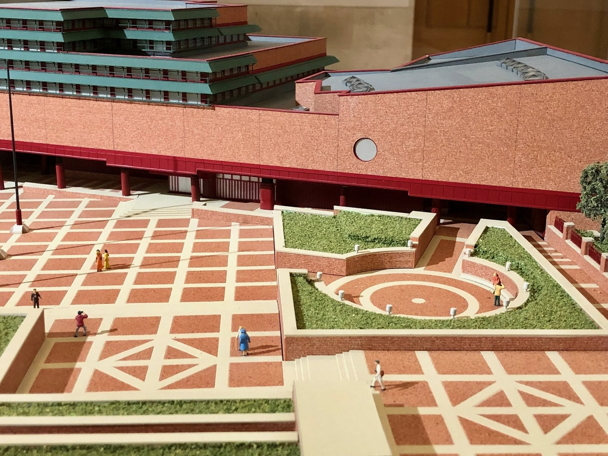
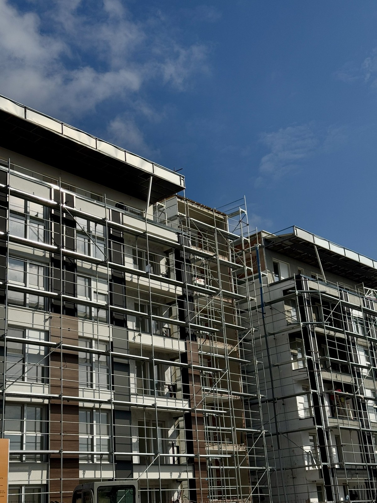

AI has arrived in architecture and planning offices, but it has not, on the evidence, taken over design. It is being used to speed up pictures, schedules, sheets and first-pass checks. Whether that produces better buildings is a different, and so far less convincing, story.

This guide asks a practical question: **what AI tools do architecture and planning offices actually use in 2026?** It starts with what surveys show, then looks at the official Autodesk tools, then at the wider market of documentation, review and early-planning products. We separate **survey findings** and **vendor descriptions** from claims we could not test ourselves. It is a status check as of **26 November 2026**, and it complements our earlier pieces on [AI in CAD](https://thearchitecthighlevel.com/2026/10/10/ai-in-cad-rea-autocad-revit-archicad/) and on [local MCP gateways and open CAD](https://thearchitecthighlevel.com/2026/11/22/local-mcp-gateways-ai-open-cad-freecad/), without repeating those technical deep dives.

## The short version

- **Adoption is high in the UK, results for design quality are modest.** [RIBA](https://www.riba.org/news/ai-adoption-reaches-tipping-point-across-uk-architecture/) reported on 22 July 2026 that **74%** of architecture practices use AI, up from **59%** in 2025. **75%** reported better productivity and **57%** a positive return on investment, but only **17%** agreed that their designs are better because of AI.
- **Autodesk Assistant in Revit** went into tech preview on **22 April 2026**. It can answer questions, query the model and carry out a defined set of documentation tasks from plain language. Autodesk says customer data is not used to train its models.
- **Forma** is Autodesk’s early-stage planning and massing environment, with daylight, sun and carbon studies and a path into native Revit models. That is official product language, not an independent performance test.
- **Most other tools do one job in one application**, usually Revit: images, sheets and tags, or first-pass review. Vendor speed claims should be treated as marketing until a firm tests them on its own project.
- **Professional judgement remains the bottleneck.** RIBA found that **61%** of respondents fear AI will make it harder for early-career staff to learn, and **59%** expect staff reductions, even though the institute said there is not yet clear evidence of sector-wide cuts.

## How widely are architecture offices using AI in 2026?

Widely in some countries, still narrowly in others, and mostly for support work rather than for core design.

The Royal Institute of British Architects published the results of its third member survey on **22 July 2026**. The headline figure is that the share of practices using AI “for most projects” rose from **59%** in 2025 to **74%** in 2026. Many contributors saw a business benefit: **75%** reported an improvement in productivity and **57%** a positive return on investment. The design-quality figure points the other way: **fewer than one in six (17%)** agreed that their designs are better because of AI. **77%** said AI can never replace human creativity. Only **21%** agreed that AI makes them more optimistic about their organisation’s future.

Two workforce findings matter for planning offices as well as design studios. **59%** of practices believe AI adoption will lead to staff reductions across the profession, and **61%** agree that it will make it harder for early-career professionals to acquire essential skills, because tasks that used to train juniors are being automated. RIBA said there is not yet clear evidence of sector-wide AI-induced cuts, and its president, Chris Williamson, argued that professional oversight remains essential if buildings are to be safe and sustainable. The institute said it would develop an AI overlay to the RIBA Plan of Work and a policy for responsible use.

A 23–24 November 2026 [field guide in e-architect](https://www.e-architect.com/articles/ai-for-architects-in-2026) adds two further snapshots, which we attribute to that article rather than to documents we re-fetched: a Chaos and Architizer survey of nearly 800 architects and designers found concept imagery and render enhancement to be the most common uses, with construction documentation still “mostly a hope”; and the American Institute of Architects found that only **6%** of U.S. architects used AI regularly, mainly chatbots and image generators. If that AIA figure is right, talk of a single global “tipping point” is premature.

## What can Autodesk Assistant and Forma do inside a normal office workflow?

They can help with questions, model queries, routine documentation and early massing — within limits that Autodesk itself states.

On **22 April 2026**, Autodesk put **Autodesk Assistant** into [tech preview in Revit](https://www.autodesk.com/blogs/aec/2026/04/22/autodesk-assistant-in-revit-tech-preview/). In Autodesk’s description, a chat panel inside Revit can:

- answer questions from official Autodesk documentation;
- query the open model (for example, counting columns on a level, or checking whether views on a set of sheets have a view template);
- act on plain-language requests such as “Create a door schedule sorted by level” or “Create a floor plan for the level L1 and name it L1-AI”;
- generate related documentation, including repeating a floor-plan setup across levels, creating sheets and exporting a PDF;
- offer usage-based tips, such as numbering tools.

Autodesk says the assistant is powered by the **Model Context Protocol (MCP)**, a way for an AI system to use defined tools rather than only generating text, and that supported workflows include model query, export, sheet management, room management, schedules and some element operations. It also says the preview is intentionally limited to a focused set of tasks, not every Revit command. On data, Autodesk states that prompts, documentation and, in some cases, model context are used to answer the question, that prompt libraries and chat history are stored in the cloud on the user’s Autodesk account, and that **none of this data is used to train language models**. Those are company privacy statements, not an audit.

**Forma Building Design**, in Autodesk’s own product announcement, is aimed at the schematic stage: a geolocated site, massing and façade options, floor plans and units, and analyses of daylight, sun hours and carbon, with a transfer into **native, geolocated Revit models**. Autodesk has also bundled Forma Site Design, Building Design, Board and data-management essentials for Revit subscribers, and has previewed tighter “Forma Connected Client” links so that teams do not re-enter site data by hand. For planning offices, the site-planning and environmental analyses are the relevant part: they are decision-support tools for early options, not a substitute for a local planning assessment.

*Photo: Robert-brook, “An architectural model of the British Library” (23 March 2018), [CC0](https://creativecommons.org/publicdomain/zero/1.0/), via [Wikimedia Commons](https://commons.wikimedia.org/wiki/File:An_architectural_model_of_the_British_Library.jpg) (resized). A traditional massing model; it illustrates the early-design stage that tools such as Forma target, and is not a screenshot of any software.*

## Which other tools do offices use for drawings, reviews and planning studies?

A crowded market of specialists, almost all described here from **vendor pages and secondary field guides**, not from tests we ran.

Sorted by the job, the November 2026 e-architect map, which itself warns that descriptions come from vendors, looks like this:

- **Images and visualisations:** Veras, from Chaos, turns geometry in Revit or SketchUp into AI visualisations. This is the lane RIBA-adjacent surveys suggest is already in daily use.
- **Drawing production:** Chaos’s Glyph automates views, sheets, tags, dimensions and packing, now also from plain language. SWAPP’s agent, Frank, works in Revit and Archicad on dimensions, tags, views, sheets, schedules and quality checks against a firm’s own standards, with accessibility checks built around the U.S. ADA. BIMLOGIQ offers AI tagging for MEP drawings, with an architectural package announced but, as of that guide, not yet released.
- **Libraries and conversion:** Pirros stores a firm’s details and families and adds an agent, Mira, that edits inside recent Revit versions. WiseBIM, listed on the Autodesk Marketplace at **US$49 a month** in that guide, rebuilds DWG, PDF or image plans as Revit walls, doors, windows and slabs.
- **Review:** Nomic offers first-pass drawing and submittal review and code checks against more than **380** codes and standards, according to the same article. Those coverage claims are the vendor’s.
- **Brief-to-model tools:** products such as Snaptrude, described in 2026 software round-ups, generate a programme and massing from a prompt or an uploaded brief and export to Revit or Rhino. Treat “up to LOD 400” and similar claims as marketing until you see the model.

A recurring gap, noted both by practitioners quoted in that guide and by common office experience, is that a real job never lives in one application. Comments arrive as a PDF, a consultant sends a DWG, the model sits in Revit, and the issue set goes out as PDFs, an IFC file and a stack of schedules. Most AI tools take one of those steps. A few newer workspaces claim to span several; we have not independently tested them and do not rank them here.

For **planning offices** specifically — site options, daylight, noise, wind, embodied carbon, test-fits — Forma and similar early-analysis tools are closer to the daily work than a general image generator. They still do not read a local zoning code for you unless a product explicitly says so, and one 2026 comparison of brief-to-BIM tools warned that setbacks and site coverage may be typical assumptions rather than a reading of the actual ordinance.

*Photo: Shixart1985, “A building frame with scaffolding at a construction site with blue sky in background,” [CC BY 2.0](https://creativecommons.org/licenses/by/2.0/), via [Wikimedia Commons](https://commons.wikimedia.org/wiki/File:A_building_frame_with_scaffolding_at_a_construction_site_with_blue_sky_in_background.jpg) (resized). Construction is the end of the chain that office AI tools only partly reach; the photograph is a general illustration.*

## What should a practice trust, and what should it still check by hand?

Trust a tool on a task you have tested. Check everything that carries professional liability.

A practical buying list, adapted from questions that experienced users now ask vendors, including Autodesk, is:

1. Does it change **native** elements in the model, or only draw on top?
2. Can you **undo** it, and does it report what it checked?
3. How do the firm’s **standards** get into the system, and who maintains them?
4. Does it reach the **second application** — AutoCAD, PDF, IFC — or only Revit?
5. Can a colleague **re-run** the same action next week?
6. Where does project data go, and is it used for **training**?

RIBA’s findings are the right frame for the answer. Productivity can rise without design quality rising. Junior training can be hollowed out even if no one has yet been laid off. And a building’s safety still depends on a competent person, not on a chat panel. Autodesk’s own preview note — that Assistant does not yet do every task — is more useful than any slogan about a skyscraper at the press of a button.

## FAQ

**What AI tools do architecture and planning offices actually use?**
Mostly image generators, chatbots, and a growing set of BIM helpers for schedules, sheets, tags and first-pass checks. Autodesk Assistant and Forma are the official tools inside the Autodesk ecosystem. Many specialists sit around Revit. Complete, reliable design-from-a-prompt remains unproven in the sources we reviewed.

**Is Autodesk Assistant generally available?**
As of Autodesk’s 22 April 2026 announcement it was a tech preview with a limited set of workflows. Check the current Revit release notes for whether that status has changed.

**Does Autodesk use my model to train its AI?**
Autodesk says no: customer data and privacy data are not used to train its language models. That is a company statement, not a third-party audit.

**Will AI cut jobs in architecture?**
RIBA found that 59% of UK practices expect staff reductions, but said there is not yet clear evidence of sector-wide cuts. The clearer near-term risk in the same survey is the training of early-career staff.

**Can these tools do statutory planning work?**
They can support early studies of massing, daylight, sun and carbon. We did not find a verified tool that reliably applies a specific local development plan or zoning ordinance without expert review.

## What we could not verify

- The Chaos/Architizer and AIA figures, which we take from the November 2026 e-architect field guide rather than from the original survey PDFs.
- Any vendor’s time-saving percentages, LOD claims, or “380 codes” coverage; we did not test the software.
- Whether Autodesk Assistant’s tech preview has been widened in the months since April 2026.
- How representative RIBA’s respondents are of small planning offices, as opposed to design practices.
- The reliability of brief-to-BIM and PDF-to-model conversion on real statutory drawings.

## Sources

- RIBA: [AI adoption reaches tipping point across UK architecture](https://www.riba.org/news/ai-adoption-reaches-tipping-point-across-uk-architecture/) (22 July 2026)
- Autodesk: [Autodesk Assistant in Revit – Tech Preview](https://www.autodesk.com/blogs/aec/2026/04/22/autodesk-assistant-in-revit-tech-preview/) (22 April 2026)
- Autodesk News: [Introducing Forma Building Design](https://adsknews.autodesk.com/en/news/autodesk-design-and-make-intelligence/)
- e-architect: [AI for architects in 2026: tools field guide](https://www.e-architect.com/articles/ai-for-architects-in-2026) (23–24 November 2026)
