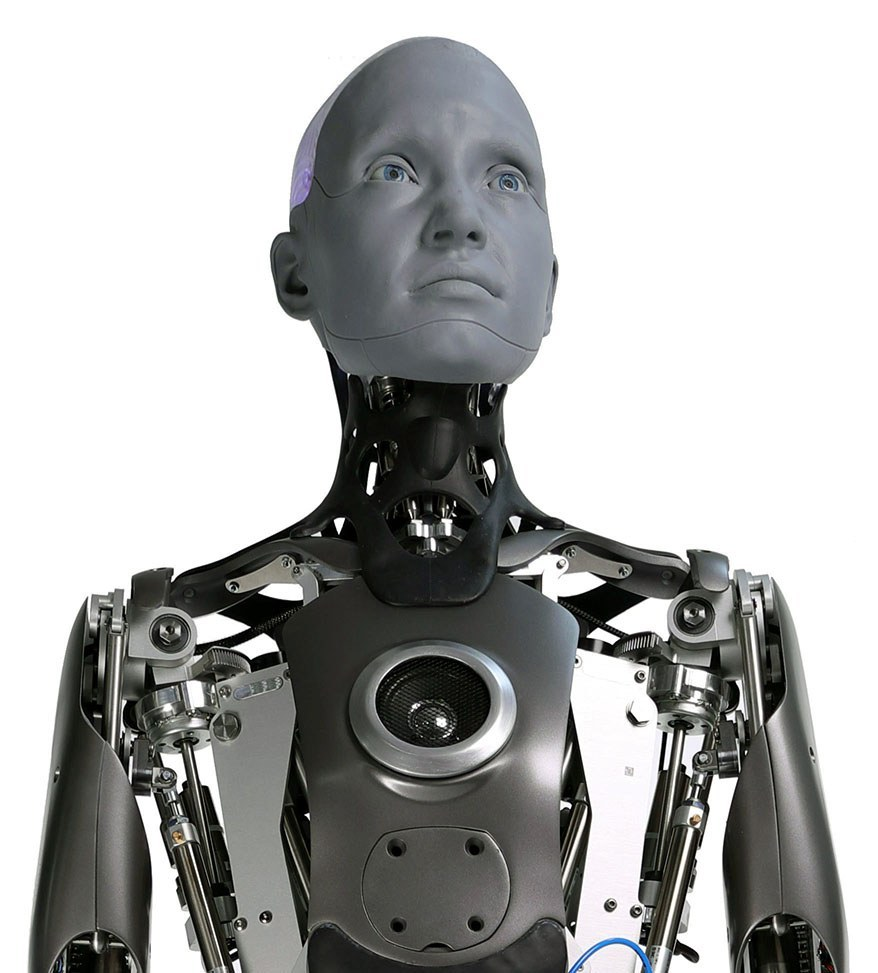
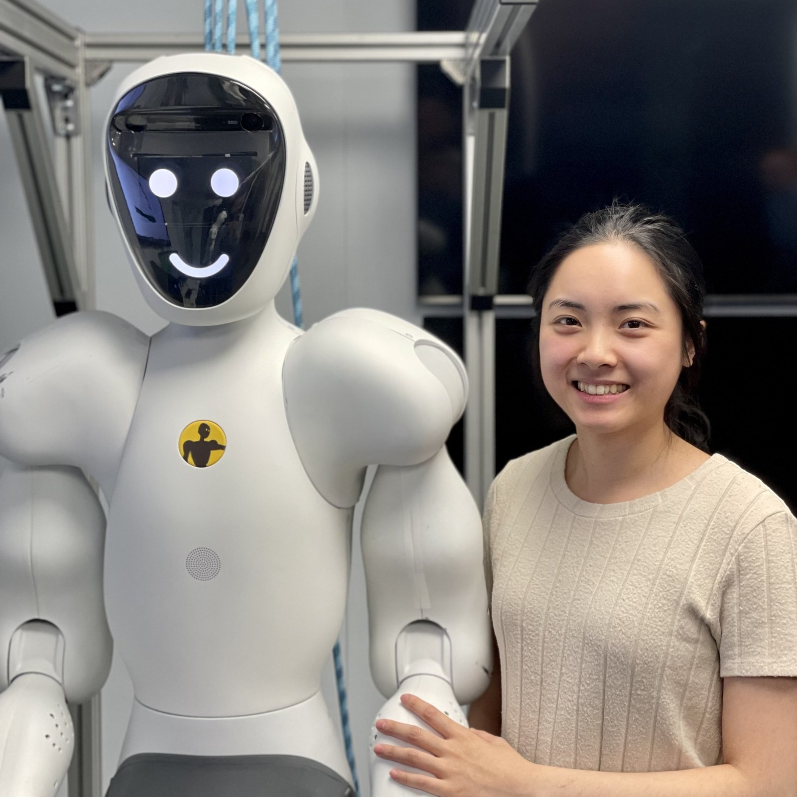

Factory robots have been welding and painting car bodies for decades. What is new is the attempt to give a humanoid robot a **general** ability to see a messy bin of parts, follow a changing plan, and use its hands — without a specialist program for every movement.

On **10 November 2026**, Google DeepMind announced **Gemini Robotics 2.5**, which it called its most capable **vision-language-action (VLA)** model to date. In the same [blog post](https://deepmind.google/blog/gemini-robotics-2-5-accelerates-real-world-physical-intelligence/), it said a proof-of-concept with **Apptronik** and **Mercedes-Benz** had put **Apollo 2** humanoid robots on active production lines in **Kecskemét, Hungary**, and **Sindelfingen, Germany**, and that the robots had packed automotive parts with a **96% success rate**.

This article explains what was announced, what a VLA model is, and which figures are **company claims**. We have not independently watched the line or re-run the tests.

## The short version

- **The model (company announcement, 10 November 2026):** Gemini Robotics 2.5 is DeepMind’s latest robotics model. It is being rolled out to robotics partners, not sold as a household product.
- **The factory pilot (company and partner claim):** Apollo 2 robots used the model, plus a companion “embodied reasoning” system, to do **kitting** — taking metal brackets from bulk bins and placing them into sequenced trays. DeepMind reports a **96%** success rate at Mercedes-Benz plants in Kecskemét and Sindelfingen.
- **Lab tests (company figures):** more than **200** distinct tasks; a **30% to 100%** higher success rate than previous baselines, depending on the task; tasks completed **20% to 30%** faster.
- **Safety (company figures):** better steering around obstacles and people, and a new open benchmark, **ASIMOV-Jailbreak**, on which Gemini 4 Argon scores **99.5%** jailbreak resistance against an **82%** previous baseline.
- **What we do not have:** an independent evaluation of the 96% figure, a public count of robots or shift hours, or a timetable for production use.

## What is Gemini Robotics 2.5?

It is a robot-control model that takes in what a robot sees and is told, and outputs how the robot should move.

DeepMind describes Gemini Robotics 2.5 as a **vision-language-action** model. In plain language, that means one system handles three jobs that used to be more tightly scripted:

- **Vision:** cameras show the scene — a bin of parts, a tray, a person nearby, a tool.
- **Language:** an instruction, a workflow, or a change of plan can be expressed in words, not only as pre-written code.
- **Action:** the model produces the motions of arms, hands and, on some platforms, a whole body.

The company says the new version increases both the range of skills a robot can learn and the speed at which it acquires them, with the aim of working in less structured environments. It says it evaluated the model on more than **200** tasks, including using tongs, tying a bow on a gift box, and pipetting liquid — examples chosen to combine tool use, flexible objects and delicate handling. Compared with previous baselines, DeepMind reports a **30% to 100%** higher success rate, depending on the task, and a **20% to 30%** shorter completion time.

Like earlier Gemini Robotics models, 2.5 is described as working on more than one robot body. The post names **Apptronik’s Apollo 2** humanoid, with a five-finger, 22-degree-of-freedom SharpaWave hand, and a **Franka Duo** platform with two-fingered grippers. DeepMind credits faster research, in part, to **Gemini 4 Argon**, which it says can generate simulated practice runs from a camera scene and help diagnose failures from video.

These are **DeepMind’s own evaluation claims**. The blog does not publish a full, third-party task table, and “success rate” can mean different things depending on how a failure is defined. The direction — more tasks, higher reported reliability, more robot types — is clear. The exact percentages should be read as the laboratory’s results.

*Photo: Willy Jackson, “Ameca Generation 1” (27 October 2021), [CC BY-SA 4.0](https://creativecommons.org/licenses/by-sa/4.0/), via [Wikimedia Commons](https://commons.wikimedia.org/wiki/File:Ameca_Generation_1.jpg) (resized). Ameca, a humanoid from Engineered Arts, is used here only as a general illustration of a human-shaped robot. It is **not** Apptronik’s Apollo 2 and was not part of the Mercedes-Benz pilot.*

## Did the model work on a Mercedes-Benz production line?

DeepMind and Apptronik say that, in a proof-of-concept, it did — on a specific, repetitive task, at a 96% success rate.

The announced trial is not a showroom demo on a quiet stage. DeepMind says Apollo 2 robots were used on **active automotive production lines** in Kecskemét and Sindelfingen. The job was **automotive kitting**: taking individual parts from bulk bins and placing them into trays in the exact order needed for each vehicle. The company argues that this is physically tiring, repetitive work, and that moving it to a robot could free technicians for more complex assembly.

Two models, in DeepMind’s account, shared the work. A **Gemini Robotics ER** (embodied reasoning) model kept track of the workflow. Gemini Robotics 2.5 generated the hand and arm actions: reaching into a bin, picking up metal brackets, placing them in sequencing containers, and correcting gaps. The reported result is a **96% success rate**.

Jeff Cardenas, co-founder and CEO of Apptronik, is quoted as saying that this is what Apollo was built for, that the models “improved dramatically in just a few weeks of post-training,” and that performance “carry[ed] over to Mercedes-Benz production with very little drop-off.” That is a **partner endorsement**, not an independent audit.

What the announcement does not give is equally important. It does not say how many robots were used, for how many hours or shifts, how “success” was counted, what happened in the unsuccessful 4%, or when Mercedes-Benz might adopt the setup as normal production equipment. “Proof-of-concept” and “pilot” are the right words until those details are published or a third party repeats the test.

## What does DeepMind say about safety?

That it has improved how the robot steers around hazards and how the wider Gemini models refuse unsafe requests — again, on its own tests.

DeepMind says Gemini Robotics 2.5 uses “inference-time reasoning guidance” to steer around physical hazards as it runs. In its evaluations, that capability improved safe task completion around obstacles by **33%** and around nearby people by **43%**. Those are relative improvements on internal tests, not a certified industrial safety rating, and they are not a substitute for the machine-safety rules that already apply in a car plant.

For longer, more agent-like tasks, the company says **Gemini 4 Argon** leads its in-house evaluations of unsafe-task refusal, handling uncertainty, and working near people. To test “jailbreaks” — prompts designed to trick a system into unsafe behaviour — it is releasing **ASIMOV-Jailbreak**, an open benchmark of hundreds of prompts across many scenes. Argon, it says, achieves **99.5%** jailbreak resistance, against **82%** for a previous baseline, Gemini Robotics ER 2.

Open benchmarks are useful, if researchers actually use them. A 99.5% score on a test the same organisation designed should still be treated as a **first-party result** until others have run it.

*Photo: Nicholas-halodi, “Halodi Robotics’ Perception Engineer With a Humanoid Collaborative Robot” (9 November 2021), [CC BY-SA 4.0](https://creativecommons.org/licenses/by-sa/4.0/), via [Wikimedia Commons](https://commons.wikimedia.org/wiki/File:Halodi_Robotics%27_Perception_Engineer_With_a_Humanoid_Collaborative_Robot.jpg) (resized). A 2021 photograph of a different company’s humanoid, used to illustrate human-scale collaborative robots. It is not Apollo 2 and is not from the Mercedes-Benz sites.*

## What can be concluded, and what cannot?

A cautious conclusion is enough. DeepMind has put a new general robotics model into partner hands and has published a concrete factory story, with a named carmaker, two named plants and a headline success rate. That is more specific than most humanoid-robot announcements. The 96% figure, the laboratory percentage gains and the safety scores are all **self-reported**. They are interesting; they are not yet a measured, independently confirmed industrial deployment.

Traditional factory robots, like the ones in the header image, already achieve very high reliability on fixed, fenced-off tasks such as welding a known car body. The bet behind Gemini Robotics 2.5 is different: that a humanoid, guided by a general model, can handle variation — a messy bin, a changed sequence, a person walking past — without a new program for every change. The Mercedes-Benz kitting trial is an early test of that bet, not the end of it.

## FAQ

**What is Gemini Robotics 2.5?**
A vision-language-action model announced by Google DeepMind on 10 November 2026, designed to let robots interpret a scene and an instruction and then move. It is being rolled out to partners.

**Did it run in a real Mercedes-Benz plant?**
DeepMind says a proof-of-concept used Apptronik Apollo 2 robots on active lines in Kecskemét, Hungary, and Sindelfingen, Germany, for parts kitting, with a 96% success rate. That is the companies’ account.

**Is 96% good enough for a production line?**
It depends on the task and on how failures are handled. In some factory jobs, 96% would be far too low; in a supervised pilot of a new humanoid workflow, it may be a starting point. DeepMind has not published enough detail for an outsider to judge.

**Can I buy this for a warehouse or a home?**
DeepMind says the model is rolling out to robotics partners. There is no consumer product in the announcement we reviewed.

**Is this the same as Gemini 4, the chatbot family?**
Related, but not the same. Gemini 4 Argon is a general model that DeepMind says also helped with robotics research and safety tests. Gemini Robotics 2.5 is the model that outputs robot actions.

## What we could not verify

- The 96% kitting success rate, the 200-task laboratory results, and the 30–100% and 20–30% improvement figures, all of which come from DeepMind’s own post.
- How success was defined on the Mercedes-Benz line, how many robots and hours were involved, and what the 4% of unsuccessful attempts looked like.
- Any independent news report that visited the Kecskemét or Sindelfingen cells and confirmed the same numbers.
- A public timetable for production deployment, or any statement from Mercedes-Benz beyond what DeepMind quoted from its partners.
- Third-party results on the new ASIMOV-Jailbreak benchmark.

## Sources

- Google DeepMind: [Gemini Robotics 2.5 accelerates real-world general dexterity](https://deepmind.google/blog/gemini-robotics-2-5-accelerates-real-world-physical-intelligence/) (10 November 2026)
