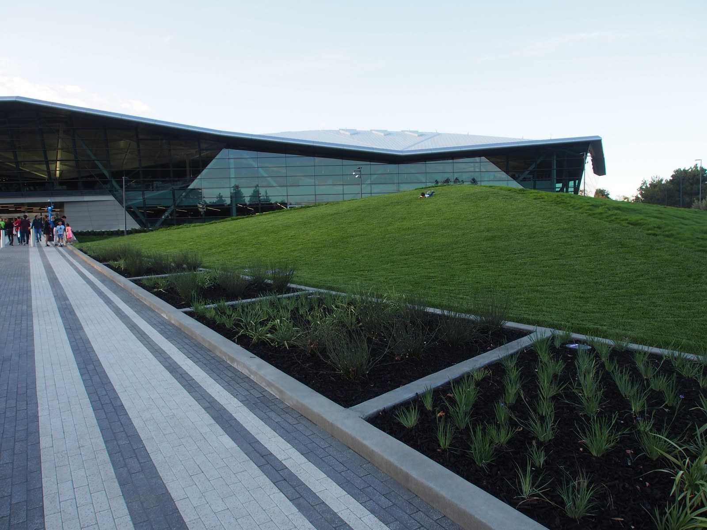
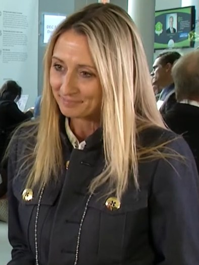
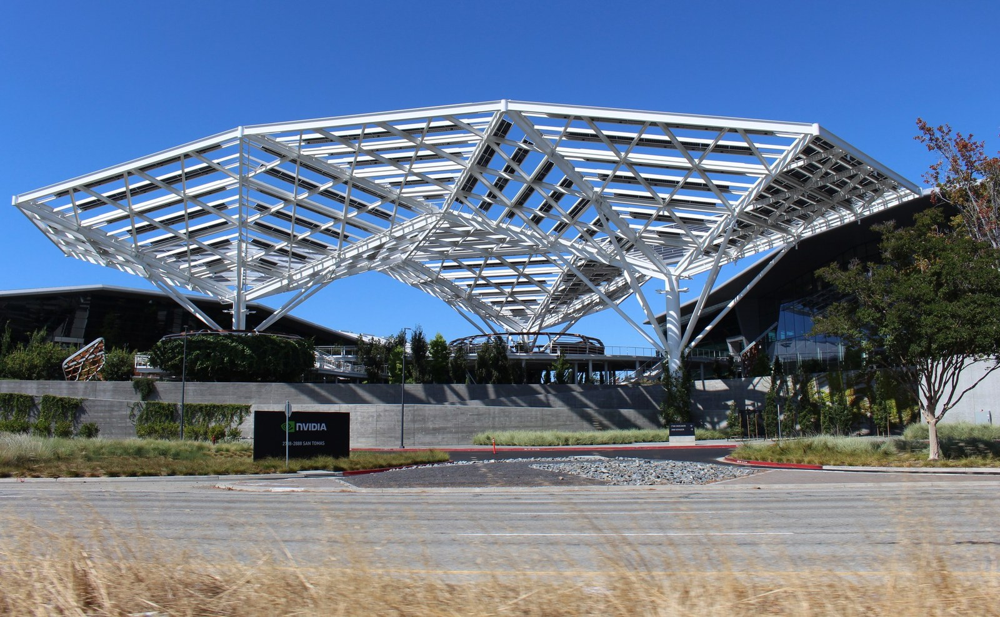

Eleven days after Nvidia announced that co-founder **Jensen Huang** had resigned, the company brought him back. On **23 November 2026**, Nvidia said its board had unanimously reinstated Huang as president, chief executive officer and a board director, effective immediately. The reversal came only days after chair **Harvey C. Jones** and then-interim CEO **Colette Kress** had said the board would not reinstate him.

This is a status check as of **26 November 2026**. It builds on our earlier explainers on [Nvidia’s financing web and Huang’s exit](https://thearchitecthighlevel.com/2026/11/13/nvidia-financing-web-ceo-exit/) and on [Colette Kress and the campaign to bring Huang back](https://thearchitecthighlevel.com/2026/11/17/colette-kress-nvidia-interim-ceo-bring-back-jensen/). It focuses on the business and governance consequences, not on private matters. We separate **company facts**, **reporting by named news organisations**, and **opinions**.

## The short version

- **Fact (company):** Nvidia announced on 23 November 2026 that Huang had been reinstated as president, CEO and a director, effective immediately. The board vote was on **22 November 2026**, according to Nvidia’s [SEC Form 8-K](https://www.sec.gov/Archives/edgar/data/1045810/000104581026000090/nvda-20261122.htm).
- **Fact (company):** Kress remains chief financial officer. Jones remains board chair. An independent investigation announced after Huang’s departure “will proceed to conclusion,” Nvidia said, and Huang “fully supports” it.
- **Fact (company, 17–18 November):** On the 17 November earnings call, Jones said the board did not intend to reinstate Huang as CEO. Kress told CNBC the next day: “The board has determined that they will not reinstate Jensen.”
- **Reporting:** Reuters put the 23 November share-price rise at **31.5%**, adding nearly **US$1 trillion** in market value, though not enough to erase all losses since 12 November. CNBC and Reuters reported that U.S. President Donald Trump said his intervention was important. Nvidia’s own statement referred only to “input from senior levels of the United States government.”
- **Still open:** the internal investigation; new board committees on national security and export controls; a search for a chief compliance officer; and scheduled congressional testimony in early December.

## Did Nvidia reinstate Jensen Huang as chief executive?

Yes. In a [newsroom statement dated 23 November 2026](https://nvidianews.nvidia.com/news/nvidia-board-reinstates-jensen-huang-as-president-ceo-and-board-director), Nvidia said the board had voted unanimously to reinstate Huang as president and CEO and as a director, effective immediately. The [Form 8-K](https://www.sec.gov/Archives/edgar/data/1045810/000104581026000090/nvda-20261122.htm) gives the date of that vote as **22 November 2026**. After the vote, Kress “will continue to serve as NVIDIA’s Executive Vice President and Chief Financial Officer.”

Jones, who remains chair, said: “The Board believes Jensen is the right person to lead NVIDIA, and that his reinstatement is in the best interests of our stockholders, employees, partners and customers.” He thanked Kress “for her outstanding service as interim CEO, in addition to her continuing responsibilities as NVIDIA’s Chief Financial Officer.”

Huang said: “I am honored to return to NVIDIA and lead one of the most consequential technology companies in the world at the beginning of a new industrial revolution.” He thanked the board, Jones, Kress, the executive staff, employees, shareholders and his family, and added: “I can’t wait to get back to work.” CNBC and Reuters reported that he returned to the office on Monday, 23 November, to cheers from employees.

Kress had been interim CEO only since **12 November 2026**, when Nvidia announced Huang’s resignation. That interval lasted **11 days**.

*Photo: Crocodiletiger, “Nvdia Endeavor Grand Opening entry lawn” (12 November 2017), [CC BY-SA 4.0](https://creativecommons.org/licenses/by-sa/4.0/), via [Wikimedia Commons](https://commons.wikimedia.org/wiki/File:Nvdia_Endeavor_Grand_Opening_entry_lawn.jpg) (resized). Nvidia’s Santa Clara headquarters; the photograph predates the 2026 leadership changes and does not show Huang’s return.*

## What happened between the resignation and the return?

Nvidia announced the resignation on **12 November 2026**. In brief, and as we described on 17 November: Huang stepped down after reports of extramarital affairs, including one with a woman U.S. intelligence agencies were reported to suspect of spying for China. Reuters later reported that Huang had acknowledged being unfaithful and apologised, and that China has denied the espionage allegations. Those reports are the public context for the governance decisions; this article does not examine the private matters themselves.

In the days after the resignation, an independent volunteer campaign, “Stand with Jensen,” asked the board to bring Huang back while an investigation established the facts. Reuters, on 23 November, said the petition had drawn **more than 180,000** signatures; CNBC, on 18 November, put the figure at nearly 200,000, including more than 10,000 people who said they were current Nvidia employees, out of a workforce of roughly 42,000. Those affiliations are **self-reported and not independently verified**. Investors Brad Gerstner of Altimeter Capital and Gavin Baker of Atreides Management had asked for a deliberate process that included considering his return, not for an immediate reinstatement.

On **17 November 2026**, with Kress still interim CEO, Nvidia reported third-quarter fiscal 2027 revenue of **US$115.8 billion**, up 103% from a year earlier, including **US$107.6 billion** of data-center revenue, up 110% ([Nvidia investor release](https://investor.nvidia.com/news/press-release-details/2026/NVIDIA-Announces-Financial-Results-for-Third-Quarter-Fiscal-2027/default.aspx)). On that earnings call, Jones said the board “does not intend to reinstate Jensen as CEO,” according to CNBC. The next day Kress told CNBC’s Jim Cramer: “The board has determined that they will not reinstate Jensen.” The same report said Huang had, the day before, issued his first public statement since leaving, saying he would be “honored” to return.

Five days later, the board reversed that position.

## Why did the board change its decision?

Nvidia’s own explanation is limited and should be read as the company’s account. The 23 November statement said the board voted unanimously “following a series of discussions and meetings with Mr. Huang, after which the Board was satisfied with respect to Mr. Huang’s candor and ability to lead NVIDIA.” It added: “In the process of reaching its decision, the Board received input from senior levels of the United States government, and based on that input, the Board is confident that Mr. Huang’s reinstatement poses no national security risk.”

**Reporting, not a company statement:** CNBC, citing unnamed sources, reported that senior government officials briefed the board late the previous week, said that no national security laws had been violated, and that this prompted contact with Huang; the same sources said the board met him on 21 and 22 November and that the falling share price helped accelerate the talks. Reuters described the about-face as coming “under pressure from US President Donald Trump,” less than a week after Jones had said Huang would not be rehired because his personal behavior was inconsistent with the company’s code of conduct.

Trump told CNBC on 23 November that he had been speaking to the board “directly and indirectly,” that Huang “did nothing wrong,” and, as quoted by Reuters, “I believe my intervention was very important to get Jensen Huang back.” Musk wrote on X that the board’s “mistake has been corrected,” CNBC reported.

These are **claims and second-hand accounts**. Nvidia did not name Trump in its statement and did not publish the substance of the government input. We cannot independently verify what officials told the board, or how much weight the petition, the share price or presidential comments carried in the vote.

*Photo: SiliconANGLE theCUBE, “Colette Kress” (2017), [CC BY 3.0](https://creativecommons.org/licenses/by/3.0/), via [Wikimedia Commons](https://commons.wikimedia.org/wiki/File:Colette_Kress.png) (converted to JPEG and resized). Kress served as interim CEO for 11 days and remains CFO. The still is from 2017 and does not show any event from November 2026.*

## What is still unfinished?

Reinstatement is not the end of the governance story.

**The investigation continues.** Nvidia repeated that a committee of independent directors had retained independent counsel, after reporting that Huang “has been the target of a foreign intelligence effort.” CNBC earlier identified the firm as Wachtell, Lipton, Rosen & Katz. The 23 November statement said the investigation “will proceed to conclusion” and that Huang will cooperate. No findings have been published.

**New oversight.** The board has also formed a National Security and Export Control Committee of independent directors. Nvidia said it is searching for a new **chief compliance officer**, who would report to the Nominating and Corporate Governance Committee, and that it will continue to cooperate with government inquiries.

**Congress.** CNBC reported that Huang was due for a closed-door House interview on **1 December 2026**, with Nvidia general counsel Tim Teter scheduled for 2 December, and that Senate Banking Committee Chairman Tim Scott said Huang would testify in public on **3 December 2026**, at a hearing on U.S. export controls. Those dates were set before the reinstatement. Senator Elizabeth Warren said the decision “does not change the fact that Mr. Huang, NVIDIA executives, and the company’s board still owe Congress answers about the company’s compliance with U.S. export controls.” That is a political statement, not a finding.

**The share price.** Reuters reported that Nvidia shares closed up 31.5% on 23 November, adding nearly US$1 trillion in market value and returning the company to the position of second-largest listed firm after Apple, while still not erasing all losses since 12 November.

*Photo: Coolcaesar, “2788-2888 San Tomas Expressway,” [CC BY-SA 4.0](https://creativecommons.org/licenses/by-sa/4.0/), via [Wikimedia Commons](https://commons.wikimedia.org/wiki/File:2788-2888_San_Tomas_Expressway.jpg) (resized). Buildings at Nvidia’s official Santa Clara address; the photograph does not show employees or the 23 November return.*

## What does the reversal mean for Nvidia’s AI-chip business?

In operational terms, the 11-day interval did not include an announced change to the product roadmap. On 17 November, with Kress still interim CEO, Nvidia said it had begun shipping the **Vera Rubin NVL72** rack-scale system, which it called the fastest product ramp in the company’s history, with racks running at partners including CoreWeave, Google Cloud, Microsoft Azure, Oracle Cloud Infrastructure and Nebius. The fourth-quarter outlook was for about **US$130.0 billion** of revenue, plus or minus 3%, and assumed no data-center compute revenue from China.

Whether customer-financing arrangements, export-control policy or relations with Washington will change under Huang’s return is an open question, not a fact. Some governance specialists quoted by Reuters called the rapid reversal a troubling signal about board independence; that is an **opinion**. The 17 November results largely reflect demand that built up before the resignation.

## FAQ

**Did Nvidia reinstate Jensen Huang as CEO?**
Yes. On 23 November 2026 Nvidia announced that its board had unanimously reinstated him as president, CEO and a board director, effective immediately. The board vote was on 22 November 2026, according to the company’s Form 8-K.

**Is Colette Kress still the interim CEO?**
No. She remains executive vice president and chief financial officer, the post she has held since 2013. Her time as interim CEO lasted from 12 to 22 November 2026.

**Did a petition force the board to bring Huang back?**
No. Choosing a chief executive is the board’s decision. A volunteer petition and public comments from investors, technology executives and the U.S. president can apply pressure, but they have no legal power to compel a reinstatement. Nvidia did not say that the petition determined the outcome.

**Has the investigation been dropped?**
No. Nvidia said the independent committee’s investigation will continue to a conclusion, and that Huang will cooperate. No report has been released.

**Does the company say Huang’s return is a national-security risk?**
The opposite: Nvidia said that, based on input from senior levels of the U.S. government, the board is confident the reinstatement “poses no national security risk.” That is the board’s stated conclusion, not an independent verification of the underlying evidence.

## What we could not verify

- The substance of the “input from senior levels of the United States government,” including who spoke to the board and what was said.
- How much the petition, the share-price fall, or presidential comments actually weighed in the 22 November vote. Nvidia did not publish a detailed rationale beyond the sentences quoted above.
- An independently audited count of petition signatures, or a verified count of current Nvidia employees among the signers.
- Whether the congressional interview and hearing dates reported on 23 November will remain unchanged after the reinstatement.
- The findings of the continuing internal investigation, which have not been made public.
- Reuters also reported a shareholder lawsuit and additional investigations; we did not review those filings for this article and do not treat that summary as a complete legal record.

## Sources

**Primary sources**

- Nvidia newsroom: [NVIDIA Board Reinstates Jensen Huang as President, CEO and Board Director](https://nvidianews.nvidia.com/news/nvidia-board-reinstates-jensen-huang-as-president-ceo-and-board-director) (23 November 2026)
- U.S. Securities and Exchange Commission: [Nvidia Form 8-K](https://www.sec.gov/Archives/edgar/data/1045810/000104581026000090/nvda-20261122.htm) (event date 22 November 2026)
- Nvidia investor relations: [Financial Results for Third Quarter Fiscal 2027](https://investor.nvidia.com/news/press-release-details/2026/NVIDIA-Announces-Financial-Results-for-Third-Quarter-Fiscal-2027/default.aspx) (17 November 2026)
- Nvidia newsroom: [NVIDIA Announces CEO Transition](https://nvidianews.nvidia.com/news/nvidia-announces-ceo-transition) (12 November 2026)

**Reporting**

- CNBC: [Jensen Huang reinstated as Nvidia CEO. Stock skyrockets 31%](https://www.cnbc.com/2026/11/23/nvidia-jensen-huang-ceo.html) (23 November 2026)
- Reuters: [Huang returns as Nvidia CEO after Trump intervention in abrupt board reversal](https://www.reuters.com/3fec1b0a85a0/technology/nvidia-reinstates-jensen-huang-ceo-2026-11-23/) (23 November 2026)
- CNBC: [Nvidia split over Jensen Huang return as Kress takes over](https://www.cnbc.com/2026/11/18/nvidia-kress-jensen-huang-return.html) (18 November 2026)
- CNBC: [What’s next for Nvidia’s Colette Kress](https://www.cnbc.com/2026/11/23/nvidia-jensen-huang-returns-colette-kress-cfo.html) (23 November 2026)
