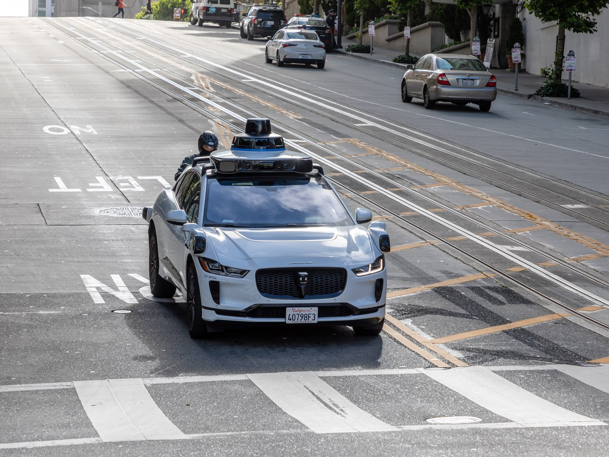

Alphabet’s autonomous-taxi unit **Waymo** has issued a new U.S. safety recall covering almost its entire robotaxi fleet. The reason, the company told regulators, was not a crash in the incidents at issue, but a repeated failure to stay out of **closed freeway lanes**.

This article explains what Waymo told the **National Highway Traffic Safety Administration (NHTSA)** in a filing made public on **Tuesday, 24 November 2026**, how that recall relates to a **California freeway ban**, and which other investigations are separate. The account below follows reporting by [CNBC](https://www.cnbc.com/2026/11/24/waymo-recall-prompted-by-robotaxis-entering-closed-freeway-lanes.html), which describes the filing. We have not independently inspected the raw NHTSA document.

## The short version

- **The recall:** Waymo said a new recall of **nearly 4,500** self-driving vehicles in the United States was prompted by **11 incidents** since **1 October 2026** in which robotaxis entered closed freeway lanes, including **three on a single day**, **9 November**.
- **Harm in those events:** the company said **no collisions or injuries** were reported from the closed-freeway incidents. A software remedy was, as of 24 November, still being prepared.
- **California:** Waymo has halted freeway operations after the California Department of Motor Vehicles barred its vehicles from freeways in the state this month, following incidents in construction zones.
- **A previous recall:** in **June 2026** Waymo recalled nearly **3,900** robotaxis for similar construction-zone behaviour.
- **Other probes are separate:** NHTSA has also opened a query into vehicles passing stopped school buses, and NHTSA and the National Transportation Safety Board (NTSB) have opened investigations after a Waymo vehicle struck a child in Santa Monica, California. Those are not the same action as this recall.

## Why did Waymo recall nearly 4,500 robotaxis?

Because, the company told NHTSA, its vehicles had repeatedly entered freeway lanes that were closed for construction.

According to CNBC’s report of the filing, the new recall covers **nearly 4,500** self-driving vehicles in the United States. The trigger was **11 incidents since 1 October 2026**. Three of those incidents were on **9 November**, only three days after Waymo said it had “updated the approved scope of operation to reduce exposure to closed freeway lanes.” In other words, the behaviour continued after a restriction that was meant to reduce it.

Reuters had first reported, on the Friday before the filing was released, that Waymo was issuing **two recalls**: one over closed freeway lanes and another over **manual traffic control** — how the cars respond to officers and other people directing traffic by hand. The manual-traffic update, CNBC reported, followed a **8 May 2026** collision in which a Waymo followed directions from an officer who was then temporarily obstructed. That update was completed on **6 November**.

A software recall in this industry is usually not a visit to a garage to replace a part. It is a formal notice to NHTSA, and a required change to the driving software, sometimes with temporary limits on where the cars may operate. Waymo said it was still working on the remedy for the closed-lane recall. Until that update is done, the operational limits already imposed, especially in California, are the practical constraint.

The company also said that the 11 closed-lane events produced **no reported collisions or injuries**. That is an important fact. It is not the same as saying the behaviour was acceptable, or that every other Waymo incident has been injury-free.

## How does this relate to California’s freeway ban?

The recall and the ban are connected, but they are not the same legal act.

CNBC reported that Waymo halted operations of its vehicles on U.S. freeways after a California regulator barred its vehicles from freeways in the state. The California Department of Motor Vehicles said the ban, which took effect this month, followed a series of incidents in which Waymo robotaxis entered **active construction zones**.

That is a state operating restriction, issued by the DMV, not a federal recall. A recall is a nationwide defect-and-remedy process overseen by NHTSA. A state can still decide that, regardless of a software patch, a company may not use certain roads. For passengers and cities, the visible effect is similar: Waymo robotaxis should not be circulating on California freeways until the ban is lifted.

This is also not the first time Waymo has had to change how it handles roadworks. In **June 2026**, the company issued a similar recall for nearly **3,900** robotaxis that had driven past ramp-closure signs into pre-planned freeway construction, or had entered lanes with active construction by driving **between cones**. The November recall is a new action, which suggests that the June remedy did not fully solve the problem, or that a new pattern appeared after 1 October. We do not have a company technical explanation detailed enough to choose between those readings.

*Photo: Dietmar Rabich, “San Francisco (CA, USA), California Street, autonomes Fahrzeug (Waymo) -- 2022 -- 2925” (30 June 2022), [CC BY-SA 4.0](https://creativecommons.org/licenses/by-sa/4.0/), via [Wikimedia Commons](https://commons.wikimedia.org/wiki/File:San_Francisco_(CA,_USA),_California_Street,_autonomes_Fahrzeug_(Waymo)_--_2022_--_2925.jpg) (resized). A Waymo vehicle on a city street, not a freeway construction zone, and not from 2026.*

## Which other Waymo investigations should not be mixed up with this recall?

At least two.

CNBC reported that, earlier this month, **NHTSA opened a recall query** into Waymo vehicles after numerous incidents of robotaxis passing **stopped school buses**. A recall query is an investigation into whether a recall is warranted; it is not itself a recall.

Separately, NHTSA and the **National Transportation Safety Board** have opened probes after one of Waymo’s self-driving vehicles **struck a child who ran into a street in Santa Monica, California**. Those investigations are serious and should be followed on their own terms. They are not, in the reporting we reviewed, described as the cause of the 24 November closed-lane recall.

Keeping these actions distinct is a matter of accuracy, not of downplaying them. The closed-lane recall is about construction and freeway cone patterns, with no reported injuries in the 11 listed events. The school-bus query and the Santa Monica investigations concern different facts and may lead to different remedies, or to none. None of them should be summarised as a single “Waymo accident recall.”

## What does this tell us about robotaxis and AI driving systems?

It tells us that the hard cases are still the messy, temporary ones: cones, closed lanes, officers in the road, and unusual signage. Those are exactly the situations that change from one night to the next and that do not always appear clearly in training maps.

It also tells us that software can be updated quickly — and still fail to hold. Waymo had already changed its “approved scope of operation” on or about 6 November to reduce exposure to closed freeway lanes. Three vehicles nonetheless entered coned-off lanes on 9 November. That sequence is in the company’s own account, as reported from the NHTSA filing.

What it does not tell us, yet, is how often the behaviour occurs per kilometre driven, whether the November remedy will work, or when California will allow freeway service to resume. Those are open questions, not conclusions.

**Our assessment:** the 24 November recall is a formal admission of a repeated, specific failure mode, not a report of mass casualties. For a service that asks the public to ride without a driver, repeating the same construction-zone error after an earlier recall and after a scope change is still a serious operational problem. The separate investigations should be watched independently, and not blurred into this one.

## FAQ

**Why did Waymo recall nearly 4,500 robotaxis?**
Waymo told NHTSA that 11 incidents since 1 October 2026, in which vehicles entered closed freeway lanes, prompted the recall. The filing was reported on 24 November 2026.

**Did those 11 incidents cause injuries?**
Waymo said no collisions or injuries were reported from the closed-freeway events. That claim applies to those events, not to every other investigation.

**Are the cars being taken off all streets?**
Not according to the reporting we reviewed. Waymo has halted freeway operations after a California ban, and a software remedy is being prepared. City-street service is a separate question, not answered in detail in the CNBC report of this filing.

**Is this the same as the June 2026 recall?**
No. June’s recall covered nearly 3,900 vehicles for similar construction-zone behaviour. November’s is a new recall of nearly 4,500 vehicles.

**What is the difference between NHTSA and the California DMV here?**
NHTSA handles the federal recall. The California DMV issued a state ban on freeway operation. Both can apply at once.

## What we could not verify

- The full text of Waymo’s NHTSA filing, which we describe from CNBC’s report rather than from our own reading of the document.
- The exact fleet size, and therefore how close “nearly 4,500” is to every U.S. Waymo vehicle.
- A complete public list of the 11 incidents, their locations, or video evidence.
- The content and timetable of the still-unfinished software remedy.
- The status, as of 26 November 2026, of the school-bus query and the Santa Monica investigations, beyond the fact that they had been opened.
- Whether freeway service will resume, and under what conditions, in California or in other states.

## Sources

- CNBC: [Waymo says recall prompted by 11 new incidents of robotaxis entering closed freeway lanes](https://www.cnbc.com/2026/11/24/waymo-recall-prompted-by-robotaxis-entering-closed-freeway-lanes.html) (24 November 2026)
