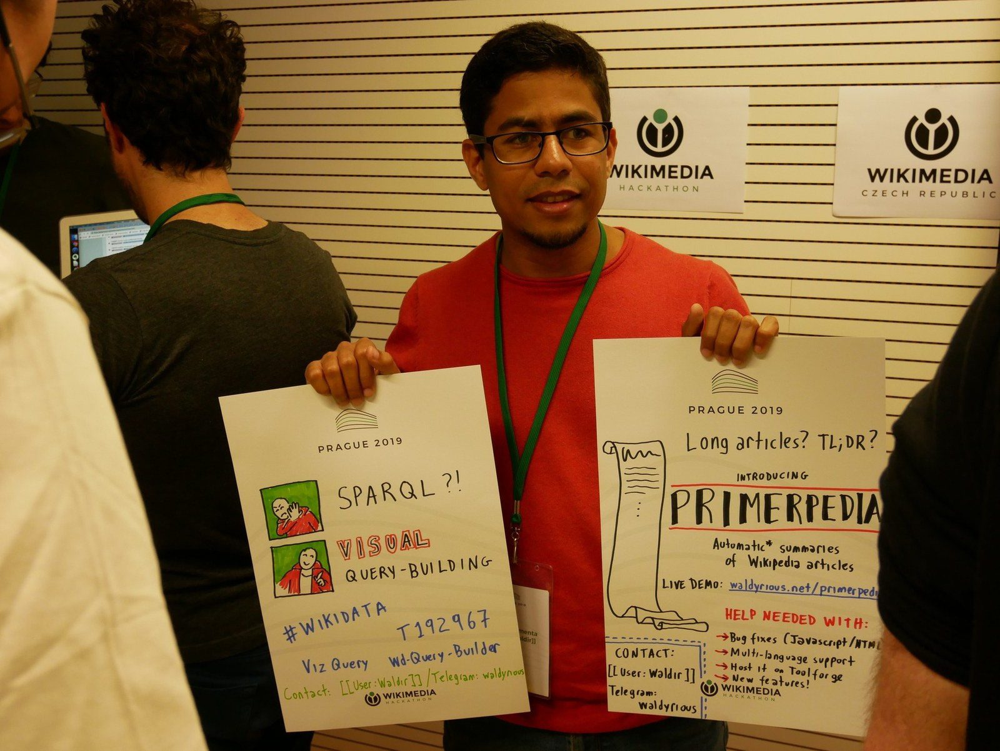

Hackathons are short, intense building contests: a team has a day or a few weeks to ship a working prototype, then presents it to judges. In 2026 the format is one of the main ways AI companies put new models in front of developers. This article asks which events **xAI** and other organisations have actually run or announced, what the prizes were, and which results can be checked against a primary page.

A naming point first, because it is easy to get wrong. **xAI**, the company Elon Musk founded in March 2023, was acquired by **SpaceX** in February 2026, according to contemporaneous reporting by [AP News](https://apnews.com/article/spacex-xai-musk-space-2079f03fa888652b7fe836afe8b670a1) and [The Verge](https://www.theverge.com/tech/872619/elon-musk-merges-spacex-with-xai-and-x). It was later rebranded **SpaceXAI** and, in October 2026, **SpaceX Super Intelligence**, often shortened to **SpaceXSI**. The Grok models, and the X account that announced the August hackathon results, now sit under that name. When we say “xAI hackathons” below, we mean events run by that company or clearly built around Grok, even where the banner already says SpaceXSI.

## The short version

- **Official event:** SpaceXAI/SpaceXSI held a 12-hour, invitation-only **Grokathon** on **Saturday, 8 August 2026**, at the old X office on Market Street in San Francisco. Participants had to use Grok models or the xAI API ([Devpost](https://spacexai-grokathon.devpost.com/)).
- **Prizes (official page):** not cash. First prize was a **Starship launch viewing** in Starbase, Texas; there was also swag such as jackets and stickers.
- **Results (company posts, 13 August 2026):** first, **Nova** (binary reverse-engineering into C); second, **Signal** (a follower graph for testing posts); third, **ThinkVoice** (Grok Voice plus brain-sensing). These are the organiser’s descriptions of the demos, not independently audited products.
- **Attendance is unclear:** Devpost lists **16** participants; a later recap said **220**. We could not reconcile the two.
- **Other events:** several Grok Bot meetups and hackathons are listed for late November and December 2026. Separately, large open competitions from **Google** and **Amazon Web Services** are currently on Devpost, with cash prizes.

## What was the official xAI, or SpaceXSI, Grokathon?

A one-day, in-person, invitation-only contest in San Francisco, built around Grok.

The [SpaceXAI Grokathon Devpost page](https://spacexai-grokathon.devpost.com/) says selected builders received exclusive access to the latest Grok models and the X API, and had **12 hours** “to ship something real.” The event was listed for **8 August 2026**, at the old X office on Market Street. Requirements included a project name and description, a working live demo, a repository, a full team roster, and **non-trivial use of Grok models or the xAI API**. “If it doesn’t call our models, it doesn’t get judged,” the rules said. Judging criteria were usefulness and technical complexity. The page lists **two non-cash prizes**, 16 participants, and “members of our Technical Staff” as judges. It is marked as ended.

On **13 August 2026**, the **@SpaceXSI** account announced the top three projects built in those 12 hours, in posts that were widely recirculated:

1. **Nova**, first place, “taught Grok to reverse-engineer binaries into clean C.” The announcement said the team started with 262-kilobyte Game Boy ROMs and ended by rebuilding a 1995 car’s engine-control-unit runtime. The named teammates were posted as @theoc____, @supratikp07 and @henryzhang.
2. **Signal**, second place, built a graph from followers’ biographies, posts and engagement and used simulated audiences to test how a post might land.
3. **ThinkVoice**, third place, combined Grok Voice with “brain-sensing technology” so that a user could choose spoken replies through subtle movements.

Those descriptions are the **organiser’s account of a 12-hour demo**. A later recap noted, correctly, that there was no separate public benchmark or released code showing that the rebuilt engine-control unit ran in a real vehicle. We have not seen such a verification either.

The prize, on the official page, was experience rather than money: a **Starship launch** viewing in Texas for the winner, plus jackets and stickers. That matches the company’s taste for spectacle. It also means there is no published cash-prize table to compare with Google’s or AWS’s later events.

*Photo: 01tonythomas, “Wikimedia Hackathon 2019 Matching Program 05” (17 May 2019), [CC BY-SA 4.0](https://creativecommons.org/licenses/by-sa/4.0/), via [Wikimedia Commons](https://commons.wikimedia.org/wiki/File:Wikimedia_Hackathon_2019_Matching_Program_05.jpg) (resized). Another generic hackathon scene; not a 2026 xAI event.*

## Are more Grok hackathons coming, and who actually runs them?

Some are listed, but they are not all the same kind of event as the August Grokathon.

A directory updated on **25 November 2026** ([BuildJams](https://jams.shippedby.app/grok-hackathons/)) listed five upcoming in-person Grok or xAI-related events, with Luma as the registration source:

- **Dhaka, Bangladesh**, 27 November 2026, “Grok Bot Hackathon Dhaka,” organiser styled as SpaceXSI for Dhaka;
- **Toronto, Canada**, 30 November 2026, 17:30–20:30 local time, “Grok Bot Hackathon Toronto,” free, with dinner, speakers and Cursor credits, organiser styled as SpaceXSI for Toronto ([event listing](https://events.intentface.com/e/grok-bot-hackathon-toronto-november-toronto-2026-11));
- **Salvador, Brazil**, 4 December 2026;
- **Boston, United States**, 5 December 2026;
- **Chiang Mai, Thailand**, 12 December 2026.

The Toronto page, in particular, reads as a **short evening meetup**, not a 12-hour judged contest with a Starship prize. Doors were listed as closing at 18:15. It is reasonable to describe these as **Grok Bot community events** under a SpaceXSI local banner, and not as a second official company Grokathon, unless the company itself says otherwise. Always check the live Luma or company page, because volunteer listings can go stale.

A related student event has already ended: the **BDBI x SpaceXSI Grokathon** at Georgia Tech, listed on [Devpost](https://bdbi-x-spacexsi.devpost.com/) for **2 November 2026**, invited college students to build with Cursor and Grok Bot. The page lists 256 participants, an invite-only online format, and a non-cash prize of Cursor merchandise or credits. Winners were “announced soon” on the page we reviewed; we did not find a confirmed public results post.

## What other AI hackathons are open or just ending?

Several larger, cash-prize contests are running on Devpost at the end of November 2026, and they are not Grok-specific.

From the public [Devpost AI category](https://devpost.com/c/artificial-intelligence) as reviewed on 25 November 2026:

- **#BuildHybridAI 2026**, running with Firebase, asks for apps that run on-device and in the cloud. It lists **US$30,000** in prizes and more than **5,300** registered participants, with a submission deadline of **30 November 2026**.
- The **AWS MSP AI Hackathon** asks teams to build tools for managed service providers. It lists **US$64,000** in prizes, 560 participants, and a deadline of **11 December 2026**.
- **Hack AI x Stan**, in Toronto on **5–6 December 2026**, is an in-person event listing **CA$23,000** in prizes.
- Smaller or student-only events include **AI OpenBuild** (students, **US$150**, deadline 10 December 2026), the **Global AI Builder’s Challenge**, and various agent-building contests. Prize pots and participant counts on Devpost change as people register or drop out; treat the figures as a snapshot.

These events matter for a simple reason: a 12-hour invitation-only Grokathon and a month-long public Google or AWS contest are both “AI hackathons,” but they serve different populations. One is a showcase for a single model family. The others are broader, usually allow any model, and often pay cash.

## How should readers treat hackathon “results”?

As demos, unless code, users or measurements are published.

A 12-hour project can be genuinely impressive and still be unfinished, unreproducible or over-claimed. Nova’s jump from a Game Boy ROM to a 1995 engine-control unit is a striking story; it is not, on the public record we found, a certified automotive product. Signal’s simulated audiences are a product idea, not a published accuracy study. ThinkVoice involves biosignals, which raises obvious safety and consent questions that a prize announcement does not answer.

The same caution applies to upcoming community events. An organiser name that includes “SpaceXSI for” a city is not, by itself, proof that the parent company is flying judges in or offering a rocket-launch prize. Read the rules, the prize table and the eligibility line.

## FAQ

**Did xAI run a hackathon in 2026?**
Yes. Under the SpaceXAI/SpaceXSI name, it held a 12-hour Grokathon in San Francisco on 8 August 2026. The official page is on Devpost.

**What did the winners build?**
According to the official announcement: Nova (binary reverse-engineering), Signal (a follower-graph posting tool) and ThinkVoice (voice plus brain-sensing). Those are organiser descriptions of demos.

**Is the prize money large?**
Not at the official Grokathon: the published prizes were a Starship launch viewing and swag. Some other AI hackathons, including Google’s and AWS’s current contests, advertise cash pots in the tens of thousands of U.S. dollars.

**Can anyone enter a Grok event?**
The August Grokathon was invitation-only. Some later Grok Bot city events are listed as free to attend, with their own limits. Check each page.

**Do these events require you to use Grok?**
The official Grokathon did: projects that did not call the company’s models were not judged. Google, AWS and OpenBuild events generally allow a wider choice of models, subject to their own rules.

## What we could not verify

- The true attendance of the August San Francisco Grokathon: Devpost says 16 participants; a recap said 220. We could not reconcile the figures.
- Independent tests of the winning demos, or public repositories that reproduce the engine-control-unit claim.
- Whether every “SpaceXSI for [city]” event is an official company hackathon, as opposed to a community meetup using the name and the tools.
- Final winners of the Georgia Tech Grokathon, which the Devpost page still described as “announced soon.”
- Live prize amounts and deadlines after 25 November 2026, which can change on Devpost.

## Sources

- Devpost: [SpaceXAI Grokathon](https://spacexai-grokathon.devpost.com/)
- SpaceXSI prize announcements, 13 August 2026, as circulated from the official account (see also recaps such as [Huuush on Nova](https://huuush.com/en/blog/development-automation/grokathon-2026-nova-game-boy-rom-car-ecu))
- AP News: [Elon Musk joins his rocket and AI businesses into a single company](https://apnews.com/article/spacex-xai-musk-space-2079f03fa888652b7fe836afe8b670a1)
- The Verge: [Elon Musk merges SpaceX with xAI (and X)](https://www.theverge.com/tech/872619/elon-musk-merges-spacex-with-xai-and-x)
- BuildJams: [Grok hackathons: open now and upcoming](https://jams.shippedby.app/grok-hackathons/) (updated 25 November 2026)
- Devpost: [BDBI x SpaceXSI Grokathon](https://bdbi-x-spacexsi.devpost.com/); [AI category listings](https://devpost.com/c/artificial-intelligence); [AI OpenBuild](https://ai-openbuild.devpost.com/)
