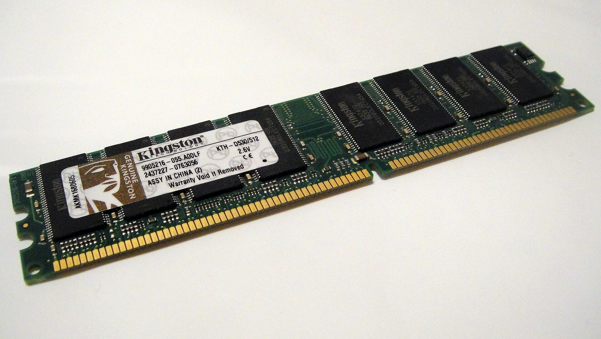

Most people meet AI through a website or an app: you type, a company’s data centre computes, an answer comes back. A growing number of people do something different. They download an AI model and run it **on their own laptop or desktop**, with no internet connection needed once the model is on the disk. This guide explains what that involves as of late November 2026 — the terms, the models, the tools, the hardware and the trade-offs — and keeps facts separate from opinion.

## Open-weight vs open-source AI: what the words mean

A large language model is, at its core, a huge table of numbers called **weights** (or parameters), learned during training. A model is **open-weight** when its maker publishes these weights for download. You can then run the model yourself. Usually the weights come with a licence that may allow commercial use or restrict it.

**Open source** is a stricter idea. The Open Source Initiative (OSI), which maintains the classic definition of open-source software, published an [Open Source AI Definition](https://opensource.org/ai/open-source-ai-definition). In short, it requires the freedoms to **use, study, modify and share** the system, and that requires access not only to the weights but also to the complete code used for training and running, plus detailed information about the training data — enough for a skilled person to build a substantially equivalent system.

Most popular downloadable models meet the first test but not the second: their weights are public, but their training data and full training pipeline are not. That is why careful writers say “open-weight” rather than “open source”. Ollama’s [gpt-oss page](https://ollama.com/library/gpt-oss), for example, describes OpenAI’s downloadable models as “open-weight models”.

## Which open models people run locally in November 2026

There is no single official ranking, and new models appear weekly. A practical snapshot is the [Ollama model library](https://ollama.com/library), a large public catalogue of models packaged for local use. On 28 November 2026 it listed, among others:

- **[Gemma 4](https://ollama.com/library/gemma4)** from Google, described on the page as designed for “reasoning, agentic workflows, coding, and multimodal understanding”. The 12-billion-parameter version (`gemma4:12b`) is listed at about **7.7 GB**, the 26b version at about **16 GB** ([tags](https://ollama.com/library/gemma4/tags)).
- **[Qwen3.6](https://ollama.com/library/qwen3.6)** from Alibaba’s Qwen team, presented as an upgrade in “agentic coding”. The 27b version is listed at about **18 GB**, including a coding variant ([tags](https://ollama.com/library/qwen3.6/tags)).
- **[gpt-oss](https://ollama.com/library/gpt-oss)** from OpenAI, in a **20b** version (about **14 GB**) and a **120b** version (about **65 GB**).
- Very large models such as **[Kimi K3.1 Pro](https://ollama.com/library/kimi-k3.1-pro)**, which its listing describes as a “3T-class” open-weight model with a one-million-token context window. Models of this size are far beyond a normal home computer.

Ollama’s “newest” view on the same day also showed recent arrivals such as Inkling 2, Hy4, MiMo v2.6 and the LFM3 family. Older names — Llama 3.x, DeepSeek-R1, Qwen2.5, Mistral, Phi — remain among the most-pulled entries. Popularity on one catalogue is not a quality ranking; benchmark claims on model pages come from the makers themselves.

## The common tools: Ollama, llama.cpp and LM Studio

You do not need to write code to run a local model. Three widely discussed tools are:

- **[llama.cpp](https://github.com/ggml-org/llama.cpp)** is the open-source engine underneath much of the local-AI world. It runs models on ordinary CPUs as well as on NVIDIA, AMD and Apple hardware, and uses the widely adopted **GGUF** file format for quantized models, which comes from the related [ggml](https://github.com/ggml-org/ggml) project. Its latest release, [v1.1.0](https://github.com/ggml-org/llama.cpp/releases/tag/v1.1.0), was published on 26 November 2026 (Vienna time) and, according to its release notes, adds support for new model families such as Inkling 2 and Hy4 and a large set of speech and audio models.
- **[Ollama](https://github.com/ollama/ollama)** wraps local models in a simple command-line tool and app: one command downloads and starts a model, and a local API lets other programs use it. Version [v0.40.19](https://github.com/ollama/ollama/releases) was released on 26 November 2026 (Vienna time).
- **[LM Studio](https://lmstudio.ai/)** is a desktop app with a graphical interface for finding, downloading and chatting with models, and for serving them to other apps. Its [changelog](https://lmstudio.ai/changelog) showed version 0.4.26 as the latest entry at the time of writing.

## How much hardware do you need? RAM, VRAM and quantization

*Photo: Matt Kieffer, “Kingston DDR Memory Module” (20 January 2011), CC BY-SA 2.0, via [Wikimedia Commons](https://commons.wikimedia.org/wiki/File:Kingston_DDR_Memory_Module.jpg) (resized). An older memory module, shown as a generic illustration of computer memory.*

The single most important number is **memory**. To answer quickly, the whole model should sit in fast memory:

- **VRAM** is the memory on a graphics card (GPU). It is the fastest option on a Windows or Linux PC.
- **Unified memory** on Apple Silicon Macs is shared between processor and graphics, so a Mac with lots of memory can hold larger models.
- **System RAM** works too, but a model running mostly on the CPU from RAM is clearly slower.

A rough rule: you need at least as much free memory as the model file, plus extra for the **context** — the text of the conversation and documents the model is working with. Longer contexts need more memory. Using the sizes Ollama lists, a 7–8 GB model such as `gemma4:12b` is plausible on a computer with 16 GB of RAM or a graphics card with 12 GB of VRAM, while a 65 GB model like `gpt-oss:120b` needs a workstation-class machine. These are approximate guides, not guarantees; speed also depends on the processor and memory bandwidth.

**Quantization** is what makes home use possible. A model’s weights are normally stored as 16-bit numbers. Quantization stores them with fewer bits — often 8 or 4 — so the file and memory need shrink dramatically. Ollama’s Gemma 4 page shows the effect: `gemma4:12b` is about **7.7 GB** in its default quantized form but about **24 GB** in full 16-bit (`bf16`) precision. Fewer bits usually cost some accuracy; how much depends on the model and the method. File names such as `Q4_K_M`, `qat` (quantization-aware training), `mxfp8` or `nvfp4` refer to different quantization formats.

## Privacy: real benefits and real limits

**The benefit is real:** when a model runs on your machine, your prompts and documents do not have to be sent to a cloud AI provider. This can matter for confidential drafts, client data or simply personal notes, and it works offline. LM Studio, for example, has documentation on [offline operation](https://lmstudio.ai/docs/app/offline).

**The limits are also real:**

- Local tools can still go online: to download models, check for updates, search the web or call plug-ins. Read each tool’s settings and privacy notes.
- The model’s **licence** still applies even on your own machine, especially for commercial use.
- Local models are generally smaller than the largest cloud models, so they can be less accurate. They can still invent facts (“hallucinate”), just like cloud models.
- Security becomes your job: a model connected to tools can read files or run commands if you let it.

## Local MCP servers: when a local model drives your desktop apps

The **Model Context Protocol (MCP)** is an open standard ([modelcontextprotocol.io](https://modelcontextprotocol.io/)) that lets an AI application connect to “servers” offering tools — for example reading files, querying a database or controlling another program. According to its [documentation](https://lmstudio.ai/docs/app/mcp), LM Studio has acted as an MCP host since version 0.3.17, so local models can use MCP servers configured in an `mcp.json` file.

This is how a local model can operate a desktop application. One example from CAD: the community project [neka-nat/freecad-mcp](https://github.com/neka-nat/freecad-mcp) provides an MCP server for **FreeCAD**, the open-source 3D modelling program, and had about 3,500 GitHub stars on 28 November 2026. In principle, a model can then create or change objects in FreeCAD through text instructions. How reliably this works depends heavily on the model; smaller local models are usually weaker at multi-step tool use than large cloud models — an assessment, not a measured result.

The caution matters: LM Studio’s own page warns, “Never install MCPs from untrusted sources,” and notes that some MCP servers can run arbitrary code, access local files and use the network. A local model with a powerful MCP server is only as safe as the permissions you give it.

## What is fact and what is prediction

**Facts as of 28 November 2026:** open-weight models such as Gemma 4, Qwen3.6 and gpt-oss are downloadable and run through tools such as Ollama, llama.cpp and LM Studio; quantization reduces their memory needs severalfold; MCP lets local models control other software.

**Open questions:** whether open-weight models will keep closing the gap to the largest closed cloud models, and whether everyday computers will gain enough memory to run today’s large models comfortably. Both are widely discussed, for example in the [r/LocalLLaMA](https://www.reddit.com/r/LocalLLaMA/) community, but they are predictions, not established facts.

## Sources

- Open Source Initiative: [The Open Source AI Definition](https://opensource.org/ai/open-source-ai-definition)
- Ollama: [Model library](https://ollama.com/library), [Gemma 4](https://ollama.com/library/gemma4) and [tags](https://ollama.com/library/gemma4/tags), [Qwen3.6](https://ollama.com/library/qwen3.6) and [tags](https://ollama.com/library/qwen3.6/tags), [gpt-oss](https://ollama.com/library/gpt-oss), [Kimi K3.1 Pro](https://ollama.com/library/kimi-k3.1-pro) (accessed 28 November 2026)
- Ollama on GitHub: [ollama/ollama](https://github.com/ollama/ollama) and [releases](https://github.com/ollama/ollama/releases)
- llama.cpp on GitHub: [ggml-org/llama.cpp](https://github.com/ggml-org/llama.cpp) and [release v1.1.0](https://github.com/ggml-org/llama.cpp/releases/tag/v1.1.0)
- LM Studio: [website](https://lmstudio.ai/), [changelog](https://lmstudio.ai/changelog), [Use MCP Servers](https://lmstudio.ai/docs/app/mcp), [Offline operation](https://lmstudio.ai/docs/app/offline)
- Model Context Protocol: [modelcontextprotocol.io](https://modelcontextprotocol.io/)
- FreeCAD MCP server: [neka-nat/freecad-mcp](https://github.com/neka-nat/freecad-mcp)
- Community discussion: [r/LocalLLaMA](https://www.reddit.com/r/LocalLLaMA/)
- Images: [ASUS NVIDIA GeForce 210 silent graphics card with HDMI](https://commons.wikimedia.org/wiki/File:ASUS_NVIDIA_GeForce_210_silent_graphics_card_with_HDMI.JPG) (Joydeep, CC BY-SA 3.0); [Kingston DDR Memory Module](https://commons.wikimedia.org/wiki/File:Kingston_DDR_Memory_Module.jpg) (Matt Kieffer, CC BY-SA 2.0)
